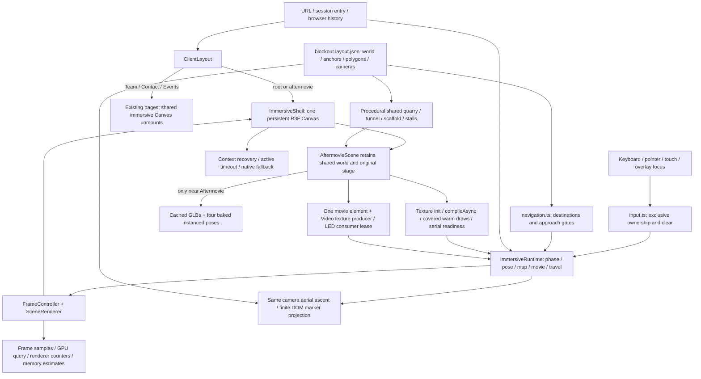

# Breeze 2027 / Gullyverse — current implementation final review

Review date: 11 October 2026. The current user-approved implementation is the authority for all visual and spatial findings. **This task collected evidence only; no production code, geometry, materials, lighting, camera configuration, navigation, assets, Git history or deployment was changed.** Prior technical repairs are described and reverified; they were not reimplemented in this review.

**Verdict:** the shared two-location experience is an established functional blockout with important stabilization repairs. It is suitable for a bounded, measured asset-integration pilot subject to user approval. It is not yet evidence-backed approval for unrestricted photorealistic production or desktop/mobile 60 FPS release. Physical-device performance, final asset budgets and several visual/lifecycle limits remain open. Detailed results and failures below take precedence over this overview.

## 1. Exact starting state and history

Branch `codex/navigation-board`; HEAD **`e3dbbc233f1f12f5e4d96333db3b797e75da4760`**. Staged changes: none; unstaged changes: none; untracked files: none. [Starting state](../reports/current-final-review-2026-10-11/raw/starting-state.json), [starting hashes](../reports/current-final-review-2026-10-11/raw/source-hashes-before.json), [changes versus October audited worktree](../reports/current-final-review-2026-10-11/raw/changes-against-audited-worktree.json), [commit/file history](../reports/current-final-review-2026-10-11/raw/history.json), [source diff against audit HEAD](../reports/current-final-review-2026-10-11/raw/changes-since-audit-source.patch.txt).

The October 10 audit used 8919589 plus uncommitted compact-quarry/restored-stage work. Comparing only that commit would incorrectly attribute all baseline environment work to stabilization. The source-manifest comparison accounts for the audited working tree. The earlier approved baseline document began with seven modified tracked files and an untracked AftermovieEnvironment; those changes are now committed. There are no later uncommitted/manual edits in today's starting tree. Human authorship is not inferred from a Git author label.

| Revision | Recorded changes | Meaning for this review |
| --- | --- | --- |
| c5ffe11 | Stabilization, approved compact/restored environment preservation, reports/regressions | Focus/input, session Home, movie ownership, timing, finite projection, 404 preload, cancelled crowd cleanup; existing audited uncommitted visual baseline also included |
| a1c4333 | Explicit sharp 0.34.5 dependency | Build/Vercel/pnpm dependency declaration, not visual change |
| 4c58cd1 | Explicit @next/env 15.3.8 dependency | Existing payment worker environment-loader declaration; no payment behavior implemented here |
| 88b6c59 | Under-scaffold forward Aftermovie gate, wider movement zones, Team/Contact second stalls | Latest explicit user requests; quarry rock footprint and stage placement not resized |
| 8998866 | Full tunnel rear closure into surrounding rock | Replaces detached collar/gap, preserves actual passage |
| e3dbbc2 | Sloping tunnel rear crown and welded rear noise | Removes broad straight rear panel; latest current appearance |

Current dependencies include Next15.3.8, React19.0.8, R3F9.6.1 and Three0.169. No new library was added during this reporting task. Existing events/forms/payments/admin remain outside modification scope. Historical audits and baseline screenshots were preserved, with clearly labeled copies of selected evidence in this package.

## 2. Current visual baseline and asset preservation

[Authoritative configuration/visual baseline report](gullyverse-current-visual-baseline.md) documents dimensions, complete configuration sources, anchors, material/lighting values, movement polygons, map policy, crowd/stalls and camera positions. [Current registry](../reports/current-final-review-2026-10-11/raw/current-layout.json) and [actual generated bounds](../reports/current-final-review-2026-10-11/raw/geometry-bounds.json) are the exact inventory.

Key current composition: 97.8×123.5 m outer quarry registry footprint,25faceted quarry rock masses,42m bent tunnel,24×14.5×3.4m scaffold at[0,0,−70], original stage at[−12,0,−134.3], dry generated ground, no artificial paths. Walking bounds are wider than the earlier audit, while the quarry footprint is unchanged. Team/Contact are second stalls. GULLYVERSE-only hanging header and five directional signs retain the approved hierarchy. The original Breeze logo remains on the upper beam; Main Stage/Accommodation hanging signs remain removed.

**Original stage identity is preserved by evidence, not assumption:** [stage preservation hashes](../reports/current-final-review-2026-10-11/raw/stage-preservation.json) show the stage GLB, both crowd GLBs and MP4 byte-identical to8919589,fe51c10 andb1ed3a8. Stage/Trusses/Lights/Speakers/Barricades/Fireworks/palette code is unchanged since audit HEAD; earlier versions differ where stage ground toggling, reusable trusses or animations were already adjusted. Current LED/crowd/video code has documented stabilization edits. Camera/world placement, shared surroundings, fog and adaptive crowd counts are not claimed identical to the isolated original stage screenshot.

The approved dark49×39floor, stage lighting, cream return placard, shared open rear quarry sightline and user-restored environment elements remain. No asset replacement occurred here. Historical stage/reference images and the preceding matched rear-crown comparison are included in the [gallery](../reports/current-final-review-2026-10-11/gallery.html); current versus historical shots with different poses/DPR are qualitative comparisons, not pixel-difference tests.

## 3. Environment assessment

Visual completeness here means finished environment art, not simply functioning3D. No whole environment is certified photorealistic.

| Environment | Actual rendered appearance / behavior | Classification and evidence |
| --- | --- | --- |
| Entrance | Broad gray-green face, cream graffiti, irregular arched hole; tunnel visible, distant quarry initially occluded. Desktop and portrait entry copy/lens fit. Rock still reads as broadly planar generated facade with low-frequency texture. | **Functional but visually temporary.** [desktop](../reports/current-final-review-2026-10-11/screenshots/desktop/01-landing.png), [portrait](../reports/current-final-review-2026-10-11/screenshots/mobile/01-landing.png) |
| Tunnel | Enclosed5.6m-high roughly5.9m-wide bent passage; generated artist paint conforms to wall, no framed plaques. Quarry signs become visible around final bends. Latest rear opening connects to shell/ring. Human-scale navigation exists, final sculpting/UV/PBR detail does not. | **Functional but visually temporary.** [midpoint](../reports/current-final-review-2026-10-11/screenshots/desktop/tunnel-mid.png), [live exit](../reports/current-final-review-2026-10-11/screenshots/desktop/live-tunnel-exit.png) |
| Quarry | Open sky, compact ring of large angular rock masses; muted gray/green material, sparse tiny stones/grass over dry brown ground; stage distant/slightly left. Large exposed facets and capsule population remain conspicuous. | **Functional but visually temporary.** [wide](../reports/current-final-review-2026-10-11/screenshots/desktop/quarry.png), [upward](../reports/current-final-review-2026-10-11/screenshots/desktop/quarry-open-roof.png) |
| Scaffold | Wide reused trusses, header high above directions, hanging cables/lamps and supported feet. Signs readable at captured poses and share typography scale. Construction has a convincing festival hierarchy but coarse/generated material/attachment detail. | **Implemented and functional, final-art detail incomplete.** [front](../reports/current-final-review-2026-10-11/screenshots/desktop/scaffold-front.png), [diagonal](../reports/current-final-review-2026-10-11/screenshots/desktop/scaffold-diagonal.png) |
| Left/right stalls | Inward-facing box counters, simple roofs/posts, small luminous string bulbs; main corridor clear. Team left/Contact right at second position. No detailed fabrics, stock, realistic weathering or people. | **Functional reservations/dressing, visually temporary.** [left](../reports/current-final-review-2026-10-11/screenshots/desktop/left-stalls.png), [right](../reports/current-final-review-2026-10-11/screenshots/desktop/right-stalls.png) |
| Aftermovie | Original stage/crowd/trusses/LEDs, dark foreground and beam lights, live three-panel movie. Retained rectangular black ground contrasts with common terrain; background/fog change by mode; behind player is quarry/scaffold/tunnel, not an isolated wall enclosure. | **Implemented and functional in tested profile; surrounding art/integration temporary.** [front](../reports/current-final-review-2026-10-11/screenshots/desktop/aftermovie-stage-front.png), [playback](../reports/current-final-review-2026-10-11/screenshots/desktop/stage-playback.png), [rear](../reports/current-final-review-2026-10-11/screenshots/desktop/stage-looking-back.png) |
| Team quarry anchor | Simple slab/sign and travel direction. Full immersive pinboard/photo zoom is not implemented at the quarry anchor. Existing separate Team page has physical board rendered from content texture and approach camera. | **Quarry reservation incomplete; existing route implemented.** [anchor](../reports/current-final-review-2026-10-11/screenshots/desktop/team-board.png). Route capture/result listed in supplemental gallery/checks. |
| Contact quarry anchor | Procedural counter/sign. No attached in-world form in quarry. Existing separate contact page has3D kiosk and DOM form. | **Quarry reservation incomplete; existing route implemented.** [anchor](../reports/current-final-review-2026-10-11/screenshots/desktop/contact-stall.png). No form submission was performed. |
| Events | Reserved sign/footprint; directional travel uses `/events` and existing catalog, not a complete3D event district. | **Functional webpage;3D reservation incomplete.** Browser route evidence below. Backend/live event data is not certified. |
| Past Sponsors | Reserved sign; immersive marker/menu disabled, outward gate shows Coming soon; `/sponsors` redirects to root. | **Unavailable placeholder**, not a completed destination. |
| Accommodation | Registry reservation with nullhref; no hanging navigation board; map/menu disabled. | **Unavailable placeholder**, not a completed destination. |
| Aerial map | Same3D world, camera rises/rotates, shared markers and leaders; portrait fits entire geography but leaves substantial upper/lower margin and labels cover some geography. Dark stage plane conspicuous from above. | **Functional; composition usability subject to design/device review.** [desktop](../reports/current-final-review-2026-10-11/screenshots/desktop/aerial-map.png), [portrait](../reports/current-final-review-2026-10-11/screenshots/mobile/aerial-map.png) |

Reference assessment: current rocks lack the layered fractured geology, roughness/normal detail, concrete imperfections and nuanced natural illumination of supplied quarry/tunnel references. Graffiti is legible generated text/paint, not a final original artist atlas. Stalls/capsules lack human/material realism. Current lighting is the approved baseline; its difference from warmer references does not authorize a relight. Scaffold hierarchy intentionally differs from the photograph. Stage identity is stronger than surrounding environment realism. No new art correction was made.

## 4. Actual architecture

[ClientLayout](<../reports/current-final-review-2026-10-11/source/app/(user)/ClientLayout.tsx.txt>), [ImmersiveShell](../reports/current-final-review-2026-10-11/source/components/immersive/ImmersiveShell.tsx.txt), [runtime](../reports/current-final-review-2026-10-11/source/components/immersive/runtime.ts.txt), [navigation](../reports/current-final-review-2026-10-11/source/components/immersive/navigation.ts.txt), [rendering/readiness](../reports/current-final-review-2026-10-11/source/components/immersive/rendering.tsx.txt), [projection/overlays](../reports/current-final-review-2026-10-11/source/components/immersive/WorldOverlays.tsx.txt), [diagnostics](../reports/current-final-review-2026-10-11/source/components/immersive/diagnostics.ts.txt).

The Canvas/context persists across Hub↔Aftermovie, map, movie and immersive history changes. Geometry, stage and generated textures largely stay resident; near crowd mounts only in Aftermovie. This is not independent scene unloading for every destination. Ordinary pages unmount the immersive shell. Team/Contact currently have their own separate Canvas/shadows/postprocessing; the application does not maintain one global renderer across all pages.

Runtime owns pose and exclusive modes. Player simulation clampsdt50ms; cinematic clocks use active foreground frame elapsed, clip activation time, skip resume catch-up and cover extreme gaps. Pose interpolation uses smoothstep and shortest yaw, entrance Hermite Z along the bent centerline, map saved pose and playback activation anchor. Readiness waiting is not cinematic time. Exceptional low-FPS frames can preserve timing while still looking discontinuous.

Hub travel uses swept boundary crossings/outward intent, radius clamp and gate ranges. Multiple gates may target the same destination. Aftermovie perimeter opens the focus-trapped text overlay, disarmed until clearance exceeds.65m; no forced return. Map/menu/nav all call the same coordinator. Direct `/aftermovie` bypasses intro; fresh root requires intentional entry; session/history/arrival intent returns Home to hub.

Asset loading: initial scene imports retain world + stage GLB/logo/generated maps/shaders. Male/female crowd assets become critical near Aftermovie; no active shared-world proximity prefetch is established. The standalone ConcertStageHero has preload/warm calls, but that is not proof those calls execute in the current immersive shell. MP4 loads only after userPlay/900ms focus delay. Loader cache and complete baked pose cache are reused without an eviction policy. Generated owned textures/geometries/materials dispose on owner unmount; cached GLBs and published poses are deliberately protected. BlenderAsset clones objects while sharing cached geometry/materials and sets envMapIntensity on shared material instances; future asset-specific edits must respect that sharing.

Readiness traverses current material/shader samplers, initializes static textures, awaits compileAsync, validates live serial/context, draws upload/warm frames under cover, then releases arrival. Slow/failed assets remain covered or reach45s active foreground fallback. Native fallback provides real video controls and existing information links. Recovery recompiles and restores saved state on the same Canvas. New heavy assets could make full-world compilation, long warm windows and permanent caches fragile; the measured findings do not justify replacing the entire architecture.

## 5. Browser acceptance evidence

PASS means a browser interaction/assertion was performed in the stated profile. Unit tests and source inspection are separate evidence. Controlled edge fixtures are explicitly distinguished from uninterrupted public walking. Emulated touch is not physical mobile acceptance.

The unmodified `npm run test:immersive:browser` suite passes all eight groups: [results](../reports/current-final-review-2026-10-11/raw/regressions/results.json). Additional independent visitor, perimeter, failure, lifecycle and touch tests below preserve both failures and corrected report-harness expectations. Production source was never edited.

| Browser behavior | Result | Actual observation / evidence |
| --- | --- | --- |
| Fresh click / Enter / touch entry | PASS | Intentional landing entry; actual tunnel traversal, no automatic entry before activation. Regression and live capture sessions. |
| Forward walk beneath scaffold → Aftermovie | PASS | Uninterrupted public W approach triggers covered travel at the local gate, rather than walking to the physical stage. Same Canvas. [visitor journey](../reports/current-final-review-2026-10-11/raw/visitor.json). |
| Diagonal Team / Contact / Events / Sponsors approaches | PASS | Real SA/SD/WA/WD movement from direct hub spawn reaches `/team`, `/get-in-touch`, `/events`, or Sponsors Coming soon. [unrecorded follow-up](../reports/current-final-review-2026-10-11/raw/navigation-followup.json). Backend event listings were unavailable with the intentionally inert test backend; this is not certified live content. |
| Hub bounds / arrows / rotation alone | PASS | Movement clamped to current polygon, swept directional gate responds to outward movement; drag rotation without locomotion does not travel. Canonical arrows inspected against registry; approved additional forward Aftermovie gate also works. |
| Unavailable destinations | PASS | Sponsors gate displays Coming soon; Sponsors and Accommodation map choices are disabled. No completed destination is implied. |
| All Aftermovie perimeter faces and corners | PASS | Eight faces plus four corners: fixture places player at a measured interior pose, then actual keyboard approach opens options and clamps. These are not twelve uninterrupted walks from spawn. Maximum checked radius-corrected boundary error 4.55e−15 m; tolerance 1e−6 m. [measurements](../reports/current-final-review-2026-10-11/raw/perimeter-tolerance.json). |
| Text-only boundary options / no forced return | PASS | Actual screenshot and DOM show destination text over scene, no surrounding local card/board. A full-screen translucent overlay exists. Scene remains Aftermovie until choice. [menu](../reports/current-final-review-2026-10-11/screenshots/desktop/boundary-menu.png). |
| Esc / Stay / reactivation hysteresis | PASS | Esc and Stay preserve clamped pose; continued contact does not reopen. Walk inward, then return to boundary, reopens. Keyboard and emulated touch tested. |
| Boundary keyboard focus / touch destination | PASS | Tab wraps, Shift-Tab reaches Stay, Enter dismisses/selects, return is fully covered. Touch pad, Stay and Return to Hub tested. [keyboard evidence](../reports/current-final-review-2026-10-11/raw/input-map-followup.json), [touch evidence](../reports/current-final-review-2026-10-11/raw/edges-and-media.json). |
| Map M / button / marker selection | PASS | Actual ascent/descent of same camera/world, click/tap and Tab/Enter Aftermovie selection. Shared coordinates; invalid attributes intercepted during travel/resize. [regressions](../reports/current-final-review-2026-10-11/raw/regressions/results.json). |
| Saved map pose restoration | PASS | Tight 1e−6 m invariant at actual activation pose. Corrected reduced-motion follow-up returns with zero measured position error; original failed pre-activation expectation retained. |
| Map portrait / resize / orientation | PASS | Finite markers and working selection after portrait→landscape; actual screenshot captured. Portrait composition has large margins/label overlap, a visual usability concern rather than an invalid projection. [landscape](../reports/current-final-review-2026-10-11/screenshots/mobile/orientation-landscape-map.png). |
| Navbar Home entry policy / reload / direct URLs / Back-Forward | PASS | Fresh root, direct Aftermovie, session Home/reload and immersive history behave as intended; Home arrives at hub with no Enter/tunnel. Separate-route Home responsiveness has the failure below. |
| Team Home within 30 seconds under recorded VM test | FAIL | Original actual click timed out after 30 s; trace retains URL on Team despite a quick successful RSC response. Independent unrecorded return eventually succeeds in 30.513 s; Contact 24.415 s, Events 4.385 s. Correct entry policy does not eliminate this observed delay. [original failure](../reports/current-final-review-2026-10-11/raw/visitor.json), [trace network](../reports/current-final-review-2026-10-11/raw/team-home-network.json). |
| Held key → editable / missed keyup / focus return | PASS | Real held D into eight editable/form cases, native typing, stale-repeat rejection and released velocity. Blur/freeze and transitions clear ownership; held input does not reactivate. |
| Actual hidden-tab suspension | UNVERIFIED | Headless Chromium never reported `document.hidden=true` after foregrounding another page. Synthetic blur/freeze passes; it does not prove native mobile background behavior. |
| Reduced-motion entry / map | PASS | Actual reduced media preference; reduced introduction and map, saved activation anchor restored. Latest reduced map ascent action 456 ms in this VM. |
| Playback / Esc / restore | PASS | Real MP4 time advances; Esc exits movie without opening menu; exact activation pose restored, rapid restart safe. Audible output and physical-device autoplay policy unverified. |
| WebGL recovery while walking / playing | PASS | Actual WEBGL_lose_context loss/restore preserves Canvas, covered recovery and correct walking pose. [recovery](../reports/current-final-review-2026-10-11/raw/edges-and-media.json), [playing/interruption](../reports/current-final-review-2026-10-11/raw/interruption.json). |
| Delayed / failed critical assets / interrupted preparation | PASS | 3 s delayed crowd stays covered; aborted stage reaches native fallback, delayed crowd travel interruption does not reveal stale scene. Allocation ownership additionally inspected/unit tested; not exhaustive failure timing proof. |
| Use without 3D / actual not-found page | PASS | Public fallback removes Canvas, shows one native controlled video and route links. Deliberate unknown URL returns HTTP404 and loads error image naturally. [fallback](../reports/current-final-review-2026-10-11/screenshots/desktop/native-fallback.png). |
| Truly unavailable WebGL / Safari / physical touch / screen reader / audible sound | UNVERIFIED | No physical devices, Safari or assistive/audio test rig available. Failure fallback is exercised, but native unsupported-browser detection is not separately proven. |

The first recorded visitor journey completes public landing → tunnel → hub → forward travel → movie → Esc → boundary → return → map → Aftermovie. The same run later fails the Team Home timeout; subsequent routes were then tested in independent unrecorded sessions. Ten-round-trip navigation and ten-playback tests are separate benchmark/lifecycle runs. [Edge results](../reports/current-final-review-2026-10-11/raw/edges-and-media.json) contain a preserved reduced-map FAIL: its expectation sampled the walking pose before activation while inertia continued. The corrected subscriber samples the actual activation event; the initial corrected run measured 0.061347 m pre-activation drift, the final extended run 0.061403 m, both zero restore error. This is a report-harness defect, not a production fix or relaxed tolerance. The edge process exits zero even with a failed assertion inside JSON; classifications above use assertion evidence, not just exit codes.

## 6. Previously identified technical defects — current verification

| Issue | Previous observed problem / established cause | Current path and verification / remaining risk |
| --- | --- | --- |
| Held-key focus | Textarea focus while holding movement continued1.47m; only new keydowns checked editability | `input.ts`: focusin editables/forms clears keys/touch/drag/runtimevelocity; blur/freeze/visibility and ownership changes clear; stale repeat rejected. Actual held-key cases tested for input,textarea,select,contenteditables/form controls; native typing, lost keyup and restore measured. Native hidden-tab behavior is separately unverified when document.hidden cannot be induced. |
| Movie textures | Four cycles grew Three25→28, trackedGL29→32. Prior trace established retired VideoTexture remained sampled after disposal and was uploaded again; original race hypothesis was then supported by trace. | `useStageVideo`, `videoTextureOwnership`, `LEDScreens`: producer retirement; LED consumer retained through render-driven fade, ALL samplers set to blank before last lease releases. Timers remain for authored focus delay, not disposal. Current ten-cycle/edge results below; counters cannot certify driverVRAM or multi-hour leaks. |
| Invalid map projection | NaN/Infinity reachedSVG while camera changed | `mapProjection.projectMapPoint`, `WorldOverlays`: homogeneous clip-W, finite input/output, behind/depth/frustum rejection before division; hidden invalid markers. Browser captures and attribute interception during map/resize/destination tested, plus mathematical unit cases. |
| Cinematic timing | Shared50ms clamp extended authored7.2s entrance to roughly17s on the VM | `runtime.tick`: independent cinematicDelta, bounded locomotion, activation clock, suspension/resume and exceptional-gap curtain. Current entrance activation phase timing measured; temporal correctness is not perceptual smoothness. |
| Initial404 transfer | Successful landing transferred unrelated4.59MB404image | `notFound.tsx`: removed priority preload, lazy error image. Earlier investigation tied fallback preload to missing localhost Vercel telemetry routes, not a failed landing URL. Fresh cache-aware network evidence below. Actual deliberate not-found navigation returns 404 and displays its image. External deployed telemetry is not certified here. |
| Cancelled pose preparation | Partial baked output potentially abandoned when asynchronous preparation cancelled | `Crowd.bakePose`/chunked effect/warmCrowd + `poseResources`: finally disposes owned unpublished geometry, mixers/intermediate meshes cleaned, published cache protected, concurrent loser disposed once. Source/unit inspection plus delayed route interruption browser tests; not an exhaustive allocation proof for every cancellation timing. |
| Entry/history | Navbar Home returned landing/Enter state after leaving experience | Shared `initialNavigation`/session mark/arrival intent andNavbar links; no second Navbar state machine. Current browser Home/reload/direct/history tests. |
| Repeated navigation | Cache/resource growth risk | Existing static world/caches retained intentionally; current ten-round-trip/ten-movie evidence below distinguishes warm-up from settled changes. |
| Visual mode discontinuity | Stage-local rectangular floor and mode-dependent background/fog differ from quarry | Current sources retain both approved elements. Screenshots show the stage rectangle and a different atmosphere when stage/map/hub modes change. **Not fixed here and not automatically a technical regression**: any visual change requires review against current approval. |
| Framing / latest boundary requests | Earlier under-scaffold approach could stop at boundary without travel; Team/Contact first stalls; detached tunnel exit rear | Current registry has additional forwardAFgate, widerHub/AFpolygons, second stalls; latest exit shares shell edge/crown. Fresh public forward journey and stage rear screenshots used to verify. Portrait stage keeps original58°FOV and crops lateral trusses; aerial margins/labels are visible review limitations. |

No technical fix was implemented during this task. All changes in this table predate the starting HEAD. No restored stage asset, locked lighting or spatial configuration was modified to improve test results.

## 7. Performance and resource measurements

Environment: Debian13/KVM, Linux6.18.44, three exposed AMD EPYC9V74 vCPUs, Chromium151.0.7922.173, ANGLE/SwiftShader Vulkan software renderer. [Hardware details](../reports/current-final-review-2026-10-11/raw/hardware.json). No IntelUHD/Ryzen integrated GPU, physical iPhone/Android, Safari/Firefox, audio output device or thermal/long-duration acceptance device was available.

Functional/performance profile uses1366×900, requested/effective DPR.25, stage settles quality3/300crowd; no CPU/network throttling. Visual captures use DPR.5 and are not mixed into the benchmark. Native project tooling uses its own1366×768/DPR1 profile and is reported separately. A tiny test DPR makes this a reproducible correctness profile, not a shipping-quality certification.

Method: production build, one active browser suite at a time, no screenshot/video/trace recording during frame benchmarks. Diagnostics record actualR3F frame delta and CPU submission; FPS summaries filter frames with finitecpuRenderMs so covered/non-rendered RAF callbacks are not counted as draws. p50/p95/p99 are frame intervals, not CPU render duration. Short transition windows include readiness/covered time and are not steady-state FPS. Longtask observer and raw frame/phase/preparation samples retained. HTTP cache remains enabled for cold/warm loading via CDP API-write guard; suites using Playwright routing are not used for cache-transfer comparison.

[Raw production frames/preparation/network/long tasks](../reports/current-final-review-2026-10-11/raw/current-performance.json), [compact summary](../reports/current-final-review-2026-10-11/raw/performance-summary.json), [network comparison](../reports/current-final-review-2026-10-11/raw/network-summary.json), [frame interval chart](../reports/current-final-review-2026-10-11/frame-intervals.png).

| Window | Wall ms / rendered samples | FPS | p50 / p95 / p99 ms | Max ms / stalls >100ms | Final calls / triangles / textures / geometries |
| --- | --- | --- | --- | --- | --- |
| cold-landing-load | 5855.0 / 23 | 3.93 | 155.0 / 183.4 / 1433.5 | 1433.5 / 22 | 155 / 105162 / 25 / 150 |
| warm-same-browser-cache-landing-load | 5197.0 / 22 | 4.23 | 143.1 / 201.0 / 1417.6 | 1417.6 / 21 | 155 / 105162 / 25 / 150 |
| tunnel-and-first-hub-arrival | 7522.0 / 61 | 8.11 | 126.4 / 175.4 / 207.8 | 207.8 / 44 | 141 / 100990 / 25 / 150 |
| first-hub-arrival-settling | 3002.0 / 31 | 10.33 | 97.4 / 115.0 / 151.5 | 151.5 / 13 | 141 / 100990 / 25 / 150 |
| hub-local-movement | 6304.0 / 61 | 9.68 | 104.1 / 140.3 / 153.1 | 153.1 / 46 | 139 / 93418 / 25 / 150 |
| hub-to-aftermovie-physical-route | 11627.0 / 70 | 6.02 | 101.2 / 370.9 / 1012.4 | 1012.4 / 35 | 115 / 1020152 / 25 / 154 |
| aftermovie-local-movement | 6704.0 / 23 | 3.43 | 302.3 / 355.8 / 380.0 | 380.0 / 23 | 115 / 1020152 / 25 / 154 |
| aftermovie-boundary-return-to-hub | 6272.0 / 32 | 5.10 | 127.7 / 433.2 / 542.3 | 542.3 / 29 | 141 / 93430 / 25 / 154 |
| map-to-aftermovie | 9862.0 / 53 | 5.37 | 116.6 / 392.4 / 451.6 | 451.6 / 47 | 115 / 1020152 / 25 / 154 |
| tunnel-interior | 3176.2 / 23 | 7.24 | 133.8 / 181.9 / 183.3 | 183.3 / 22 | subset / subset / subset / subset |
| quarry-reveal | 2092.3 / 22 | 10.51 | 97.6 / 104.9 / 107.2 | 107.2 / 7 | subset / subset / subset / subset |

The tunnel-interior and reveal rows are subsets of the same entrance frame window, not independent reruns. Short samples (23 stage movement draws) make p99 essentially the observed maximum; they do not characterize multi-hour tails. Cold loading FPS includes suppressed/covered initialization intervals. Calls/triangles are final-view snapshots, not an average across every changing camera.

| Loading baseline | Cold ready ms | Cold transfer bytes | Warm ready ms | Warm transfer bytes | 404-image cold bytes |
| --- | --- | --- | --- | --- | --- |
| October audit | 5541 | 5,477,609 | 5028 | 1,800 | 4,586,644 |
| Stabilized | 5861 | 893,138 | 5337 | 1,500 | 0 |
| Current | 5855 | 893,403 | 5197 | 1,500 | 0 |

Current cold transfer is 83.69% below October, almost entirely the removed irrelevant404preload. Warm1,500bytes represents revalidation/telemetry headers with cached body bytes, not an empty scene. The stage GLB417,140decoded bytes transfers30,604gzip payload bytes cold; crowdGLBs/MP4 are not initial landing requests. DOM load completion is about297ms cold, but scene-ready landing5,855ms includes GPU preparation. The largest observed long task is1,432ms. No network speed throttle was imposed; local host transfers do not emulate a mobile connection.

| First physical travel phase | Measured ms |
| --- | --- |
| departure | 696.7 |
| covered | 5559.8 |
| arrival | 979.3 |

Physical route window11,627ms includes walking from hub to the gate; committed camera departure→local is7235.8ms, with most time covered. First GLTF parse-to-ready samples15.2ms each, crowd bakes4.7–11ms each, shader compile34.6ms, actual hidden warm window4,830.9ms. These are directly sampled wall timings; glTF parse-to-ready includes scheduler/wait time rather than pure decoder CPU.

Entrance phase activation→local in this profiler is7,216.9ms; independent browser regression7,300.6ms, within its actual last-frame quantization. The prior audit entrance wall window16,952ms versus current7,522ms includes action overhead and supports corrected pacing. Temporal correctness does not turn an8FPS cinematic into smooth motion.
Ten warm hub-aftermovie samples: full map/action wall median9198.5ms (range8648–10156); committed departure/covered/arrival median5691.1ms. Each settled textures25/geometries154. No errors; all twenty map legs complete. Four cached pose geometries remain resident after first stage visit, explaining150→154 warm-up rather than unexplained repeated growth.
Ten warm aftermovie-hub samples: full map/action wall median9329.0ms (range8477–9923); committed departure/covered/arrival median2468.1ms. Each settled textures25/geometries154. No errors; all twenty map legs complete. Four cached pose geometries remain resident after first stage visit, explaining150→154 warm-up rather than unexplained repeated growth.

| Comparable software movement window | Prior stabilization FPS / p50 / p95 / p99 ms | Current FPS / p50 / p95 / p99 ms |
| --- | --- | --- |
| hub-local-movement | 10.25 / 99.60 / 138.80 / 153.70 | 9.68 / 104.10 / 140.30 / 153.10 |
| aftermovie-local-movement | 3.13 / 322.10 / 370.90 / 389.30 | 3.43 / 302.30 / 355.80 / 380.00 |

These are same-class SwiftShader/viewport/DPR/tier windows, not a randomized repeated experiment or identical physical GPU. Small FPS variation cannot establish a causal regression from the140extra exit triangles. No sustained60FPS or hitch-free claim is made. Native project-tool results are listed with the browser test summaries; a timeout is not substituted with the low-DPR success.

Playback resources: instrumented WebGL create/delete functions use WeakSet accounting; snapshots include renderer.info, texture/buffer/program/shader/framebuffer proxies, runtime-created weak media references, sampled material bindings and post-GC JS metrics. Diagnostic arrays are cleared before settled heap samples. Context-loss allocation counters are excluded from leak comparison. Scene payload geometry bytes and RGBA+mipmap texture bytes are **estimates**, not driverVRAM.

[Raw ten-cycle snapshots/traces](../reports/current-final-review-2026-10-11/raw/resource-results.json), [summary](../reports/current-final-review-2026-10-11/raw/resource-summary.json), [lifecycle chart](../reports/current-final-review-2026-10-11/resource-lifecycle.png).

| Completed cycle | Settled Three textures | Tracked GL textures | Geometries | Programs | Post-GC JS heap MB |
| --- | --- | --- | --- | --- | --- |
| 1 | 25 | 29 | 154 | 45 | 14.445 |
| 2 | 25 | 29 | 154 | 45 | 14.675 |
| 3 | 25 | 29 | 154 | 45 | 14.714 |
| 4 | 25 | 29 | 154 | 45 | 14.991 |
| 5 | 25 | 29 | 154 | 45 | 15.098 |
| 6 | 25 | 29 | 154 | 45 | 15.175 |
| 7 | 25 | 29 | 154 | 45 | 15.242 |
| 8 | 25 | 29 | 154 | 45 | 15.138 |
| 9 | 25 | 29 | 154 | 45 | 15.270 |
| 10 | 25 | 29 | 154 | 45 | 15.298 |

Five cycles use Exit then return; five navigate away while playing. All ten return to the stage and settle. Each playing source advances real movie time. Early exit before source assignment, near-end seek causing realended event, late rejected play promise, abortedMP4 followed by restart, and SPAunmount media cleanup all PASS. A near-end seek verifies completion handling; it is not watching all197.376seconds continuously or validating audible sound. Movie metadata: H.2641920×1080/24FPS, AAC48kHz stereo,52,291,090bytes. [ffprobe metadata](../reports/current-final-review-2026-10-11/raw/movie-metadata.json).

No disposed-but-still-sampled event or unexplained monotonic settled texture growth is observed. The original four-cycle25→28/29→32 failure is not reproduced now. Generated/static textures stay resident intentionally; one movie texture is added while playing then released. Static shader/material resources and complete cached GLB/baked poses are reused, not indiscriminately disposed. Renderer geometry154 and program45 plateau, DOMnodes327 in all ten settled samples. Runtime video is paused andsrc removed on stop; a native fallback video is a separate preloadnone element and is not counted as a playback leak.

Post-GC heap rises0.853MB (14.445→15.298) with non-monotonic late samples. Warm caches/JIT/diagnostic observers may contribute, but retained-heap allocation analysis was not performed; a longer soak remains open. Current settled source payload estimate roughly2.73MB geometry and45.03MB textures is a scene traversal estimate, excluding some caches and driver overhead. Buffers/shaders/framebuffers/vertexarrays and media refs are in each rawsnapshot. GPU timing extension is unavailable; GPUmilliseconds/driverVRAM are unmeasured.

Hardware60FPS, capable mobile60FPS, low-end30FPS and absence of compilation/transition hitches on physical devices are **UNVERIFIED**. The VM's recurring long frames are measured and visually apparent; it does not provide sustained smooth playback/travel. Do not compare these software figures directly to historic IntelUHD620 measurements. Repeatable hardware procedure is included in the evidence package; real-device budgets must precede an unrestricted detailed asset pass.

### Supplementary map and first-playback action windows

Separate unrecorded production session, 1366×900, DPR0.25, same software renderer, no CPU/network throttle. Its request interception disables HTTP cache; it is not the cold/warm transfer comparison. Action windows include input scheduling and wait-for-state time. The first-video window includes three seconds of viewing after playback becomes active; 10.139 s is **not** a pure download/startup time. Exit covers input dispatch, fade and restore, not just authored camera duration.

| Action | Wall ms | Rendered FPS | p50 / p95 / p99 frame ms | Final calls / triangles | Textures / geometries | Tier |
| --- | --- | --- | --- | --- | --- | --- |
| map-ascent | 1536 | 10.42 | 109.7 / 148.6 / 148.6 | 155 / 105,162 | 25 / 150 | 0 |
| map-descent | 1232 | 12.18 | 92.0 / 133.5 / 133.5 | 141 / 100,990 | 25 / 150 | 0 |
| first-video-start-and-three-seconds-view | 10139 | 2.96 | 344.8 / 442.8 / 461.4 | 100 / 1,018,788 | 26 / 150 | 3 |
| video-exit-camera-restore | 4899 | 3.06 | 351.8 / 396.7 / 396.7 | 115 / 1,020,152 | 25 / 154 | 3 |

[Raw supplementary samples](../reports/current-final-review-2026-10-11/raw/supplementary-performance.json). The 4.899 s exit/restore action is an observed low-FPS responsiveness limit despite correct final pose and resource release. Camera-active interpolation and automation input/scene submission time differ; a causal breakdown beyond the raw frame trace is not established. Entrance clock repair is proven by the approximately7.2 s measured phase; it does not certify every extreme-load action latency.

## 8. Build/test evidence and limitations

Fresh commands: `npm run test:immersive`57/57PASS; `npm run lint`exit0 with existing warnings; `npm run build`exit0 includingPrisma generation; `npx tsc --noEmit --incremental false`exit0. [Command summary](../reports/current-final-review-2026-10-11/raw/checks.json), [unit log](../reports/current-final-review-2026-10-11/raw/unit.log), [lint log](../reports/current-final-review-2026-10-11/raw/lint.log), [build log](../reports/current-final-review-2026-10-11/raw/build.log), [typecheck log](../reports/current-final-review-2026-10-11/raw/typecheck.log).

Build/server use command-scoped inert Supabase URL/key placeholders, unchanged local environment files. Read-only API GET/HEAD permitted, browser API writes blocked. No forms/payments/admin/live data were submitted or mutated. Backend behavior is therefore unverified, even where pages render. The historical OCR worker/network failure is not resolved or retested by this immersive review. Full payment integration/OCR/live browser suites are out of current scope; their historical failures remain in the copied audit rather than being claimed fixed.

[Existing browser regression log](../reports/current-final-review-2026-10-11/raw/browser-wrapper.log), [assertion results](../reports/current-final-review-2026-10-11/raw/regressions/results.json), [all additional commands/exit codes](../reports/current-final-review-2026-10-11/raw/browser-commands.json). Capture/benchmark failures are retained, including timed-out tests; successful process exit does not override FAIL or NOTTESTED entries inside JSON.

### Remaining failures and verification limits

| Priority | Finding | Supporting evidence / next direction |
| --- | --- | --- |
| High, environment-specific | Native project benchmark cannot complete first Aftermovie arrival at requested DPR1 on SwiftShader | Unmodified `npm run perf:immersive` runs 376.44 s overall and times out its 60 s local-Aftermovie assertion; retains only partial images, no complete benchmark. [failure](../reports/current-final-review-2026-10-11/raw/project-performance/failure.txt), [command log](../reports/current-final-review-2026-10-11/raw/project-performance.log). Lower-DPR diagnostic success does not erase it. Reproduce on physical integrated GPU; inspect covered preparation/runtime responsiveness without redesigning approved lighting. |
| Medium/high, observed | Slow Team/Contact Home return and original 30 s timeout | No-record follow-up measures 30.513/24.415 s. Entry policy is correct when arrival completes; root cause not established. Profile page unmount/renderer recreation/preparation and event scheduling on real hardware. RSC response200 in18.95 ms is not evidence the interactive return was quick. |
| Medium | Standalone Team image transfer | Actual route trace identifies22 portrait responses,15,005,201 response-body bytes, independent of the small cold landing. [Team transfer](../reports/current-final-review-2026-10-11/raw/team-portrait-transfer.json). Consider measured image delivery improvements later; no proof this caused Home delay and no change here. |
| Medium | Longer resource/heap soak and real background/device behavior open | Ten cycles plateau textures/geometries, but JS heap rises0.853 MB. Native hidden tab, real Safari/touch/autoplay/audio and driverVRAM acceptance are unverified. |
| Visual production / review | Faceted rocks, generated ground/graffiti, stall boxes and capsule hub people | Functional blockout, not photorealism. Preserve latest proportions/light settings; production surfaces/dressing need budgets and approval. |
| Visual review, locked baseline | Dark stage-floor rectangle, mode-dependent fog/background, portrait map margins/labels | Visible in actual captures, intentionally retained. The report is not authorization to remove restored stage elements or relight/redesign the current world. |

The initial reduced-map mismatch was a report timing expectation defect corrected without source changes. The retained Team Home and native performance failures are actual observed limits, not silently reclassified as harmless test defects. No production defect discovered here was fixed.

## 9. Blender and production asset pipeline

Blender4.3.2 is installed and functional now: [read-only opening of existing smoke source](../reports/current-final-review-2026-10-11/raw/blender-read-only.log). Existing metric1m cube has correct1×1×1dimensions, Blender base at Z=0, converted to glTF Y=0, oneUVlayer andSmoke_PBR. The earlier pipeline document's “Blender unavailable” statement is stale environment history. Existing smoke .blend/GLB/export manifest and prior validator/loader evidence are included underhistorical/blender; they are clearly historical unless a new run is listed below. No new production mesh/source/export was created.

Fresh isolated browser smoke passes using the **unchanged production `BlenderAsset`** and the existing one-metre GLB, without inserting it into the quarry. Twelve mount/unmount samples reuse the same cached geometry UUID, one geometry, dimensions [1,1,1], valid UV/material and raycast intersection; renderer disposes at test end. [fresh loader results](../reports/current-final-review-2026-10-11/raw/blender-browser.json), [log](../reports/current-final-review-2026-10-11/raw/blender-browser.log), [actual isolated viewer](../reports/current-final-review-2026-10-11/blender/loader-smoke.png). This establishes a functional authoring source and existing export/loading contract, with cache stability for that small asset. Fresh export and full collision/LOD/compressed-texture integration are **not** newly performed. Prior export/validator evidence is historical and labeled accordingly. Blender pipeline classification: **PARTIAL production readiness**, basic units/UV/cache/raycast smoke PASS.

[Complete asset inventory](../reports/current-final-review-2026-10-11/raw/asset-inventory.json) records hashes, sizes, GLBmesh/triangle/material/image/compression details. Existing production GLBs: stage417KB/6192triangles; Man493KB/1852; Woman1.492MB/6108; standalone stall/helpdesk each462KB/7004; team-backstage324KB/4872. The latter GLBs are present but current quarry stalls are procedural; do not assume every asset is active. Duplicate crowd GLBs also exist underAssets/Models. Movie52.29MB is progressively fetched, not all initial transfer.

No production quarry/entrance/tunnel .blend master exists. The only .blend found is the prior isolated smoke cube. `generate_breeze_assets.py` builds procedural stage/team/help assets and writes existing paths; it was inspected **but not run**, because it could replace approved assets. `validate_toolchain.py` is a scratch exporter; no authoring rerun was needed for this reporting task. Current loader uses ordinaryGLTFLoader without DRACO/Meshopt/KTX2 setup, and current GLBs have no such compressed extensions. Generated512² rock/ground maps, board textures, LEDprompt/loading768high/glow128 and font-driven graffiti are not final PBR assets. Exact embedded/public image dimensions/formats are in inventory.

Contract: metre-based BlenderZup→glTFYup; explicit origins/anchor names and offline registry validation; critical shell separate from optional dressing; original stage and shared cache remain untouched; static meshes instance repeated geometry/materials; low/medium/high LODs selected explicitly, not assumed automatic. Base color sRGB; normal/roughness/AO linear. Compression requires local decoders and measured parse/upload tradeoffs before shipping. Current raycast/loader smoke establishes scale/visibility/cache compatibility, **not** automatic collision polygon export or full production scene readiness.

| Area | Can remain / production need |
| --- | --- |
| Stage, crowd identities, movie | Preserve original binaries, layout and working playback; crowd triangle cost/density requires hardware budget evidence |
| Quarry walls | Replace/refine coarse faceted procedural surfaces with segmented original rock meshes preserving approved silhouette/footprint; export collision proxies/LOD/UVs |
| Entrance and tunnel | Retain path, occlusion, hole and accepted rear crown; final geological surface authoring/PBR detail required |
| Graffiti | Retain names/locations/branding hierarchy; original decal/atlas/detail production required, no reference-photo pasting |
| Ground | Retain dry rocky/grassy direction and geography; authored terrain/material detail/optimized distribution, not artificial paths |
| Scaffold | Retain current assembly/scale/signs/logo; refine material, hardware/suspension plausibility within budget |
| Stalls and people | Quarry boxes/capsules remain placeholders; final consistent low-density assets/materials/LOD needed; reuse current crowd only after profiling cost |
| Stage surroundings | Retain restored floor, darkness and composition; any approved integration/blending change must be explicit; no removal based on historical advice |

## 10. Prioritized next-stage readiness

### A — gates before unrestricted detailed production

1. **High: physical integrated-GPU and mobile budgets unverified.** Current software-only readiness/FPS cannot set final poly/texture limits. Test existing baseline on oneordinary laptop and iOS/Android before approving aggregate art budgets. Native software fallback/timeouts below remain real observations, without proving physical GPU failure. A small reversible pilot can establish the needed measurements.
2. **High: resolve or scope the measured native benchmark/Home latency limits before release.** Treat each recorded FAIL individually; do not infer clearance from57unit tests. Reproduce on comparable configuration before proposing a fix. Current public journey and resource tests, not old report recommendations, determine runtime gate status.
3. **Medium: final asset contract needs operational collision/LOD/compression decisions.** Current loader scales/cachesGLBs but doesn't auto-wire authored collision proxies, LODswitches or compressed textures. Validate these in onepilot rather than begin all final rocks/stalls at once.
4. **Medium: visual approval of current baseline remains with the user.** This report captures it; it cannot authorize a relight, resize, revised scaffold, removed floor or changed stage surround.

### B — useful alongside a bounded production pilot

Explicit critical/optional residency and preload budgets; parser/upload/compile timing and fallback monitoring; a longer retained-heap/resource soak; local decoder/compression experiments; asset manifest/anchor validation; accessible fallback and screen-reader checks; physical rotation/background/autoplay/sound checks. The measurements support incremental safeguards, not an unproven architecture rewrite.

### C — visual asset production work

Geological wall/entrance/tunnel detail; original graffiti atlases; roughness/normal/AO and dry ground variation; stall textiles/fixtures; coherent people models; scaffold material/hardware detail; optional stage surroundings refinement under separate visual approval. Keep world dimensions, camera composition, anchors, current light settings, stage identity and directional hierarchy fixed unless reviewed changes are explicitly authorized.

### D — optional polish

Marker-label placement/readability tuning after device review; microdetails/cable slack/wear; tighter diagnostic script portability and bounded assertions; longer screen recordings; extra dressing only after budgets are proven. No new destination is required for this slice.

**Dependency-ordered recommended scope, not started:** approve this captured baseline → benchmark it on physical integrated GPU/mobile → set critical/optional triangle/drawcall/decodedtexture budgets → integrate one small original rock segment outside player collision, at an existing wall anchor, with unchanged silhouette/material lighting settings → validate units/UV/PBR/LOD, cache ownership, covered upload/compile, collision proxy and matched camera screenshots → repeat navigation/video/context recovery → extend segmented quarry assets only if budgets plateau and real device results hold → entrance/tunnel surfacing → approved dressing/population. The safest first asset is one non-stage quarry wall segment, not regeneration of the original stage or whole cave.

Provisional pilot limits from prior acceptance remain hypotheses:≤2MBGLB,≤50kvisible triangles,≤2materials, no new light/postprocessing; low/medium shell≤75k/150kvisible triangles and≤20additional drawcalls with512–2Kshared atlases. These are **proposed test limits**, not certified budgets, particularly with the existing ~1Mtriangle stage crowd at low tier.

## 11. Evidence package and reproduction

[Gallery](../reports/current-final-review-2026-10-11/gallery.html), [core capture metadata](../reports/current-final-review-2026-10-11/raw/capture-metadata.json), [all PNG metadata and hashes](../reports/current-final-review-2026-10-11/raw/all-screenshot-metadata.json), [asset inventory](../reports/current-final-review-2026-10-11/raw/asset-inventory.json), [physical-device procedure](../reports/current-final-review-2026-10-11/PHYSICAL-DEVICE-PROCEDURE.md), [source/historical integrity](../reports/current-final-review-2026-10-11/raw/integrity.json). Report-only tooling is under `reports/current-final-review-2026-10-11/scripts/`; source snapshots use .txt extensions so TypeScript does not compile evidence. No credentials/environment files are packaged.

Actual browser recording: [full visitor WebM](../reports/current-final-review-2026-10-11/recordings/page@61254d65818b46e738ad0148784b0390.webm). It begins with the uninterrupted public journey; later controlled perimeter fixtures and the recorded Team Home failure are retained. [Full Playwright trace](../reports/current-final-review-2026-10-11/traces/visitor.zip), [trace summary](../reports/current-final-review-2026-10-11/raw/navigation-trace-summary.json). Recording/tracing adds cost and is not the FPS benchmark. No generated video replaces real footage.

There are 46 main desktop/portrait captures with full camera metadata, 51 current frames in the main gallery including supplemental route/fallback/orientation captures, and additional raw test screenshots. All 66 PNGs in the package, including labeled historical images and data plots, are inventoried with dimensions/hashes. Registered inspection poses are labeled separately from public moving-camera evidence. Intermediate ascent/descent PNGs are actual browser frames. The gallery links every current individual PNG and selected original-resolution historical references. Screenshot end-pose metadata records acquisition motion; separate-page/fallback camera poses are explicitly unmeasured or inapplicable. No pixel-identity claim is made.

The root `gullyverse-final-review-evidence.zip` contains both reports and the entire new evidence directory, including original PNGs, raw JSON/logs/traces, source snapshots, inventory, representative historical/reference comparison and local gallery. Relative links resolve inside the extracted package. [Artifact/link validation](../reports/current-final-review-2026-10-11/raw/package-validation.json) records actual file presence and integrity. Final Git changes consist only of new review reports/artifacts, plus ordinary ignored build/test caches; HEAD and production contents remain unchanged. No commit, push, deployment or Stage2 work was performed.
