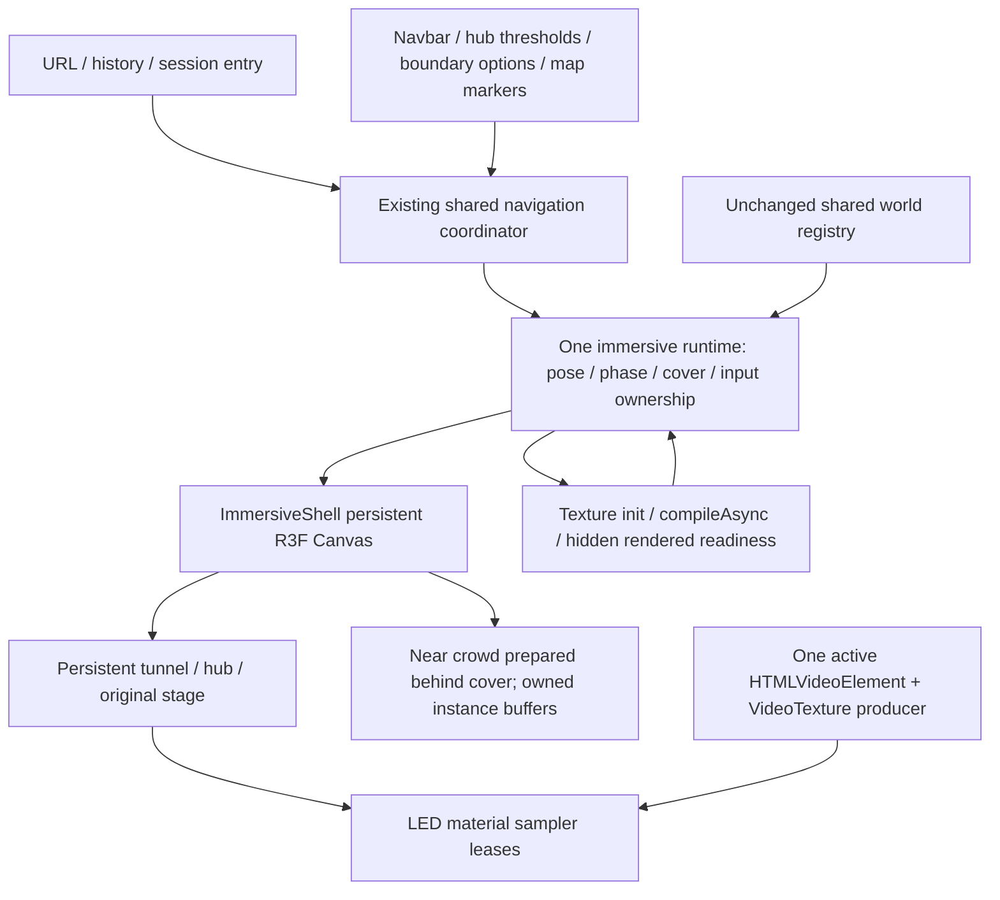

# Gullyverse Stage 1 final acceptance — 2026-10-11

The current user-approved worktree is the visual and spatial authority. This delivery applies bounded runtime fixes and preserves the current environment. It does **not** grant visual approval or certify production art or physical-device performance. No commit, push, deployment, database mutation or Stage 2 environment production was performed.

## Exact starting baseline and preservation

Branch `codex/navigation-board`, HEAD `8919589d47385efd674ca91b52376f1ad310b797`; no staged changes. Starting modifications were `AftermovieScene.tsx`, `HubScene.tsx`, `ImmersiveShell.tsx`, `aerial.ts`, `blockoutGeometry.ts`, the layout JSON and `runtime.test.ts`; untracked `AftermovieEnvironment.tsx` and `reports/` existed already. They were preserved. See the exact [starting status](../reports/stage-1-final-2026-10-11/raw/baseline-state.json), [original working-tree patch](../reports/stage-1-final-2026-10-11/raw/baseline.patch) and [current baseline document](gullyverse-current-user-approved-baseline.md).

A non-destructive [baseline archive](../reports/stage-1-final-2026-10-11/raw/current-approved-baseline.tar.gz) contains 871 selected non-secret source/configuration/asset/evidence files, including important untracked files. All current `public`/`Assets` files are covered: [raw/asset-backup-coverage.json](../reports/stage-1-final-2026-10-11/raw/asset-backup-coverage.json). No environment credentials were copied. Changes in this delivery are measured against this snapshot, **not** against Git HEAD: [raw/source-diff.json](../reports/stage-1-final-2026-10-11/raw/source-diff.json) and [raw/changes-against-approved-baseline.patch](../reports/stage-1-final-2026-10-11/raw/changes-against-approved-baseline.patch). The snapshot comparison with the October 10 source manifest found no differences for overlapping files; this is evidence of the present content, not proof of who edited it or when. Historical audit files remain unchanged.

## Preserved composition and visual review

The shared manifest still defines the 97.8 × 123.5 m quarry, stage origin `[-12,0,-134.3]`, scaffold `[0,0,-70]`, current movement polygons, 25 rock masses, dry ground and left/right stalls. The 24 × 14.5 × 3.4 m scaffold and current GULLYVERSE/signboard hierarchy remain unchanged. No Main Stage/Accommodation signs were restored. Current tunnel bend, exterior, graffiti placements, lighting, fog, exposure and current aerial camera configuration remain the baseline. Exact configuration is reproduced in the baseline document.

All 362 current public/Assets files and locked HubScene, AftermovieEnvironment, aerial camera, blockout geometry, layout manifest, LED shader sources/dimensions, lockfiles, historical audit and payment/admin files pass snapshot preservation checks: [raw/locked-preservation.json](../reports/stage-1-final-2026-10-11/raw/locked-preservation.json). The original stage GLB, male/female crowd GLBs, video, principal stage placement, trusses, effects, LED dimensions/UVs/shader source and crowd pose times are preserved. Playback code changes concern ownership and camera restoration, not stage art. The current dark 49 × 39 m stage-local floor, cream return placard and mode-specific environment lighting/fog remain intentionally preserved. Their visible rectangular floor/atmosphere discontinuity is documented for explicit review rather than silently redesigned under historical instructions.

There are 23 matched fixed-view desktop/portrait pairs: [before/after gallery](../reports/stage-1-final-2026-10-11/gallery.html), [baseline poses](../reports/stage-1-final-2026-10-11/baseline/captures.json) and [acceptance poses](../reports/stage-1-final-2026-10-11/acceptance/captures.json). These are actual production-browser captures at desktop 1366 × 900 and portrait 390 × 844, DPR .25, with recorded camera/FOV/tier. The opt-in review-camera diagnostic positions are not claims about visitor navigation. Public journey evidence is separate. Pixel differences are quantified in [raw/visual-comparison.json](../reports/stage-1-final-2026-10-11/raw/visual-comparison.json); animated LED content/practical lights and capture timing can change pixels. No claim of universal pixel identity is made. Original references and old audit frames are labelled historical context in the gallery.

Entrance and tunnel are still procedural blockouts: faceted rock silhouette, flat graffiti surfaces and limited roughness detail. Tunnel bend/delayed reveal remain functional; final irregular rock/PBR/graffiti art is unfinished. Quarry/stalls/hub capsule population remain temporary, with original stage crowd identity preserved. Higher-density reused crowd models were not introduced: no physical-GPU performance evidence justified that visual/resource change. No new paths, shadow system, postprocessing, lighting redesign or destination was added.

## Root causes and narrowly scoped fixes

| Problem | Evidence / root cause | Fix and affected code | Visible consequence |
| --- | --- | --- | --- |
| Held movement survives editable focus | Fresh baseline held D → actual textarea focus moved 1.88859 m; keyup could be lost and held ownership persisted. | `input.ts`: clear keys/touch/drag/velocity on focus into inputs, textarea, select, contenteditable or forms; guard composed path/active element; blur/freeze/suspension clears ownership; stale repeats cannot reacquire an unheld key. | Movement stops on focus; environment unchanged. |
| Navbar Home replays landing | Fresh baseline ordinary Home from Contact ended in `landing`. No explicit completed-entry routing policy existed across remounts. | `navigation.ts` owns URL/session entry policy; Navbar uses that coordinator href; `ImmersiveShell` records completed entry/history preserving Next fields. `/?arrival=hub` is explicit; fresh bare entry remains user-activated. | Requested Home behavior changes; layout/camera spawn preserved. |
| Video texture reallocation | Initial four untraced cycles plateaued; traced old-runtime cycles reproduced Three 26→29 / tracked GL 30→33. Disposed texture UUIDs remained sampled by three LED materials and were re-uploaded. Thus the race is timing-dependent, not inevitable every run. | `videoTextureOwnership.ts` producer/consumer leases; `useStageVideo.ts` retires producer, cancels pending activation/listeners/promises and releases source. `LEDScreens.tsx` retains through the existing fade, detaches all samplers to blank before final disposal; no arbitrary disposal timer. | Original segmented shared-video wall and fade retained. |
| Cinematics slow under low FPS | Entrance and travel accumulated the same ≤50 ms delta used by safe locomotion; baseline entrance action window 16.423 s. | `runtime.ts`: safe movement delta separate from active cinematic time; event-clock clips first frame to actual activation, smoothstep/yaw paths preserved. Suspension excludes hidden time; first resumed frame discarded. Exceptional foreground camera gaps >500 ms are covered and the existing cover fades back over bounded updates, so skipped path segments are not shown. The authored clock keeps progressing. `activeDeadline.ts` measures foreground readiness budget. | Authored pacing restored; very low FPS still looks discontinuous. No asset reveal before readiness. |
| Invalid map projection | October audit observed NaN/Infinity writes. Fresh browser sampling caught none; deterministic actual spawn/projection state produced clip W=0 and invalid old coordinates. Old projection reused cached results based on position/viewport while rotation/FOV could change. | `mapProjection.ts`: homogeneous finite/W/depth/frustum checks before division; `WorldOverlays.tsx` refreshes actual camera state, omits invalid SVG nodes/lines and non-visible focus targets. | Same actual-world aerial map; invisible/invalid markers safely omitted. |
| Irrelevant 404-image preload | Successful root DOM did not contain image. Missing local Vercel telemetry script responses were 404 pages with HTTP Link preload for the 4,586,644-byte image. | `notFound.tsx`: remove `priority`, use lazy loading. Real 404 page and image preserved; telemetry packages untouched. | No appearance change to successful landing. |
| Cancelled crowd preparation ownership | Interrupted/stale preparations could abandon private pose buffers; disposing shared GLTF/cache resources would be unsafe. | `Crowd.tsx` + `poseResources.ts`: finally clean CPU intermediate geometry/mixer; publish complete shared pose batch atomically; dispose only unpublished or losing owned batches, once; errors propagate to existing fallback. | Pose selection, model identity, density and materials preserved. |
| Playback/transition interruption | Rapid playback restart during camera restore could replace original walking anchor; interruption could reset covered opacity. | `runtime.ts` preserves original walking anchor through restart and current cover on interrupted departure; late play rejection guarded by current source identity. | Camera restoration becomes consistent; authored composition unchanged. |

Evidence: [raw/baseline-defects.json](../reports/stage-1-final-2026-10-11/raw/baseline-defects.json), [raw/map-projection-reproduction.json](../reports/stage-1-final-2026-10-11/raw/map-projection-reproduction.json), [raw/baseline-preload-headers.json](../reports/stage-1-final-2026-10-11/raw/baseline-preload-headers.json), [raw/baseline-video-trace.json](../reports/stage-1-final-2026-10-11/raw/baseline-video-trace.json), [raw/regressions/results.json](../reports/stage-1-final-2026-10-11/raw/regressions/results.json) and [raw/resource-results.json](../reports/stage-1-final-2026-10-11/raw/resource-results.json).

## Architecture and loading policy

Browser tests check identity of the same Canvas across immersive travel/map/video; ordinary information routes unmount the immersive shell as before. No disconnected destination pages or scene-manager rewrite was introduced. Camera cinematic/player/map/movie modes remain in the existing runtime, with fixed registry poses, eased path interpolation and restored ownership.

Initial entry still mounts the persistent hub/tunnel shell, textures and low-detail original stage. Those distant stage assets are critical before first quarry sightline reveal, but some are not needed to draw the exterior entrance. Female/male crowd assets and four-pose preparation are destination-triggered, reused on later visits. Video is created on playback. Optional vendor/rock/hub population blockouts remain resident. Shader/texture preparation and hidden render warm-up are readiness, not network completion alone. No speculative full residency rewrite was performed; initial shell/stage deferral needs a separate measured design preserving first reveal.

Unpublished crowd resources are operation-owned; shared loader/pose caches are not indiscriminately cleared. Unit cancellation ownership and browser delayed-load/interruption/failure/context recovery checks are distinguished below. No JavaScript/Three counter can prove driver VRAM leak freedom. Post-GC JS heap increased from 14.43 to 15.28 MB across ten cycles while Nodes=330/Documents=2 and GL buffers/programs/shaders/VAOs stayed constant. That increase is reported, not dismissed as proof of no JS leak; extended retained-heap profiling remains open.

## Regression tests and lifecycle measurements

`npm run test:immersive`: **53 passing tests** (38 existing +15 new). `npm run test:immersive:browser`: **8 groups passing**, including native held-key/focus interactions with injected editable fixtures, actual touch input in portrait emulation, fresh-session click/Enter, reduced motion, map resize/finite attributes, playback anchor, boundary Stay/rearm, navbar/reload/direct URL/history and Canvas identity. Fresh entrance runtime activation → local took **7214.1 ms**. Fixture forms are DOM input tests; no payment/contact submission was performed.

Initial browser failures were harness defects: action wall time included Playwright click waiting before actual activation, and a nominal fresh-entry test retained a completed-entry history marker. The corrected invariant measures actual runtime activation and uses a genuinely fresh browser context. Initial results remain available: [raw/browser-initial/results.json](../reports/stage-1-final-2026-10-11/raw/browser-initial/results.json) / [raw/browser-initial.log](../reports/stage-1-final-2026-10-11/raw/browser-initial.log). Old boundary strict float equality is now 1e-6 m finite geometry tolerance; restoration is sampled at activation rather than before remaining inertia; movement tests wait for actual clearance/yaw, not fixed short sleeps. No actual allocation/focus assertions were removed.

Ten completed public playback/return cycles include five normal Exit+return and five navigation interruptions, then early exit, actual media-ended via near-end seek, controlled stale play rejection, failed transfer, recovery playback and SPA unmount. This is ten full **playback/return cycles**, not ten full-length screenings. Seek-generated native `ended` separately verifies completion. Settled counters must plateau from the second cycle onward; leaks are judged after disposal/render settlement, not by removing a React node.

| Cycle | Exit method | Start-to-playing ms | Three textures | Tracked GL textures | Three geometries | GL programs |
| --- | --- | ---: | ---: | ---: | ---: | ---: |
| 1 | Exit button then return | 7266 | 25 | 29 | 154 | 45 |
| 2 | Exit button then return | 7443 | 25 | 29 | 154 | 45 |
| 3 | Exit button then return | 6655 | 25 | 29 | 154 | 45 |
| 4 | Exit button then return | 7781 | 25 | 29 | 154 | 45 |
| 5 | Exit button then return | 6911 | 25 | 29 | 154 | 45 |
| 6 | Navigation interruption during playback | 7541 | 25 | 29 | 154 | 45 |
| 7 | Navigation interruption during playback | 6605 | 25 | 29 | 154 | 45 |
| 8 | Navigation interruption during playback | 9196 | 25 | 29 | 154 | 45 |
| 9 | Navigation interruption during playback | 6877 | 25 | 29 | 154 | 45 |
| 10 | Navigation interruption during playback | 6807 | 25 | 29 | 154 | 45 |

Raw allocations, program/shader/geometry statistics, media state, post-GC JS metrics and bounded UUID traces: [raw/resource-results.json](../reports/stage-1-final-2026-10-11/raw/resource-results.json). Before trace: [raw/baseline-video-trace.json](../reports/stage-1-final-2026-10-11/raw/baseline-video-trace.json). Baseline untraced plateau is retained: [raw/baseline-media-cycles.json](../reports/stage-1-final-2026-10-11/raw/baseline-media-cycles.json). Driver memory bytes are unavailable. `activeTextureBytesEstimate` is image dimensions × RGBA × nominal mip factor, not measured GPU memory; `activeGeometryBytes` is deduplicated scene CPU array-buffer bytes, not driver allocations. Dispose trace sampler counts describe the previous completed draw; detachment earlier in a frame can leave that snapshot at three. The post-render disposed-sampler reuse event and settled allocations are the relevant checks. Stable counters are bounded evidence of application ownership, not a universal VRAM certification. Context-loss runs are excluded from create-minus-delete comparisons.

## Actual before/after performance

Same cloud host, Chromium 151.0.7922.173, Debian 13.6/Linux 6.18.44, AMD EPYC 9V74 host, cgroup 2 CPU cores/8 GiB, **SwiftShader software rendering**, no physical GPU. JavaScript `os.cpus()` count in raw logs is not the CPU quota. Functional/performance comparison uses 1366×900 requested/effective DPR .25 and unchanged adaptive quality settings; tier varies as logged. One browser at a time, cache enabled, no recording/screenshots/CPU throttle during timed windows. Loop samples are filtered to rendered frames; average FPS is rendered frames divided by complete action window (which can include cover/waiting), with cadence FPS also in raw data. Reported percentiles are rendered-loop intervals, not GPU execution time. Tail estimates for short windows are noisy; no repeated statistical performance claim is made.

Cold landing total browser ResourceTiming transfer (document + subresources): **5,477,608 → 893,138 bytes** (83.69% reduction). Document-only and entry timing, each URL/transfer/duration and long tasks remain in raw files. ResourceTiming transfer can omit opaque cross-origin bytes; later rows contain cumulative resource entries, not per-window incremental transfer totals. The 404 preload removal is the narrow loading improvement; stage/lighting/quality have not been sacrificed for benchmark results.

| Revision | Window | Action ms | Avg rendered FPS | p50 ms | p95 ms | p99 ms | Max stall ms | >100 ms intervals | Draw calls | Triangles | Textures | Geometries | DPR | Quality tier |
| --- | --- | ---: | ---: | ---: | ---: | ---: | ---: | ---: | ---: | ---: | ---: | ---: | ---: | ---: |
| Before | cold-landing-load | 5594 | 4.29 | 134.10 | 182.60 | 1409.00 | 1409.00 | 23 | 155 | 105022 | 25 | 150 | 0.25 | 0 |
| Before | warm-same-browser-cache-landing-load | 4358 | 4.59 | 118.60 | 1347.60 | 1347.60 | 1347.60 | 17 | 155 | 105022 | 25 | 150 | 0.25 | 0 |
| Before | tunnel-and-first-hub-arrival | 16423 | 8.95 | 108.00 | 165.80 | 178.10 | 193.60 | 113 | 138 | 100818 | 25 | 150 | 0.25 | 0 |
| Before | first-hub-arrival-settling | 3001 | 10.33 | 99.30 | 113.90 | 154.50 | 154.50 | 15 | 138 | 100818 | 25 | 150 | 0.25 | 1 |
| Before | hub-local-movement | 6165 | 10.38 | 99.00 | 115.40 | 160.80 | 160.80 | 28 | 138 | 93258 | 25 | 150 | 0.25 | 2 |
| Before | hub-to-aftermovie-physical-route | 14614 | 5.27 | 91.30 | 375.40 | 972.20 | 972.20 | 31 | 115 | 1020152 | 25 | 154 | 0.25 | 3 |
| Before | aftermovie-local-movement | 6794 | 3.24 | 321.80 | 367.60 | 368.10 | 368.10 | 22 | 115 | 1020152 | 25 | 154 | 0.25 | 3 |
| Before | aftermovie-boundary-return-to-hub | 6907 | 6.08 | 105.50 | 335.80 | 378.10 | 378.10 | 30 | 138 | 93258 | 25 | 154 | 0.25 | 3 |
| Before | map-to-aftermovie | 13365 | 5.91 | 98.80 | 353.80 | 380.10 | 380.10 | 36 | 115 | 1020152 | 25 | 154 | 0.25 | 3 |
| Before | repeat-1-aftermovie-hub | 15837 | 4.99 | 227.10 | 346.20 | 408.10 | 408.10 | 54 | 138 | 93258 | 25 | 154 | 0.25 | 3 |
| Before | repeat-1-hub-aftermovie | 13126 | 6.02 | 87.70 | 382.80 | 401.80 | 401.80 | 27 | 115 | 1020152 | 25 | 154 | 0.25 | 3 |
| Before | repeat-2-aftermovie-hub | 15759 | 5.01 | 208.40 | 335.30 | 358.50 | 358.50 | 65 | 138 | 93258 | 25 | 154 | 0.25 | 3 |
| Before | repeat-2-hub-aftermovie | 12223 | 6.55 | 90.90 | 360.60 | 402.80 | 402.80 | 31 | 115 | 1020152 | 25 | 154 | 0.25 | 3 |
| Before | repeat-3-aftermovie-hub | 15300 | 5.16 | 202.50 | 324.20 | 374.60 | 374.60 | 59 | 138 | 93258 | 25 | 154 | 0.25 | 3 |
| Before | repeat-3-hub-aftermovie | 12118 | 6.60 | 101.70 | 314.80 | 355.70 | 355.70 | 40 | 115 | 1020152 | 25 | 154 | 0.25 | 3 |
| Before | tunnel-interior | 7010.899999999441 | 8.56 | 108.70 | 161.40 | 193.60 | 193.60 | 55 | — | — | — | — | — | — |
| Before | quarry-reveal | 4101.4000000003725 | 10.73 | 94.90 | 116.40 | 145.60 | 145.60 | 16 | — | — | — | — | — | — |
| After | cold-landing-load | 5861 | 3.92 | 127.90 | 165.80 | 1439.00 | 1439.00 | 22 | 155 | 105022 | 25 | 150 | 0.25 | 0 |
| After | warm-same-browser-cache-landing-load | 5337 | 4.31 | 132.90 | 190.10 | 1505.70 | 1505.70 | 22 | 155 | 105022 | 25 | 150 | 0.25 | 0 |
| After | tunnel-and-first-hub-arrival | 7495 | 8.41 | 116.20 | 171.50 | 182.70 | 182.70 | 48 | 138 | 100818 | 25 | 150 | 0.25 | 0 |
| After | first-hub-arrival-settling | 3004 | 9.32 | 105.30 | 152.60 | 168.80 | 168.80 | 19 | 138 | 100818 | 25 | 150 | 0.25 | 1 |
| After | hub-local-movement | 6146 | 10.25 | 99.60 | 138.80 | 153.70 | 153.70 | 31 | 138 | 93258 | 25 | 150 | 0.25 | 2 |
| After | hub-to-aftermovie-physical-route | 11288 | 5.40 | 107.60 | 380.10 | 1131.80 | 1131.80 | 39 | 115 | 1020152 | 25 | 154 | 0.25 | 3 |
| After | aftermovie-local-movement | 7019 | 3.13 | 322.10 | 370.90 | 389.30 | 389.30 | 22 | 115 | 1020152 | 25 | 154 | 0.25 | 3 |
| After | aftermovie-boundary-return-to-hub | 5773 | 5.89 | 103.80 | 368.90 | 384.20 | 384.20 | 19 | 138 | 93258 | 25 | 154 | 0.25 | 3 |
| After | map-to-aftermovie | 9173 | 6.21 | 101.20 | 374.20 | 393.30 | 393.30 | 31 | 115 | 1020152 | 25 | 154 | 0.25 | 3 |
| After | repeat-1-aftermovie-hub | 9490 | 5.27 | 222.30 | 302.00 | 346.00 | 346.00 | 38 | 138 | 93258 | 25 | 154 | 0.25 | 3 |
| After | repeat-1-hub-aftermovie | 9395 | 5.85 | 99.40 | 371.20 | 409.30 | 409.30 | 27 | 115 | 1020152 | 25 | 154 | 0.25 | 3 |
| After | repeat-2-aftermovie-hub | 9174 | 5.34 | 203.60 | 311.80 | 319.20 | 319.20 | 40 | 138 | 93258 | 25 | 154 | 0.25 | 3 |
| After | repeat-2-hub-aftermovie | 9054 | 6.19 | 98.00 | 370.70 | 387.30 | 387.30 | 23 | 115 | 1020152 | 25 | 154 | 0.25 | 3 |
| After | repeat-3-aftermovie-hub | 9173 | 5.12 | 234.20 | 344.50 | 389.40 | 389.40 | 31 | 138 | 93258 | 25 | 154 | 0.25 | 3 |
| After | repeat-3-hub-aftermovie | 9400 | 5.85 | 104.90 | 375.60 | 406.70 | 406.70 | 32 | 115 | 1020152 | 25 | 154 | 0.25 | 3 |
| After | tunnel-interior | 3087.60000000149 | 7.77 | 120.20 | 173.80 | 180.30 | 180.30 | 21 | — | — | — | — | — | — |
| After | quarry-reveal | 2083.199999999255 | 10.08 | 97.60 | 131.80 | 140.10 | 140.10 | 9 | — | — | — | — | — | — |

Raw samples / readiness prep / phases / memory / long tasks: [raw/baseline-performance.json](../reports/stage-1-final-2026-10-11/raw/baseline-performance.json) and [raw/after-performance.json](../reports/stage-1-final-2026-10-11/raw/after-performance.json). Separate native-DPR1 adaptive-quality diagnostic: [raw/native-dpr1-profile.json](../reports/stage-1-final-2026-10-11/raw/native-dpr1-profile.json); it is **not** comparable to the .25 DPR run. No 60 FPS physical-device or Bruno-Simon-level smoothness claim is made. Software-frame stalls remain visible even when cinematic time is correct. The user’s Intel UHD 620 laptop, modern iPhone and mainstream Android are unavailable; their acceptance is **UNVERIFIED**. See [PHYSICAL-DEVICE-PROCEDURE.md](../reports/stage-1-final-2026-10-11/PHYSICAL-DEVICE-PROCEDURE.md) for reproducible hardware validation.

## Builds, commands, failures and remaining acceptance

Production build and TypeScript checks pass: [raw/build-final.log](../reports/stage-1-final-2026-10-11/raw/build-final.log) / [raw/typecheck-final.log](../reports/stage-1-final-2026-10-11/raw/typecheck-final.log). Build emits existing repository lint warnings; unrelated warning cleanup was intentionally avoided. Pure payment tests (13) and event catalog tests (4) pass without live service mutations; standalone lint passes with existing warnings. Unit results: [raw/runtime-tests-final.log](../reports/stage-1-final-2026-10-11/raw/runtime-tests-final.log). Full command/test ledger and browser suites: [raw/commands.json](../reports/stage-1-final-2026-10-11/raw/commands.json), [raw/remaining-commands.json](../reports/stage-1-final-2026-10-11/raw/remaining-commands.json), [raw/extra-checks.json](../reports/stage-1-final-2026-10-11/raw/extra-checks.json), [raw/browser.log](../reports/stage-1-final-2026-10-11/raw/browser.log), [raw/navigation.log](../reports/stage-1-final-2026-10-11/raw/navigation.log), [raw/resources.log](../reports/stage-1-final-2026-10-11/raw/resources.log), [raw/edges-and-media.json](../reports/stage-1-final-2026-10-11/raw/edges-and-media.json), [raw/interruption.json](../reports/stage-1-final-2026-10-11/raw/interruption.json). One added gap test initially hit exact 7.2-second floating-point accumulation; it now advances past the endpoint by one valid frame, with the original failing log retained. Initial diagnostic type error (`Object3D` supplied where `Scene` required) and initial fake-video fixture failures were corrected; their initial logs remain. This is not a claim every historical failed assertion was an application regression.

Synthetic blur/freeze/focus and runtime background suspension tests pass, but a headless context that never becomes `document.hidden` cannot certify actual mobile/browser background recovery. Controlled delayed/aborted downloads, stale navigation, playback failure and WebGL loss/restoration are scoped tests, not exhaustive device/network failure certification. Real payments/admin integrations and external production services were not exercised or altered. All browser API mutations are blocked by the harness; pure existing payment tests may be run separately without live data.

## Blender pipeline and production-art readiness

Current environment has Blender **4.3.2**, unlike historical environment-specific statements in the pipeline document. A separate, non-final one-metre cube was authored/exported with metric units, glTF Y-up, UVs and PBR material: [blender/blender-smoke/one-metre-cube.blend](../reports/stage-1-final-2026-10-11/blender/blender-smoke/one-metre-cube.blend), [blender/blender-smoke/one-metre-cube.glb](../reports/stage-1-final-2026-10-11/blender/blender-smoke/one-metre-cube.glb) and [blender/blender-smoke/manifest.json](../reports/stage-1-final-2026-10-11/blender/blender-smoke/manifest.json). No original stage generator was run. The browser probe imports the existing `BlenderAsset` loader, measures scale/Y ground placement/UV/material/raycast and tests repeated mount/cache ownership: [raw/blender-browser.log](../reports/stage-1-final-2026-10-11/raw/blender-browser.log) and [blender/loader-smoke.png](../reports/stage-1-final-2026-10-11/blender/loader-smoke.png). Actual results and any limitations are recorded in the final result supplement below. Smoke asset is not inserted into the approved quarry.

Existing [environment pipeline contract](gullyverse-environment-pipeline.md) remains: metre-based master scene, separate critical shell/destination anchors/optional dressing, registry-compatible empties, offline transform extraction, owned scene instances/shared cache, texture initialization, compileAsync and hidden rendered readiness. Use segmentable rocks, shared atlases/instancing and explicitly selected LODs. PBR base color sRGB, normal/roughness/AO linear; authored UVs and graffiti/decal atlas. KTX2/Basis/Meshopt/Draco require local decoders and real-device tradeoff tests: none are newly installed or falsely claimed ready. Blender logs a missing optional Draco library, but the uncompressed GLB exports successfully. Khronos glTF Validator reports zero errors/warnings and one informational unused-UV notice: [raw/gltf-validator.json](../reports/stage-1-final-2026-10-11/raw/gltf-validator.json). Raycast smoke verifies basic collision geometry; imported GLBs still need explicit collision polygon/anchor export, not automatic runtime collision registration.

**Provisional budgets for the next approved pilot, not measured final-art limits:** one ≤2 MB compressed GLB, ≤50k visible triangles and ≤2 materials; no new lights/postprocessing. Incremental shell budgets to test: medium ≤150k visible triangles/low ≤75k, ≤20 extra draw calls, shared 1k–2k atlases with low 512–1k variants; optional dressing separately loaded. Inventory actual decoded texture bytes and benchmark alongside the existing ~1M-triangle stage crowd before approving aggregate budgets. Export LOD0/1/2 per rock segment with shared materials, remove hidden faces and preserve silhouette; compression/LOD policy must be validated on physical integrated GPU/mobile before full production.

Remaining production art: authored irregular shell/tunnel/exterior, UV/PBR rock/ground, authentic graffiti atlas, plausible scaffold joints/cables/weathering, stalls/dressing and consistent population. These are not runtime stabilization work. Preserve the user-approved positions and atmosphere during each pilot. No final asset pass has begun.

## Exact phase-only source changes

The following existed at baseline and changed in this delivery; earlier uncommitted visual edits in other files are **not** attributed to this task:

- [components/Navbar.tsx](../components/Navbar.tsx)
- [components/immersive/AftermovieScene.tsx](../components/immersive/AftermovieScene.tsx)
- [components/immersive/ImmersiveShell.tsx](../components/immersive/ImmersiveShell.tsx)
- [components/immersive/WorldOverlays.tsx](../components/immersive/WorldOverlays.tsx)
- [components/immersive/diagnostics.ts](../components/immersive/diagnostics.ts)
- [components/immersive/input.ts](../components/immersive/input.ts)
- [components/immersive/navigation.ts](../components/immersive/navigation.ts)
- [components/immersive/rendering.tsx](../components/immersive/rendering.tsx)
- [components/immersive/runtime.ts](../components/immersive/runtime.ts)
- [components/landing-page/stage3d/Crowd.tsx](../components/landing-page/stage3d/Crowd.tsx)
- [components/landing-page/stage3d/LEDScreens.tsx](../components/landing-page/stage3d/LEDScreens.tsx)
- [components/landing-page/stage3d/useStageVideo.ts](../components/landing-page/stage3d/useStageVideo.ts)
- [components/notFound.tsx](../components/notFound.tsx)
- [package.json](../package.json)
- [scripts/check-gullyverse-stage-1-revision-2.mjs](../scripts/check-gullyverse-stage-1-revision-2.mjs)

New source/test files (report scripts and evidence live separately under the output directory):

- [components/immersive/activeDeadline.ts](../components/immersive/activeDeadline.ts)
- [components/immersive/mapProjection.ts](../components/immersive/mapProjection.ts)
- [components/landing-page/stage3d/poseResources.ts](../components/landing-page/stage3d/poseResources.ts)
- [components/landing-page/stage3d/videoTextureOwnership.ts](../components/landing-page/stage3d/videoTextureOwnership.ts)
- [tests/immersive/stabilization.browser.mjs](../tests/immersive/stabilization.browser.mjs)
- [tests/immersive/stabilization.test.ts](../tests/immersive/stabilization.test.ts)
- [docs/gullyverse-current-user-approved-baseline.md](../docs/gullyverse-current-user-approved-baseline.md)
- [docs/gullyverse-stage-1-final-acceptance.md](../docs/gullyverse-stage-1-final-acceptance.md)

`package.json` changes only test command discovery/browser runner. No dependency or lockfile upgrade. Payment/admin code, assets and current spatial/lighting configurations are checked in the hash inventory. Final user review is required for world composition and any authorization to begin production Blender work.

## Final verification results and required classifications

Full public navigation suite: **32 checks**, browser errors `[]`, attempted API mutations `[]`: [raw/navigation/browser-checks.json](../reports/stage-1-final-2026-10-11/raw/navigation/browser-checks.json). It covers eight boundary approaches, four chamfer segments, all five hub directions (Aftermovie/Events/Team/Contact/Sponsors), direct URLs, history, original playback/unmute/Escape, read-only ordinary pages, portrait marker projection and touch menu navigation. Accommodation remains unavailable on the map; no hanging Accommodation sign was restored. The interrupted earlier run is retained separately in [raw/navigation-interrupted.log](../reports/stage-1-final-2026-10-11/raw/navigation-interrupted.log) / [raw/verification-interruption.json](../reports/stage-1-final-2026-10-11/raw/verification-interruption.json); its incomplete log was not counted as a passing run.

After the foreground-gap guard was added, the final production bundle passed four relevant browser groups: fresh click/timing, map/resize/coordinates, playback/rapid restoration, touch entry/movement/map plus fresh reduced-motion Enter. Final activation→hub **7249.2 ms**: [raw/camera-final/results.json](../reports/stage-1-final-2026-10-11/raw/camera-final/results.json). A controlled real 750 ms main-thread stall remains hidden under the actual DOM curtain and completes entrance in **7276.7 ms**: [raw/gap-browser.json](../reports/stage-1-final-2026-10-11/raw/gap-browser.json). The first gap test forgot to install its own diagnostic context and failed in the test helper; this fixture error remains in [raw/gap-browser-initial.json](../reports/stage-1-final-2026-10-11/raw/gap-browser-initial.json), and was corrected without an application change.

Separate public M/Esc timing runs: **PASS**, same Canvas and restored walking poses: [raw/map-timing.json](../reports/stage-1-final-2026-10-11/raw/map-timing.json). These windows are additional measurements, not a before/after hardware benchmark. A long first shader/frame interval can still make the software animation appear coarse or covered; endpoint accuracy does not imply perceptual smoothness.

| Location | Map mode | Event duration ms | Drawn FPS | p50 ms | p95 ms | p99 ms | Max ms | Calls | Triangles | Tier | DPR |
| --- | --- | ---: | ---: | ---: | ---: | ---: | ---: | ---: | ---: | ---: | ---: |
| hub | ascent | 1456.8 | 12.36 | 87.6 | 144.8 | 144.8 | 144.8 | 155 | 105022 | 0 | 0.25 |
| hub | descent | 1128.0 | 12.41 | 97.9 | 108.3 | 108.3 | 108.3 | 138 | 100818 | 0 | 0.25 |
| aftermovie | ascent | 1522.5 | 5.25 | 262.8 | 311.0 | 311.0 | 311.0 | 159 | 1028208 | 3 | 0.25 |
| aftermovie | descent | 1207.5 | 5.80 | 232.7 | 295.7 | 295.7 | 295.7 | 115 | 1020152 | 3 | 0.25 |

Controlled delayed asset, aborted stage asset and actual context-loss recovery pass: [raw/edges-and-media.json](../reports/stage-1-final-2026-10-11/raw/edges-and-media.json). Actual hidden-tab behavior is **NOT TESTED**: Chromium headless kept `document.hidden=false` after another tab was activated; synthetic lifecycle and runtime-clock suspension are tested separately. Public return while crowd asset preparation is delayed and actual WebGL loss during playback both pass: [raw/interruption.json](../reports/stage-1-final-2026-10-11/raw/interruption.json). Mid-synchronous-pose-bake cancellation was not separately browser-injected; ownership cleanup is unit-tested and inspected, not claimed as exhaustive hardware failure certification.

| Category | Classification | Evidence / scope |
| --- | --- | --- |
| Entrance composition | **PARTIAL** | Current approved entrance preserved; facade/rock/graffiti remain blockout art. |
| Tunnel reveal | **PASS** | Bent occlusion and actual public journey retained; seven-second authored entrance verified. |
| Navigation scaffold | **PASS** | Current geometry/sign arrangement/placement unchanged, approved directional zones verified; final art remains temporary. |
| Quarry layout | **PASS** | Actual registry/geometry/stalls/ground anchors hash-identical; no resizing or stage repositioning. |
| Quarry lighting direction | **PASS** | Current user-approved atmosphere preserved; historical dusk redesign deliberately not applied. |
| Stage integration | **PARTIAL** | Original/restored stage environment preserved, including visible dark floor edge and mode-specific fog; visual blending requires review. |
| Hub movement | **PASS** | Public WASD/arrows/drag/touch and five approved directional zones, including truthful unavailable Sponsors. |
| Boundary menu | **PASS** | Eight public approaches, four chamfer segments, clamp, Stay/Esc, rearm, chosen return and history. |
| Aerial map | **PASS** | Approved same-world aerial view, shared markers, finite projection, resize/portrait and saved-pose return. |
| Input ownership | **PASS** | Real held-key/focus fixtures stop immediately; stale repeats/lost keyup/blur/freeze/map/movie/menu covered. |
| Video-resource lifecycle | **PASS** | Ten completed playback/return cycles plateau at Three25 / tracked GL29; seven media/lifecycle groups pass. Driver VRAM not certified. |
| Cinematic timing | **PASS** | Final event-to-hub timing and exceptional-gap cover verified; poor software FPS remains visibly coarse. |
| Loading/resource preparation | **PARTIAL** | Delay/failure/interruption/context recovery safe in functional profile; native SwiftShader stage readiness fails45s budget. |
| Desktop hardware performance | **UNVERIFIED** | No physical GPU/laptop available; cloud software results are not representative. |
| Physical mobile performance | **UNVERIFIED** | Touch emulation only; no iPhone/Android hardware. |
| Blender pipeline readiness | **PARTIAL** | 4.3.2 editable source→validated GLB→existing loader/cache/raycast smoke passes; final collision/anchor extraction, LOD/decoders/budgets remain to validate. |

## Actual recording and final gallery evidence

[Uninterrupted actual visitor recording](../reports/stage-1-final-2026-10-11/acceptance/journey/recordings/full-journey.webm) — 173.88 s, 16,682,056 bytes. It shows user-activated landing, tunnel, hub, local walk, physical directional Aftermovie travel, real video, Escape, boundary return and actual-world map selection. This is a browser screen recording, not a generated cinematic. Recording/screenshots are separate from timed profiling. Extra Stay/rearm/ordinary-route/history combinations are exercised in the browser suites. [Playwright trace](../reports/stage-1-final-2026-10-11/acceptance/journey/traces/full-journey.zip) and [journey results/poses](../reports/stage-1-final-2026-10-11/acceptance/journey/raw/browser-audit.json) retain the raw evidence. Its two console errors are the existing local Vercel telemetry script404s; no page runtime exception or API write occurred.

[Matched visual gallery](../reports/stage-1-final-2026-10-11/gallery.html) contains 23 before/after pairs, all matching camera pose, viewport, quality and DPR. Actual image inspection reviewed entrance/scaffold/stage front/rear and portrait exit/aerial pairs; all23 were compared numerically. Larger stage-front/menu differences track existing animated light beams and capture time. No unexpected mesh, sign, terrain or exposure replacement was found within the captured views; low DPR limits fine material review. This is assistant verification, not final user visual approval.

Additional actual acceptance-only captures: [Preserved dark floor edge](../reports/stage-1-final-2026-10-11/acceptance/stage-ground-detail.png) and [Original segmented LED video playback](../reports/stage-1-final-2026-10-11/acceptance/shared-led-playback.png), with [camera/quality metadata](../reports/stage-1-final-2026-10-11/acceptance/additional-captures.json). They have **no** matched before capture; the ground-detail pose deliberately looks down at the visible seam, rather than presenting the repeated stage-return view as proof that the seam is absent. All captures are actual browser images.

## Confirmed failures, open risks and production-art work

| Severity | Issue | Evidence / files | Recommended direction |
| --- | --- | --- | --- |
| High / available environment | Native DPR1 SwiftShader cannot finish stage preparation within45s; stage-local FPS window could not be obtained. The existing `npm run perf:immersive` desktop run also times out awaiting local Aftermovie after60s. | [raw/native-dpr1-profile.json](../reports/stage-1-final-2026-10-11/raw/native-dpr1-profile.json); [raw/project-performance/failure.txt](../reports/stage-1-final-2026-10-11/raw/project-performance/failure.txt); [raw/project-perf.log](../reports/stage-1-final-2026-10-11/raw/project-perf.log); `rendering.tsx`, `ImmersiveShell.tsx`. | Retain graceful fallback; profile real integrated GPU/mobile before tuning budgets. No scene/lighting downgrade was used to hide this failure. |
| High / unverified acceptance | Physical laptop/mobile smoothness, thermal behavior, audible sound and actual mobile background recovery are not certified. | [raw/host.json](../reports/stage-1-final-2026-10-11/raw/host.json); [PHYSICAL-DEVICE-PROCEDURE.md](../reports/stage-1-final-2026-10-11/PHYSICAL-DEVICE-PROCEDURE.md). | Execute the recorded hardware procedure before full environment production budgets are approved. |
| Medium | Post-GC JS heap increased14.43→15.28 MB despite stable GPU counters and DOM counts. | [raw/resource-results.json](../reports/stage-1-final-2026-10-11/raw/resource-results.json); opt-in diagnostics and shared caches. | Longer retained-heap profiling; distinguish bounded caches/JIT/diagnostics from true retained-resource growth. Do not infer no JS leak from stable textures. |
| Medium / locked visual decision | Dark stage-local floor has a visible boundary; hub/stage fog/lighting differ. These current restored elements are intentionally retained. | [acceptance/stage-ground-detail.png](../reports/stage-1-final-2026-10-11/acceptance/stage-ground-detail.png); `AftermovieEnvironment.tsx`, `HubScene.tsx`. | Explicit user review before any ground/lighting integration work. No silent historical-reference restoration. |
| Medium / asset pipeline | Compression/LOD/registry-export/collision extraction have not been validated with production assets or physical-device budgets. | [pipeline contract](gullyverse-environment-pipeline.md); smoke evidence above. | One separately approved small asset pilot; locally pinned decoders only after measurement. |
| Medium / temporary art | Procedural faceted rock, simple graffiti surfaces, placeholder hub capsules and stall blocks remain. | [gallery.html](../reports/stage-1-final-2026-10-11/gallery.html); `HubScene.tsx`, `blockoutGeometry.ts`, world registry. | Subsequent authorized Blender/material/population pass preserving current positions/atmosphere. |
| Low / pre-existing environment | Local Vercel telemetry JS404s and existing lint warnings remain. | [raw/after-loading-check.json](../reports/stage-1-final-2026-10-11/raw/after-loading-check.json); [raw/lint.log](../reports/stage-1-final-2026-10-11/raw/lint.log). | Verify deployment-specific telemetry routing separately; unrelated cleanup not included. |

Cold landing readiness did **not** improve in the single-run sample (5.594→5.861s), despite the measured83.69% transfer reduction. There is no claimed FPS gain: software frame tails remain poor. The benchmark log's word “draws” refers to rendered-frame count; actual WebGL draw calls are `stats.calls` in the tables/raw data. Native-resolution failure and successful low-DPR functional checks are both retained.

Blender smoke has12 successful mount/cache checks, one-metre bounds `[-.5,0,-.5]`→`[.5,1,.5]`, UVs, `Smoke_PBR`, visible raycast hit `[0,.5,.5]`, stable geometry UUID and one resident geometry. Khronos validation has0 errors/0 warnings/one unused-UV informational notice. The optional Draco-library warning did not prevent this **uncompressed** GLB export; no compressed-asset or automatic collision-registry readiness claim is made.

## Readiness answers and stop condition

1. **Persistent rendering stable?** Yes across tested immersive trips/map/video; ordinary pages intentionally unmount it. Physical-device stress acceptance remains open.
2. **Additional destinations without major redesign?** The registry/coordinator supports existing destination types; new destinations still need anchors, collision, readiness and budget validation. None were added.
3. **Camera transitions consistent?** Tested state/pose restoration and active-clock durations pass, including covered exceptional gaps. Smoothness on physical hardware is unverified.
4. **Scene loading reliable?** Controlled delay/failure/interruption/recovery paths pass at the functional profile; native software rendering hits fallback. No blanket readiness certification.
5. **Resource disposal correct?** Video and published/unpublished ownership paths are repaired and bounded in ten measured cycles. Driver VRAM and all long-session JS retention are unverified.
6. **Performance measured and acceptable?** Measured honestly on the available VM; software FPS is poor and native stage readiness fails. Representative physical hardware acceptance is open.
7. **Existing Aftermovie preserved?** All current source assets, layout/environment locks and LED shader/dimensions pass preservation hashes; actual stage and playback captures support this conclusion.
8. **Ready for photorealistic Blender pass?** A small isolated asset pilot is technically feasible. Full quarry production should wait for user composition approval, physical-device measurements and an approved aggregate budget/import contract.
9. **Fixes required before visual refinement?** Review this bounded runtime delivery, run the physical-device gate, validate anchor/collision export and compressed-material/LOD readiness with a small pilot; investigate retained heap/native fallback if real hardware reproduces them. No architectural rewrite is justified by the cloud FPS alone.
10. **Smallest next scope?** After explicit approval, one small authored rock/material segment in an isolated pilot, with metre/UV/PBR/LOD/export/loader/collision/ownership checks and real-device profiling. Preserve all approved world coordinates and stage assets.

**Stopped after Stage1 stabilization and verification.** No Stage2 production art, new destinations, quarry redesign, commit, push or deployment. Current approved configuration remains authoritative for future work. Full Stage2 authorization and final world-composition approval remain with the user.
