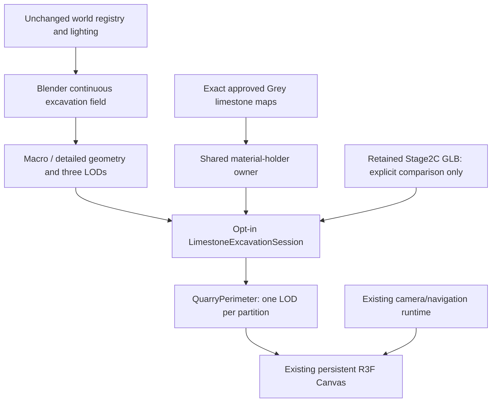

# Gullyverse Stage 2C.2 — continuous limestone excavation

The whole-quarry macro shell and three representative detailed areas are implemented **behind an opt-in review switch**. The approved isolated Grey limestone material is used directly. The production/default quarry remains Stage 2C; Stage 2C.1 remains available for comparison. No commit, push or deployment was performed.

The result is ready for **human visual review**, not certified as final photorealistic art or physical-device performance. All current functional checks pass. Aerial rendering regressed in the matched SwiftShader run and is explicitly recorded below.

## 1. Exact preserved baseline

Starting branch `codex/navigation-board`, HEAD `e3dbbc233f1f12f5e4d96333db3b797e75da4760`. Staging was empty. Four tracked source files were already modified: `AftermovieScene.tsx`, `HubScene.tsx`, `ImmersiveShell.tsx`, `rendering.tsx`; 1306 untracked files included previous art, tests and evidence. Their authorship is not inferred.

[Exact starting status](../reports/stage-2c2-limestone-excavation-2026-10-13/raw/starting-state.json), [starting hashes](../reports/stage-2c2-limestone-excavation-2026-10-13/raw/baseline-hashes.json), [preservation result](../reports/stage-2c2-limestone-excavation-2026-10-13/raw/preservation.json). A recoverable, credential-free snapshot is stored locally at `reports/stage-2c2-limestone-excavation-2026-10-13/backup/current-user-work-source-assets.tar.gz`. That large backup is deliberately excluded from the review ZIP. Of 850 protected source/config/asset files, 848 retain their exact starting hashes; only the two intended integration files differ. No protected file was removed. Original stage, crowd, video, prior quarry versions and approved map files are unchanged.

| Locked configuration | Current value / preservation |
|---|---|
| Usable quarry | Exact 20-point world polygon; bounding width **97.8 m**, length **123.5 m** |
| Stage | `[-12,0,-134.3]`, slightly left of centre at the far end; original GLB and layout |
| Scaffold | `[0,0,-70]`, width24 m, height14.5 m, depth3.4 m; existing sign hierarchy |
| Team / Contact | `[-27.6,0,-77.1]` / `[27,0,-77.1]`; current second-stall positions |
| Hub / stage local bounds | Existing polygon vertices, directional gates and boundary menu unchanged |
| Tunnel | Bent six-point centreline, endZ−42, walkHalfWidth2, profile and entrance sequence unchanged |
| Ground | Existing 600×600 m dry rocky/grassy terrain and population; no new walking paths |
| Hub environment | Background/fog `#737d87`, fog205–520; hemisphere1.35 and existing warm directional light1.35 |
| Stage environment | Existing background/fog `#b2bbb9`, fog55–130; hemisphere0.65 and original stage lighting/effects |
| Cameras / quality | World camera registry, FOV/framing, adaptive tier configuration and exposure unchanged |

Only the quarry wall/upper-rim/outer-terrain/connection surfaces are redesigned in the opt-in mode, as authorized. The original stage-local dark floor, restored surroundings and hub population remain in place.

## 2. Exact approved reference

[Fresh actual-browser isolated Grey limestone LOD0 capture](../reports/stage-2c2-limestone-excavation-2026-10-13/reference/approved-grey-limestone-lod0.png), [capture metadata](../reports/stage-2c2-limestone-excavation-2026-10-13/raw/reference-capture.json).

- Editable source: `assets-source/gullyverse/limestone-grey-pilot/quarry-grey-limestone-pilot.blend`.
- Runtime source: `public/models/gullyverse/pilot-limestone-grey/quarry-grey-limestone-pilot.glb`.
- Original scripts: `author_grey_limestone_pilot.py`, `grey_limestone_pilot_materials.py`, `limestone_pilot_surface.py`.
- Material: **`Quarry_Pilot_Grey_Limestone_PBR`**, base-colour, normal and packed occlusion/roughness/metalness maps at1024². Metallic0; exported roughnessFactor1, mapped matte roughness approximately0.82–0.99; normal strength0.58. Images are the project's original generated mineral material, not reference-photo pixels.

Only its material is imported. **The isolated rectangular geometry is never copied around the perimeter.** Its broad fractured/bedded surface informs the new field. The exact image-buffer bytes, sampler settings and glTF material JSON are retained in a small material-holder GLB; its tiny holder mesh is never rendered. [Material/image equality and packing evidence](../reports/stage-2c2-limestone-excavation-2026-10-13/raw/material-and-pack.json).

## 3. Geological model

The new shell follows one periodic Hermite excavation curve derived from the existing usable boundary. Its approximately **378.1 m** arc length, globally defined bedding and finite vertical/diagonal faults continue across runtime partitions. There are no independent pentagonal rock envelopes, exposed rectangular end caps or repeated panel meshes.

Broad faces lean by varying amounts, with local protrusions, unequal bed offsets, interrupted joints, small erosion/chip depressions and restrained excavation ledges. The shared irregular rim ranges approximately **28.61–38.67 m**. The surrounding terrain continues to a broad560×560 m landscape patch within the original600 m ground footprint; it does not descend back to the quarry floor as a detached concentric rock ring. The original entrance forecourt and enclosed tunnel remain clear.

Pass A is the modest-density whole macro excavation. Pass B refines three areas in the same surface field:

| Area | Existing-world context | Evidence |
|---|---|---|
| Navigation wall | Left wall near Team/stall/navigation area; field arc≈324 m | [Close/medium view](../reports/stage-2c2-limestone-excavation-2026-10-13/after/desktop-07-detail-navigation.png) |
| Curved corner | West/southwest curvature change; field arc≈247 m | [Corner geology](../reports/stage-2c2-limestone-excavation-2026-10-13/after/desktop-08-detail-corner.png) |
| Stage-return wall | Front/right wall visible when looking back from the stage; field arc≈45 m | [Detail view](../reports/stage-2c2-limestone-excavation-2026-10-13/after/desktop-09-detail-stage-return.png), [stage context](../reports/stage-2c2-limestone-excavation-2026-10-13/after/desktop-15-stage-looking-back.png) |

The lower rock foot is buried into the unchanged ground at−0.8 m except the functional tunnel opening. A short geological return uses the **actual retained tunnel-end vertices**, connecting the existing passage to the new opening. Source tunnel/portal geometry is not rebuilt.

## 4. Corrected export/appearance problems

The first macro outer terrain still read as a raised ring; its profile was changed into a surrounding landscape rather than a bank returning to floor level. Planar metre-scale displacement in terrain UVs removed the initial radial texture stretching. These changes affect only the opt-in geology.

Close-up browser diagnostics then revealed rectangular smear bands. Disabling the normal map and recomputing geometric normals did not remove them. The isolated pilot's image authoring paints **U=.02–.88, V=.03–.97** and clamps the padded end-cap region. Whole-atlas repetition sampled those strips. The new geometry UVs reflect **within the painted region**, preserving its local UV/metre derivative and the original maps. The perimeter reflection period closes consistently. Tangents are exported for the reflected UVs. [Diagnostic evidence](../reports/stage-2c2-limestone-excavation-2026-10-13/raw/shading-diagnostic.json), [final corrected close-up](../reports/stage-2c2-limestone-excavation-2026-10-13/after/desktop-07-detail-navigation.png).

Three initial upward-ray LOD hit/miss differences were removed with a common upper-rim/terrain band at every level, stitched to each lower wall's actual edge. It is not an overlapping cover mesh. Earlier trials and the original discrepant survey remain locally under `trials/`; no historical report or approved image was overwritten.

## 5. Blender sources and runtime exports

[Macro Blender master](../assets-source/gullyverse/limestone-excavation/excavation-macro.blend) · [detailed Blender master](../assets-source/gullyverse/limestone-excavation/excavation-detailed.blend) · [reproduction workflow](../assets-source/gullyverse/limestone-excavation/README.md) · [manifest](../public/models/gullyverse/limestone-excavation/manifest.json) · [all sizes/hashes](../reports/stage-2c2-limestone-excavation-2026-10-13/raw/asset-inventory.json).

| Variant | Combined geometry GLB bytes | Near triangles | Middle triangles | Distant triangles |
|---|---:|---:|---:|---:|
| macro | 3,628,580 | 38,371 | 21,250 | 14,780 |
| detailed | 7,898,472 | 152,986 | 40,648 | 17,413 |

The exact material-holder GLB is **2,117,836 bytes** and is shared by macro/detailed modes. The detailed runtime total is therefore **10,016,308 bytes**, versus the retained Stage2C combined wall GLB **18,594,988 bytes**. Standalone LOD0/1/2 and low-shell collision-reference exports are supplied separately.

Blender4.3.2 is installed and functional. Both editable masters use metres and packed material images. Blender `(x,−worldZ,worldY)` converts to glTF Y-up correctly. Stable named nodes and normals/UVs/tangents pass the actual Khronos glTF validator: **11 exports, zero errors and zero warnings**. [Validation](../reports/stage-2c2-limestone-excavation-2026-10-13/raw/glTF-validator.json).

These are open geological terrain surfaces at buried inner contact, distant outer landscape border and original passage attachment; a full closed underground earth volume is not claimed. They have genuine relief and connected landmass, not flat isolated panels. The simplified collision exports are low-shell raycast references. Runtime movement still uses the original authoritative navigation polygons.

## 6. Opt-in architecture and ownership

Review URL: `/?arrival=hub&quarryReview=excavation`; add `&excavation=macro` for Pass A. Allowed only in development or a build with `NEXT_PUBLIC_GULLYVERSE_WALL_PREVIEW=1`. The review panel switches **Stage2C baseline / Macro excavation / Detailed geology**. Ordinary URLs retain the existing quarry and do not request any new excavation asset. Removing the query and reloading restores the default. Existing `?quarryReview=geology` and `?quarry=original` reversals remain available.

`LimestoneExcavationSession` owns bounded caches for at most macro, detailed and baseline comparison. The18 runtime sections are **culling/LOD partitions of the same geological field**, not18 separate sculpted rock formations. Macro/detailed reuse one exact material and texture set. The old18.6 MB comparison asset is not loaded until requested. The holder mesh is never attached to the scene.

The existing projected-size/quality/distance policy selects one visible LOD per section, with hysteresis. Partition borders share146 positions; the upper rim is common across levels. The current bounded preview caches and warms all three levels. It does **not** implement a new streaming manager or certify that full-production near meshes should all remain resident.

Preparation initializes mapped textures, compiles under the current scene lighting and renders hidden warm frames before removing the cover. Generation checks dispose abandoned unpublished resources. Accidentally unpacked geometry containing duplicate image maps is rejected/disposed and safely falls back. Inactive geometry can be retired after covered baseline restoration; shared maps remain until their owner is retired/unmounted. No original stage asset cache is cleared.

## 7. Real visual evidence

[**Open the comparison gallery**](../reports/stage-2c2-limestone-excavation-2026-10-13/gallery.html): **20 views × Stage2C / macro / detailed =60 original PNGs**, plus the exact isolated reference, actual LOD screenshots and map-transition frames. Desktop1366×900; portrait390×844. Desktop/detail captures generally use fixed Q0/DPR1; public map captures use the recorded adaptive tier/DPR. Portrait is browser emulation, not physical iPhone profiling.

All20 important Stage2C/detailed pairs match camera, viewport, effective DPR and quality exactly. [Pair checks](../reports/stage-2c2-limestone-excavation-2026-10-13/raw/capture-pair-validation.json), [before metadata](../reports/stage-2c2-limestone-excavation-2026-10-13/raw/before-captures.json), [macro metadata](../reports/stage-2c2-limestone-excavation-2026-10-13/raw/macro-captures.json), [detailed metadata](../reports/stage-2c2-limestone-excavation-2026-10-13/raw/after-captures.json). Detailed close-up inspection poses are explicitly labelled and do not alter production camera configurations or claim unrestricted walking access.

[Actual public-controls walkthrough — MP4](../reports/stage-2c2-limestone-excavation-2026-10-13/recordings/visitor-walk-and-aerial.mp4), [original WebM](../reports/stage-2c2-limestone-excavation-2026-10-13/recordings/visitor-walk-and-aerial.webm), [trace](../reports/stage-2c2-limestone-excavation-2026-10-13/raw/walkthrough.json). This is57.72 seconds of real browser footage: original visitor spawn, public pointer-look/WASD movement at1.72 m eye height, then public map ascent/descent. No synthetic camera animation or generated cinematic is substituted. Low software-renderer FPS remains visible.

## 8. Geometry and functional verification

[Actual-export geometry survey](../reports/stage-2c2-limestone-excavation-2026-10-13/raw/excavation-geometry-validation.json) imports the runtime GLBs independently in Blender. Finite positions, painted-region UV bounds, unit normals, no zero-area triangles, partition joins and walking-footprint clearances pass. Five review/visitor origins ×120 yaw angles ×five pitches, including upward sightlines, compare all three levels: **zero unexpected horizontal gaps, zero new visible inverted-face samples, zero cross-LOD hit/miss differences**. All shared-border errors remain below20µm. The original double-sided passage is included as an occluder, not misclassified as newly authored inverted geometry. This is sampled coverage, not an exhaustive self-intersection/pixel proof.

[Runtime LOD selection](../reports/stage-2c2-limestone-excavation-2026-10-13/raw/lod-runtime.json) observes actual LOD0/1/2 without forcing mesh visibility. [Command/test summary](../reports/stage-2c2-limestone-excavation-2026-10-13/raw/test-summary.json).

| Check | Result / evidence |
|---|---|
| Typecheck, lint, production build | PASS; build uses local inert Supabase values and review flags; existing lint warnings remain |
| Existing + new immersive units | PASS,69/69; ownership/retirement/default isolation regressions added |
| Default visitor browser groups | PASS,8 groups |
| Opt-in visitor browser groups | PASS,8 groups |
| Entry/tunnel pacing | PASS: activation→local7225.3 ms default /7314.5 ms preview, bounded by frame sampling; click/tap/Enter remain intentional |
| Forms / lost input / map projection / resize | PASS in real browser checks; synthetic blur/freeze cases are labelled; native OS backgrounding is not certified |
| Navigation / boundary / history / direct URLs / Home | PASS; [directional evidence](../reports/stage-2c2-limestone-excavation-2026-10-13/raw/directional-travel.json) |
| Touch-emulated entry/movement/map and reduced motion | PASS; physical mobile remains pending |
| Actual context loss, optional failure/retry, delay/unmount, material failure, bad unpacked payload, critical-stage fallback | PASS,6 scenarios; [recovery](../reports/stage-2c2-limestone-excavation-2026-10-13/raw/recovery.json) |
| Ten geometry-preview switches | PASS, stable settled allocations; [lifecycle](../reports/stage-2c2-limestone-excavation-2026-10-13/raw/lifecycle.json) |
| Ten Hub↔Aftermovie round trips | PASS, same Canvas and settled resource plateau; [navigation](../reports/stage-2c2-limestone-excavation-2026-10-13/raw/navigation-cycles.json) |
| Ten playback/exit/restoration cycles | PASS; includes optional preview off/on during playback; [video](../reports/stage-2c2-limestone-excavation-2026-10-13/raw/video-with-wall.json) |

The playback cycles test real movie playback, explicit exit and complete camera restoration; they do not mean ten full-length movies were watched to natural completion. Hardware audio output and native physical-device behavior remain unverified. No original stage geometry/crowd/video code was edited.

## 9. Matched performance and transfer

Debian13 cloud VM, Linux6.18.44, Chromium151.0.7922.173, ANGLE/Vulkan **SwiftShader software rendering**. AMD EPYC9V74 host, **2 vCPU quota**,8 GiB memory limit, no `/dev/dri`. No integrated-GPU laptop, physical iPhone or Android was accessible. [Hardware profile](../reports/stage-2c2-limestone-excavation-2026-10-13/raw/hardware-profile.json).

The following uses the same production build, fixed1366×900 poses, DPR0.5/Q3,10-second windows, no throttling/recording/competing authoring or browser test. “Before” means the unchanged Stage2C default path in this build. A single paired run is noisy; these are not hardware-GPU performance claims.

| Window | Mean FPS before→after | p50 ms | p95 ms | p99 ms | Draw calls | Visible triangles |
|---|---:|---:|---:|---:|---:|---:|
| hub | 3.56 → 4.06 | 285.6 → 242.0 | 324.2 → 301.3 | 351.8 → 326.9 | 160 → 150 | 154,026 → 109,677 |
| left-wall | 2.94 → 3.32 | 340.2 → 294.1 | 378.1 → 369.2 | 389.7 → 386.4 | 32 → 30 | 143,312 → 100,549 |
| aerial-map | 4.21 → 3.09 | 225.9 → 305.9 | 279.1 → 392.4 | 285.6 → 395.1 | 180 → 171 | 131,446 → 113,899 |
| stage-looking-back | 2.30 → 2.53 | 430.7 → 400.0 | 500.0 → 487.0 | 514.4 → 490.5 | 65 → 65 | 1,053,720 → 1,037,043 |

**Aerial software performance regressed** despite fewer calls/triangles. The surrounding PBR landmass now shades substantially more of the frame; fill/shading cost is a plausible explanation, not an established GPU-timing diagnosis. No global lighting/quality redesign was applied to hide this. GPU timers/driver VRAM are unavailable. Physical aerial profiling is a priority before claiming production-scale performance.

At matched Hub views, active geometry payload proxy falls **18.43→9.47 MB**, active geometries **222→195**, texture count stays28. The scene decoded texture-payload estimate rises **57.61→61.80 MB** because the exact approved map set is larger than the previous family. One unique approved family is approximately16 MiB RGBA+mip payload. These are payload estimates, not measured driver VRAM. Raw frames, stalls, heap snapshots and prep traces: [before](../reports/stage-2c2-limestone-excavation-2026-10-13/raw/before-performance.json), [after](../reports/stage-2c2-limestone-excavation-2026-10-13/raw/after-performance.json).

| Cold intentional-entry landing | CDP encoded local bytes | Landing + asset readiness ms |
|---|---:|---:|
| stage2c-default | 14,866,495 | 7738.1 |
| macro-preview | 5,284,459 | 6880.5 |
| detailed-preview | 8,004,953 | 7304.9 |

[Network/raw resource/preparation data](../reports/stage-2c2-limestone-excavation-2026-10-13/raw/network.json). New contexts, disk cache disabled, DPR0.25/Q3, no throttle. Counts include response overhead. Localhost readiness is not an internet/device benchmark. Default makes **zero excavation requests**; preview makes **zero Stage2C wall requests** until comparison is selected. Physical60/30 FPS acceptance remains **PENDING**, as authorized rather than blocking this pilot.

## 10. Resource lifecycle

Ten baseline/detailed comparison cycles plateau at **31 Three textures /276 geometries /35 tracked GL textures /1276 buffers /23 programs**, identical first/last settled counters. The one-time extra family is the explicitly requested original comparison, not unexplained per-visit growth. Retiring inactive excavation geometry decreases276→222 geometries while preserving cached maps. Fresh single-preview residency has28 textures and195 Hub geometries.

Ten real movie/exit/restoration cycles settle at **28 textures /168 stage geometries /32 tracked GL textures** every cycle. Navigation also plateaus after warm-up. JS heap snapshots are retained, but no retained-heap/driver-VRAM leak-free certification is claimed. Context-loss allocation totals are not mixed into the ordinary repeated-visit comparison.

## 11. Exact source changes

[Patch against the initial worktree](../reports/stage-2c2-limestone-excavation-2026-10-13/raw/task-source-changes.patch).

- `ImmersiveShell.tsx`: explicit allowed excavation query and review-only controls; normal factory unchanged.
- `QuarryPerimeter.tsx`: use the optional session's geological partitions/clone; same renderer, warm gate and LOD machinery.
- New `LimestoneExcavationSession.ts`: dedicated bounded geometry/material ownership, failure/retry, interruption and deterministic retirement.
- New Blender geometry/author/pack scripts: continuous field, two masters, LOD/proxy exports, exact material extraction and safe painted UVs.
- New `tests/immersive/limestone-excavation.test.ts`: isolation, active/borrowed resource safety and input clearing during review mode changes.
- New asset source/runtime directories, evidence, workflow and this report. No libraries were added/upgraded; package/lock files remain unchanged.

## 12. Remaining production work and next step

The entire macro form is present, but only three regions have representative detail. Remaining walls are intentionally simpler. Fine cavity/mineral geometry, more irregular localized excavation cuts, final ground contact/rubble and less recognizable material reflection/repetition still need art review/refinement. The far terrain patch is a macro surface, not finished overburden/vegetation. The retained entrance/tunnel, stalls and hub capsule people remain at their existing blockout level; this task does not replace them. The old stage-local floor and context lighting differences remain the approved baseline.

Current provisional limits should use this measured asset as a checkpoint:18 selected wall partitions, near153k/middle41k/distant17k triangles, one shared16 MiB material payload, approximately10 MB detailed geometry+material transfer before HTTP compression. Uniformly applying near sampling everywhere could push wall geometry toward0.6–0.8 million triangles; the existing stage/crowd already dominates some views. This is an estimate, not a certified limit.

After human approval of the **whole macro appearance and three examples**, refine the other wall regions with the same global field and locked material. Prioritize physical aerial/Hub/stage measurements, investigate selective higher-LOD residency and far-terrain shading/culling in measured isolated trials, and validate any compression/loader change separately. Do not preload a future fully detailed quarry merely because this bounded cache passed. [Local hardware procedure](../reports/stage-2c2-limestone-excavation-2026-10-13/raw/local-hardware-procedure.md).

**Stop here:** no permanent visual substitution, additional destination, final entrance/tunnel/stall/population production, commit, push or deployment. The next art pass requires the user's review of these actual captures.
