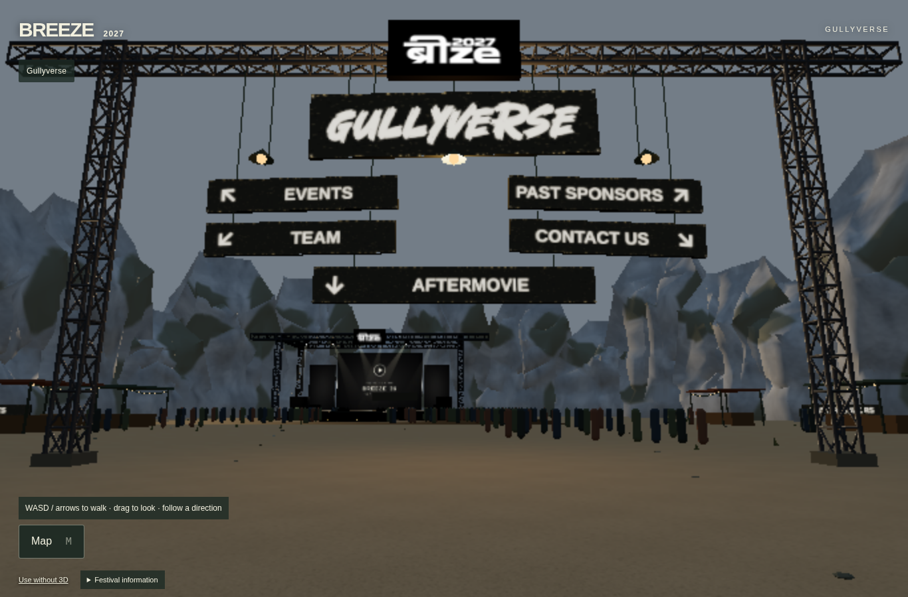
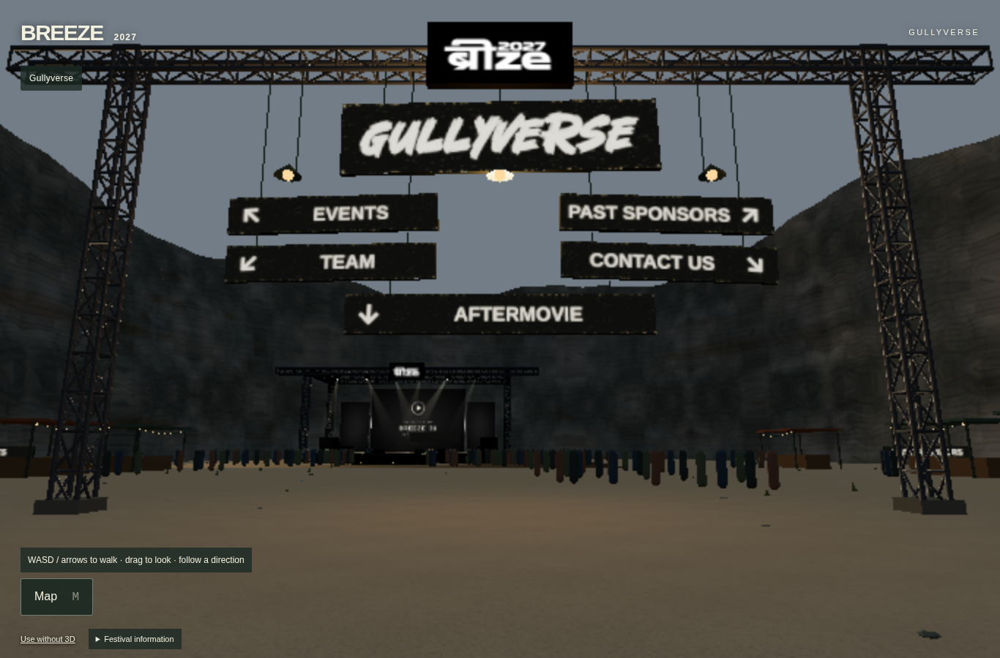
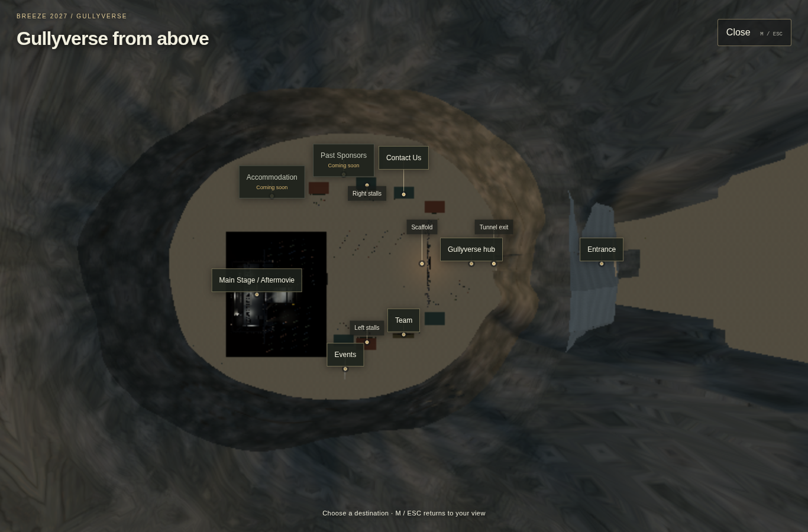

# Dark-rock quarry default correction — 15 October 2026

Starting branch `codex/navigation-board`, commit `78a927d564ac3900720180ded26e8025db343b71`; the remote WIP branch and its Vercel deployment had that exact commit. Existing untracked backups/trials were preserved.

## Root cause

The successful deployment still selected `WallPreviewSession(..., "quarry")` for ordinary visits. A real browser confirmed it requested `/models/gullyverse/quarry-rollout/quarry-limestone.glb` and displayed `Approved_Cool_Grey_Limestone_Family`. The newer connected dark-rock look existed only behind the optional `quarryReview=excavation` selector. This was a default-selection mismatch, rather than a failed merge or a browser-cache diagnosis.

## Narrow correction

Only `components/immersive/ImmersiveShell.tsx` changes. Ordinary visits now instantiate the existing `LimestoneExcavationSession(runtime, "detailed", "rock")`. Despite the retained class name, this loads the connected excavation with the actual original darker Stage 2A `Quarry_Pilot_Original_Stone_PBR` material.

Review controls require an explicit permitted review query. The unfinished C5/C5.1 two-region candidates remain opt-in. The rollout-disable environment switch and original-quarry escape query are retained. No geometry, UVs, texture files, lighting, sky, fog, camera registry, world coordinates, navigation logic, stage, crowd, LED/video, stall, payment or admin assets/code were edited.

## Verification before pushing

- Production build with `NEXT_PUBLIC_GULLYVERSE_WALL_PREVIEW=0`: PASS, including lint under the existing warning policy.
- TypeScript: PASS. Immersive unit tests: 79/79 PASS.
- Real production-build browser journey: fresh ordinary `/` and intentional entry; connected dark material; no legacy limestone or unfinished foundation asset requests; no review UI; map to Aftermovie with one Canvas; actual movie playback/exit; boundary-menu return; browser Back/Forward; reload without a review URL: PASS.
- Live deployed-before browser inspection: legacy limestone confirmed. Raw JSON includes actual material properties, resource requests, camera/quality/viewport and screenshots.
- Browser captures use Chromium 151 / SwiftShader software rendering in the cloud VM. Portrait emulation is not physical iPhone/GPU performance acceptance. No new realism or performance guarantee is made.

[Baseline and source hashes](raw/baseline.json) · [Local production result](raw/local-after.json) · [Deployed-before result](raw/deployed-before.json) · [Capture-pose checks](raw/matched-poses.json) · [Browser reproduction script](scripts/verify-default.mjs).

## Actual browser captures

Legacy deployed default:

Corrected production-build default:

Corrected map:

All original PNG resolutions are preserved. Per-capture camera, DPR and quality metadata are in the raw JSON. Verification against the updated WIP deployment follows the Git-integrated Vercel rebuild; it must not be inferred solely from these local results.
