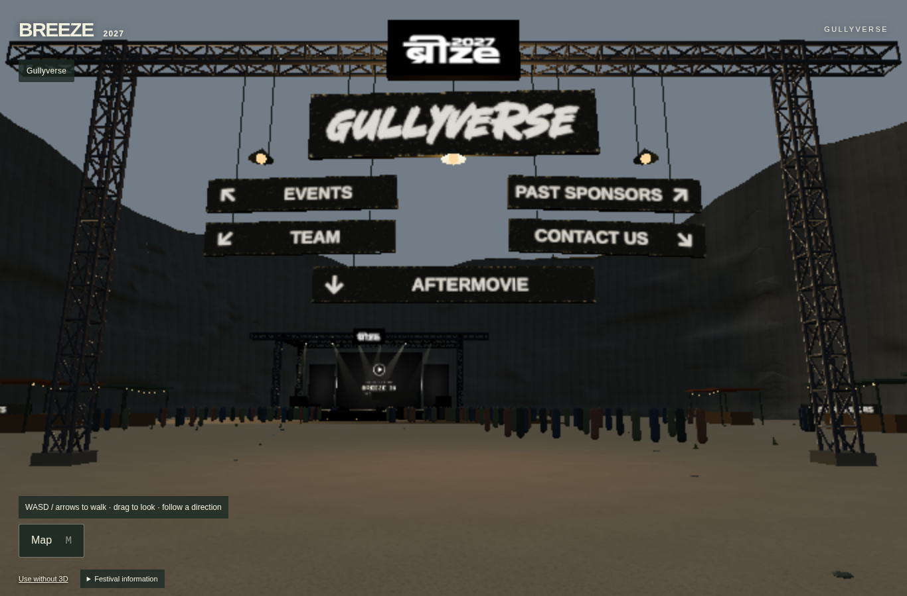
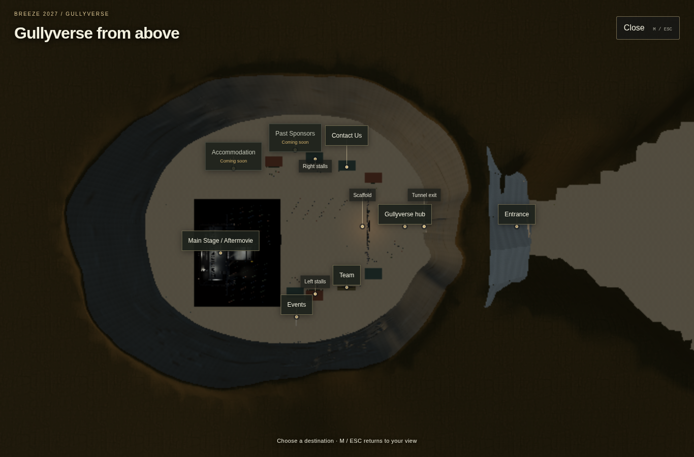
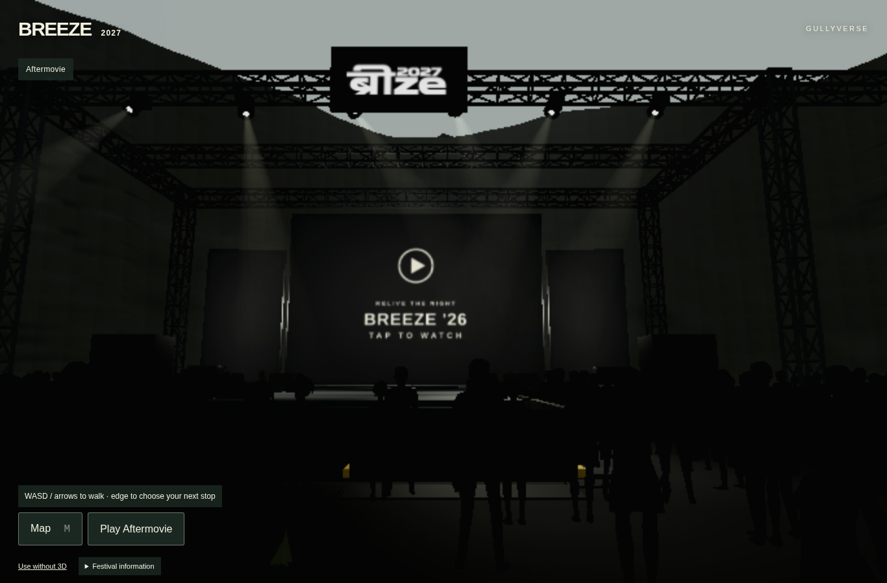

# Stage 2C.5.1 — WIP default activation

15 October 2026. Starting branch `codex/navigation-board`, HEAD `9dc8f1f5ed7c4991fcf52345d576cbde20fa555d`; both remote branches matched that revision. The user explicitly requested updating the WIP link after confirming Stage2C.5.1 was implemented but still opt-in.

Only one application line changes: the ordinary quarry default now creates `QuarryFoundationSession(runtime, true)`, selecting the exact existing `quarry-foundation-refined` geometry and material holder. This replaces the previous Stage2C.4 dark-rock default. No preview query or preview build flag is necessary. Review controls remain hidden on ordinary visits; explicit comparison modes, the disable flag and original-quarry escape remain available.

No new art was authored. Stage2C.5.1 Blender/GLB/material assets, original stage/crowd/LED/video assets, lighting, exposure, fog, camera/world coordinates, scaffold/stalls, movement bounds, navigation, routes and unrelated functionality are unchanged. The existing covered preparation, private owner/cache, LOD and failure-to-connected-baseline behavior are reused.

## Pre-push verification

- Production build with the wall-preview flag disabled: PASS, including lint with the existing warning policy.
- TypeScript: PASS. All 79 immersive unit tests: PASS.
- Actual production-build browser journey: PASS for intentional fresh entry; exact refined geometry/material requests; `refinement=true` and `foundationEnabled=true`; expected `Foundation_Dark_Rock_PBR` / `Foundation_Dry_Terrain_PBR` materials; no Stage2C.4/limestone/old-foundation downloads; no review UI; valid aerial markers; same Canvas through map/Aftermovie; real playback/exit and camera restoration; boundary return; Back/Forward; reload retaining Stage2C.5.1 without a review URL.

[Browser result](raw/local-after.json) · [Build](raw/build.log) · [Unit tests](raw/unit-tests.log) · [TypeScript](raw/typecheck.log) · [Baseline](raw/baseline.json) · [Reproduction script](scripts/verify-wip.mjs).

These are unmodified browser captures. Metadata records camera, viewport, DPR, quality and material properties. Chromium 151/SwiftShader checks are functional diagnostics; no physical GPU/mobile performance acceptance or final-art approval is claimed. Existing Stage2C.5.1 visual limitations remain recorded in the original refinement report.

After push, the Git-linked WIP deployment is verified independently against the actual refined resource requests. Local results alone do not establish that the public alias has updated.
