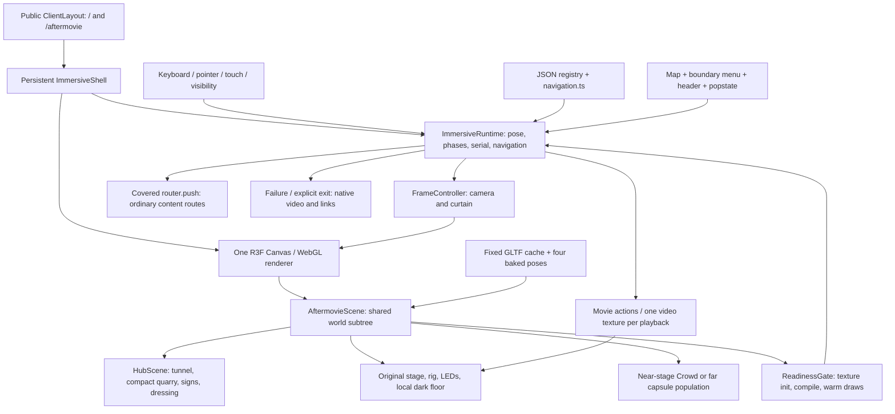

# Breeze 2027 — verification and handoff

Audit date: **10 October 2026, UTC**. Scope: the current navigation worktree, including the already implemented, uncommitted compact-quarry changes. Verification only; no production fixes, redesign, optimization, deployment, commit, or push.

**Verdict: usable as a two-location blockout under the constrained browser profile; not ready for production or photorealistic visual acceptance.** The complete journey works after visitor activation. Held-input focus handling and ordinary-navbar intro bypass fail. Repeated playback increases settled renderer texture counts (25→28 over four visits), indicating a suspected resource lifecycle leak. The stage assets are preserved, but environment and crowd-density changes mean the presentation is not unchanged. Software-rendered performance is poor; supported physical-device targets remain unverified.

## 1. Revision, scope, and implementation summary

The audited project is `/workspace/Breeze-2027-navigation`, branch `codex/navigation-board`, HEAD **`8919589d47385efd674ca91b52376f1ad310b797`**. HEAD alone does **not** reproduce this audit: the compact quarry and restored stage surroundings are uncommitted. [Initial Git status](raw/git-status-before.txt), [history](raw/git-log.txt), [working-tree patch](raw/changes-since-head.patch), and the [new AftermovieEnvironment source snapshot](raw/untracked-AftermovieEnvironment.tsx.txt) capture the starting state. The patch does not include that initially untracked source; use both artifacts.

Initial production changes: `AftermovieScene.tsx`, `HubScene.tsx`, `ImmersiveShell.tsx`, `aerial.ts`, `blockoutGeometry.ts`, `blockout.layout.json`, `tests/immersive/runtime.test.ts`; new `AftermovieEnvironment.tsx`. Audit outputs and generated build/test caches are additional verification artifacts. Final source-integrity evidence is listed in section 13. Other existing worktrees were left unchanged.

| Revision | Role in this review |
| --- | --- |
| `dd4879f17ea0c5a86907630249b809698bfa628e` | Locally available `origin/main`; does not contain the completed slice |
| `b1ed3a8` | Immediate pre-slice stage/contact/team baseline |
| `fe51c10bf34e68baaffc4c01210d1de57d42df96` | `origin/work-in-progress-2027`; persistent navigation/payment implementation and requested original stage presentation |
| `fbeb430c11f2c4cd00057067e986018427d59fc4` | Larger shared-world composition, aerial map, boundary navigation, reference pack; audited on 9 October |
| `8919589` + starting working tree | Accepted navigation scaffold/typography plus compact quarry and open rear stage sightline; this audit |

The unavailable original full implementation prompt cannot be reconstructed with certainty. Deviations below are against this audit's requested acceptance criteria, the supplied reference pack, and the later explicit user changes. Later user requests supersede image details such as Main Stage/Accommodation signs. The separate Live Timeline branch is outside this branch's ancestry and is not claimed as implemented here.

### Implemented components and decisions

| Area | Actual implementation and important source |
| --- | --- |
| Persistent immersive shell | [ClientLayout](<../../app/(user)/ClientLayout.tsx>) dynamically mounts [ImmersiveShell](../../components/immersive/ImmersiveShell.tsx), one Canvas across `/` and `/aftermovie`; page components supply metadata/noscript content |
| Runtime/camera | [ImmersiveRuntime](../../components/immersive/runtime.ts): `enter`, `requestDestination`, `tick`, `cameraPose`, `markReady`, `setMovie`, recovery; mutable pose and velocity, discrete React snapshots |
| Spatial navigation | [navigation.ts](../../components/immersive/navigation.ts): `destinationOptions`, `travelZones`, `boundaryCrossings`, `crossedHubDestination`, `constrain`; [world.ts](../../components/immersive/world.ts) and [layout registry](../../public/models/gullyverse/blockout.layout.json) share metre-based positions, bounds, spawns, and markers |
| Tunnel/entrance | [blockoutGeometry.ts](../../components/immersive/blockoutGeometry.ts): `portalGeometry`, `tunnelGeometry`, `exitGeometry`; bent 42 m passage, current cave/entrance preserved; [worldPaint.ts](../../components/immersive/worldPaint.ts) generates wall-following artist graffiti and surface textures |
| Compact open quarry | `quarryGeometry` restores 25 faceted WIP-style dodecahedron rock masses, fitted outside the collision perimeter. Footprint changed from about 163×190 m to **97.8×123.5 m**. Stage/stalls remain full scale; positions moved inward |
| Hanging wayfinding | [HubScene](../../components/immersive/HubScene.tsx): `Scaffold`, `WorldSign`; actual stage `Trusses` front beam/logo and side beams reused. Width 24 m, height 14.5 m, origin `[0,0,-70]`; Gullyverse-only header 10×2.4 m at height 11.4 m; Events↖/Past Sponsors↗ at 8.8 m, Team↙/Contact Us↘ at 7.25 m, Aftermovie↓ at 5.65 m; common navigation type size 0.58 m; Main Stage and Accommodation hanging boards removed |
| Hub dressing | `StallBlocks`, `Population`, `GroundDetail`, hanging lamps and cables; procedural box stalls, capsule population, grass/gravel, current generated ground retained. Separate real Team/Contact pages still exist; their hub anchors are blockouts |
| Shared original stage | [AftermovieScene](../../components/immersive/AftermovieScene.tsx) mounts original Stage/Trusses/Speakers/Barricades/LEDs/Lights/Fireworks in the same quarry. Stage origin now **`[-12,0,-134.3]`**, yaw 0; no duplicate closed rocky enclosure behind the visitor |
| Stage surroundings | New [AftermovieEnvironment](../../components/immersive/AftermovieEnvironment.tsx) owns a local 49×39 m dark floor and cream Gullyverse return placard; replaces the original 70 m radius dark circle and separate stage rock ring. `HubScene.stageView` selects original greenish stage hemisphere/fog/background; map uses hub lighting |
| Bounded viewing | Spawn `[-10.5,1.72,-110.8]`; arrival `[-10.5,1.72,-106.8]`. Existing 16×12.2 m chamfered walking region translated with stage without resizing. Any outward boundary attempt presents destination menu; Stay/Escape disarms it until moving back inside |
| Original crowd/video | [Crowd](../../components/landing-page/stage3d/Crowd.tsx) uses original male/female models, seeded placement, four baked static poses, 900/600/300 people by quality. Existing central lane rule restored by default `clearApproach=false`. [useStageVideo](../../components/landing-page/stage3d/useStageVideo.ts) shares one texture across LED panels and retains 900 ms focus-delay/range playback |
| Aerial navigation | [WorldOverlays](../../components/immersive/WorldOverlays.tsx): `AerialMap`, `MapMarkerProjection`, `DestinationMenu`, `useOverlayFocus`; [aerial.ts](../../components/immersive/aerial.ts) fits and interpolates the same world camera. This is a full-screen **3D aerial map**, not a literal 2D map |
| Preparation/recovery | [rendering.tsx](../../components/immersive/rendering.tsx): `ReadinessGate`, `FrameController`, `SceneRenderer`; texture upload, shader compile, hidden warm frames, serial guards, adaptive DPR, 45 s fallback, context-loss recovery |
| Input/accessibility alternatives | [input.ts](../../components/immersive/input.ts): keyboard arrows/WASD, drag look, touch axes, ownership clearing, reduced motion, blur/visibility handlers; shell offers explicit non-3D native-video/content fallback |
| Diagnostics/delivery tooling | [diagnostics.ts](../../components/immersive/diagnostics.ts), runtime unit tests, existing performance/navigation scripts, reference imagery, and [environment delivery contract](../../docs/gullyverse-environment-pipeline.md) |

Function/line index: [source-index.txt](raw/source-index.txt). Full historical main-to-branch inventory: [changed-files-main.txt](raw/changed-files-main.txt), [diff stat](raw/implementation-diff-stat.txt). This broad inventory also includes earlier contact/team and payment reconciliation work; it is not all attributable to the latest scenery changes. Payment previews, order/statement matching, admin protection, and isolated integration tests remain present and were checked without live transactions.

**Preserved:** current cave/entrance/tunnel, generated quarry ground, unscaled principal stage model, original male/female model files and movie, stage-local rig layout, bounded-crossing/menu behavior, public Events/Team/Contact routes and original forms. Active immersive entry replaces the legacy GateHero/standalone ConcertStageHero/TravelOverlay route usage; those source components remain in the repository rather than being deleted. The latest change removes the separate closed Aftermovie rock ring and the broad dark circle from the active scene, not the original stage GLB.

**Libraries:** [exact package changes](raw/library-changes-main.json) show React/ReactDOM 18→19.0.8 and corresponding type upgrades; added `@napi-rs/canvas`, `papaparse`, `pdf-parse`, `qrcode`, `tesseract.js`, Playwright, `tsx`, embedded PostgreSQL, `pdf-lib` and related types; `react-remove-scroll` override 2.6.3. Most additions support payments/testing rather than immersive rendering. Existing Next 15.3.8, Three 0.169 and R3F 9 are retained. The latest uncommitted environment changes add no library.

**Partial/missing work:** photorealistic authored quarry/tunnel assets; PBR rock/concrete/paint variation; final stall population/dressing; destination content integrated into a continuously persistent renderer; real-device performance acceptance; independently streamed detailed destination collections. Sponsors/Accommodation remain disabled “Coming soon” map destinations; a Sponsors direction sign is still shown. No additional immersive destination was implemented by this audit.

**Acceptance differences:** landing requires visitor activation before automatic choreography; ordinary navbar Home repeats the intro; literal 2D map is replaced by the later requested aerial view; complete hub/stage resources stay resident rather than independent whole-scene unloading; active shell has no proximity/hover crowd prefetch. Reference imagery's text, sign hierarchy, dark green stage lighting and compactness must be assessed against later user revisions, not copied literally from the first image.

## 2. Acceptance-test matrix

PASS means observed browser behavior for the stated scenario/profile. PARTIAL distinguishes working subsets or limitations. NOT TESTED means no valid observation. Source inspection alone never earns PASS. PASS is limited to the explicitly named scenario; it does not certify all devices, all media events, or every transition interruption. Browser data: [full audit](raw/browser-audit.json), [loading/media/recovery](raw/edges-and-media.json), [additional navigation](raw/navigation-details.json); scripts are under [scripts](scripts/).

<!-- ACCEPTANCE_MATRIX -->

| Step / requirement | Expected | Status | Actual observation | Evidence | Relevant code | Outstanding problem / scope |
| --- | --- | --- | --- | --- | --- | --- |
| Landing → automatic intro | Automatic tunnel without further activation | FAIL | Landing remains until Enter/click/tap; automatic cinematic follows activation | [browser checks](raw/browser-audit.json), [entrance](screenshots/01-desktop-entrance.png) | ImmersiveShell landing / runtime.enter | Literal automatic-entry criterion not met |
| Tunnel interior → reveal | Continuous first-person trip into open quarry | PASS | Observed bent traversal, last tunnel section and sky reveal | [02](screenshots/02-desktop-tunnel-interior.png), [03](screenshots/03-desktop-tunnel-before-reveal.png), [04](screenshots/04-desktop-quarry-reveal.png), [video](recordings/full-journey.webm) | runtime.tick; tunnelGeometry | Pacing slows with low FPS |
| Hub arrival / direction board | High hanging signs and open hub | PASS | Current Gullyverse-only board, diagonal directions and lower Aftermovie↓ observed | [05](screenshots/05-desktop-hub-arrival-board.png) | HubScene.Scaffold | Temporary environment assets |
| Local hub keyboard movement | WASD/arrows walk; drag looks | PASS | Actual pose displacement in uninterrupted journey and clean movement run | [07](screenshots/07-desktop-hub-movement.png), [browser](raw/browser-audit.json) | useImmersiveInput; runtime.tick | Not physical-device acceptance |
| Aftermovie direction → travel | Cross route threshold; covered travel; correct arrival | PASS | Public physical route completed; same Canvas and /aftermovie | [journey](raw/browser-audit.json), [clean window](raw/performance.json) | boundaryCrossings / requestDestination | Aftermovie sector is behind spawn, consistent with downward sign; first crowd prep is slow |
| Aftermovie arrival / viewing | Original stage and playback accessible | PASS | Stage/screens/crowd present; movie time advances and LEDs show movie | [08](screenshots/08-desktop-aftermovie-arrival.png), [09](screenshots/09-desktop-aftermovie-viewing-area.png), [11](screenshots/11-desktop-aftermovie-playback.png) | AftermovieScene; useStageVideo | Density adapts; sound hardware/quality-0 pyro not tested |
| Bounded Aftermovie movement | Outer edges clamp and show menu; Stay/Escape keeps pose | PARTIAL | Recorded journey edge passed; additional full-perimeter results below are authoritative | [12](screenshots/12-desktop-boundary-menu.png), [edge tests](raw/navigation-details.json) | constrain / dismissDestinationMenu | Assess all eight separately |
| Aftermovie → hub | Boundary menu returns to local hub | PASS | Return to Hub completed in recording and clean benchmark | [video](recordings/full-journey.webm), [performance](raw/performance.json) | runtime.requestDestination | Same logical coordinator, no entire scene unload |
| 2D map → Aftermovie | Map provides correct destination | PARTIAL | Full-screen 3D aerial map navigates correctly; literal 2D map absent | [10](screenshots/10-desktop-aerial-map.png), [journey](raw/browser-audit.json) | AerialMap; MapMarkerProjection | Later reference pack requests aerial view; projection console errors during a transition |
| Direct /aftermovie | Bypass landing/tunnel | PASS | Observed phases omit landing/entrance | [direct URL check](raw/browser-audit.json) | locationFromPath / constructor | Only two immersive URL IDs |
| Standard navbar navigation | Home bypasses intro | FAIL | From Contact, Home returns landing/Enter | [navbar check](raw/browser-audit.json) | Navbar.handleHomeClick; ClientLayout | Previously observed gap persists |
| Immersive header return | Breeze header returns hub without intro | PARTIAL | Media-cycle check uses the real header; final repeated-media result below qualifies it | [media cycles](raw/media-cycles.json) | ImmersiveShell header runtime.request | Separate from ordinary navbar |
| Browser Back/Forward | Correct location; renderer retained | PASS | Observed local destination and same Canvas both ways | [history check](raw/browser-audit.json) | native history / popstate / request | No full-tab reload persistence claim |
| Already focused editable input | New movement key has no effect | PASS | Injected focused input; before/after pose unchanged | [focus fixture](raw/browser-audit.json) | input.ts down target guard | Fixture in DOM, not a production form |
| Held movement → editable focus | Immediately release prior held movement | FAIL | x moved about 1.47 m while injected textarea had focus | [held-focus failure](raw/browser-audit.json) | input.ts lacks focusin clearing | Input keydown filtering does not clear stored key state |
| Control handoffs / repeat travel | Release during modal/travel/movie; usable on arrival | PARTIAL | Full journey, repeated maps/history and resize work; focus exception remains | [browser](raw/browser-audit.json), [navigation detail](raw/navigation-details.json) | ownership subscription; runtime.clearInput | Use separate movie restore/cycle assertions below |
| Reduced motion | Skip long tunnel; reduced motion flag respected | PASS | Observed hub in 968 ms after entry under reduce preference | [reduced-motion check](raw/browser-audit.json) | input media query / runtime.tick | No physical vestibular/user study |
| Mobile entry / available touch | Tap entry, touch movement/look, map and movie | PASS | 390×844 browser emulation completed; actual touch event pose changes; movie advances | [mobile captures](screenshots/mobile-03-hub.png), [touch check](raw/browser-audit.json) | touch pad / pointer drag | Browser emulation only; no real mobile GPU/FPS certification |
| Resize / orientation | Runtime and controls survive size change | PASS | Same Canvas, movement after 1024×700; 844×390 touch-emulated stage capture | [resize check](raw/browser-audit.json), [landscape](screenshots/mobile-07-landscape.png) | FrameController / composeCamera | One Chromium viewport sample |
| Synthetic blur/focus | Release held axes and resume | PASS | Dispatched blur/focus; pose held stable | [synthetic evidence](raw/browser-audit.json) | input blur/focus | Not an actual backgrounded OS tab |
| Delayed crowd GLB stays covered and eventually arrives | Opaque curtain until Crowd and render preparation ready | PASS | A 3 s delayed GLB kept boot covered (opacity 1); then reached local Aftermovie | [raw check](raw/edges-and-media.json) | AftermovieScene / ReadinessGate | Only the named Chromium/profile scenario was tested |
| Failed stage GLB provides native-video/content fallback | No Canvas; native controlled video and content links | PASS | Observed Canvas count 0, native controlled video and festival links | [raw check](raw/edges-and-media.json) | ImmersiveShell.SceneBoundary / Fallback | Only the named Chromium/profile scenario was tested |
| Context loss/recovery restores walking pose and same Canvas | Recover same Canvas and saved walking pose under cover | PASS | WEBGL_lose_context restored the same Canvas and exact saved walking pose; recovery curtain observed | [raw check](raw/edges-and-media.json) | runtime.loseContext / restoreContext; FrameController | Only the named Chromium/profile scenario was tested |
| Actual tab background clears held input and restores usable view | Real hidden tab clears held input; foreground recovers | NOT TESTED | document.hidden remained false; true visibility change unavailable | [raw check](raw/edges-and-media.json) | input.visibility / blur / focus | Only the named Chromium/profile scenario was tested |
| Aftermovie outer edge 0 clamps and presents menu; Escape stays | Clamp inside polygon, open menu, Escape preserves pose | PASS | Outward walking clamped at this face and opened menu; Escape preserved the boundary pose | [raw check](raw/navigation-details.json) | navigation.constrain; runtime.dismissDestinationMenu | Only the named Chromium/profile scenario was tested |
| Aftermovie outer edge 1 clamps and presents menu; Escape stays | Clamp inside polygon, open menu, Escape preserves pose | PASS | Outward walking clamped at this face and opened menu; Escape preserved the boundary pose | [raw check](raw/navigation-details.json) | navigation.constrain; runtime.dismissDestinationMenu | Only the named Chromium/profile scenario was tested |
| Aftermovie outer edge 2 clamps and presents menu; Escape stays | Clamp inside polygon, open menu, Escape preserves pose | PASS | Outward walking clamped at this face and opened menu; Escape preserved the boundary pose | [raw check](raw/navigation-details.json) | navigation.constrain; runtime.dismissDestinationMenu | Only the named Chromium/profile scenario was tested |
| Aftermovie outer edge 3 clamps and presents menu; Escape stays | Clamp inside polygon, open menu, Escape preserves pose | FAIL | AssertionError [ERR_ASSERTION]: Expected values to be strictly deep-equal:; strict x equality differs by approximately 1e-15 m; clamp/menu assertions already passed | [raw check](raw/navigation-details.json) | navigation.constrain; runtime.dismissDestinationMenu | Retained failure; see qualification below; no production fix |
| Aftermovie outer edge 4 clamps and presents menu; Escape stays | Clamp inside polygon, open menu, Escape preserves pose | PASS | Outward walking clamped at this face and opened menu; Escape preserved the boundary pose | [raw check](raw/navigation-details.json) | navigation.constrain; runtime.dismissDestinationMenu | Only the named Chromium/profile scenario was tested |
| Aftermovie outer edge 5 clamps and presents menu; Escape stays | Clamp inside polygon, open menu, Escape preserves pose | PASS | Outward walking clamped at this face and opened menu; Escape preserved the boundary pose | [raw check](raw/navigation-details.json) | navigation.constrain; runtime.dismissDestinationMenu | Only the named Chromium/profile scenario was tested |
| Aftermovie outer edge 6 clamps and presents menu; Escape stays | Clamp inside polygon, open menu, Escape preserves pose | PASS | Outward walking clamped at this face and opened menu; Escape preserved the boundary pose | [raw check](raw/navigation-details.json) | navigation.constrain; runtime.dismissDestinationMenu | Only the named Chromium/profile scenario was tested |
| Aftermovie outer edge 7 clamps and presents menu; Escape stays | Clamp inside polygon, open menu, Escape preserves pose | PASS | Outward walking clamped at this face and opened menu; Escape preserved the boundary pose | [raw check](raw/navigation-details.json) | navigation.constrain; runtime.dismissDestinationMenu | Only the named Chromium/profile scenario was tested |
| Map close restores bounded pose and disabled destinations remain unavailable | Saved pose restored; unavailable options disabled | PASS | Map close restored exact saved pose; Sponsors and Accommodation buttons remained disabled | [raw check](raw/navigation-details.json) | runtime.setMap; AerialMap | Only the named Chromium/profile scenario was tested |
| Playback eventually restores the exact visitor pose and releases walking | Saved activation pose restored, then fresh walking works | FAIL | page.waitForFunction: Timeout 30000ms exceeded.; target was read before clicking while inertia remained. Fresh activation-event probes pass and reproduce a 7 cm read→activation shift | [raw check](raw/navigation-details.json) | runtime.setMovie / tick; useStageVideo | Retained failure; see qualification below; no production fix |
| Manual Use without 3D removes Canvas and exposes native playback | No Canvas; native controlled video and content links | PASS | Observed Canvas count 0, native controlled video and festival links | [raw check](raw/navigation-details.json) | ImmersiveShell.SceneBoundary / Fallback | Only the named Chromium/profile scenario was tested |
| Higher-resolution hub, map and front/rear stage captures | Actual desktop stills at native DPR1, including stage | FAIL | AssertionError [ERR_ASSERTION]: Critical scene preparation exceeded 45 seconds. | [raw check](raw/navigation-details.json) | ReadinessGate / quality policy / Shell45s timeout | Retained failure; see qualification below; no production fix |
| Four repeated playback/return cycles release media and keep GL resources bounded | Playback and return function; textures/geometries/programs bounded | FAIL | Four functional play/return visits completed; settled Three textures increased 25→28 (GL allocation counter 29→32) | [raw check](raw/media-cycles.json) | useStageVideo.stopMovie; LEDScreens sampler reset | Retained failure; see qualification below; no production fix |
| Movie restores stable activation pose | Saved activation pose restored, then fresh walking works | PASS | Actual activation-event pose restored; held movement rejected during playback and fresh walking worked afterward | [raw check](raw/playback-restoration.json) | runtime.setMovie / tick; useStageVideo | Only the named Chromium/profile scenario was tested |
| Movie restores activation pose after moving (inertia accounted) | Saved activation pose restored, then fresh walking works | PASS | Actual activation-event pose restored; held movement rejected during playback and fresh walking worked afterward | [raw check](raw/playback-restoration.json) | runtime.setMovie / tick; useStageVideo | Only the named Chromium/profile scenario was tested |

<!-- END_ACCEPTANCE_MATRIX -->

The failure ledger retains initial verification defects: edge3 strict equality differed by about 1e-15 m; an early movie test targeted a pre-click position while movement inertia continued. [Fresh activation-pose tests](raw/playback-restoration.json) restore the actual saved pose in 6.00/6.53 s and reproduce a 7 cm read-to-activation shift. The existing navigation suite's separate 1 s return assertion still fails on this VM. These are distinct from the reproducible input focus bug and repeat-play texture growth.

Initial and mobile journey captures used public controls, not runtime teleports. An injected DOM input/textarea was used only to exercise focus ownership because normal content forms live outside the immersive shell. Synthetic blur/focus is labelled as such. Actual tab-background status is separately reported and never inferred from a dispatched event. Hardware audio, screen-reader behavior, Safari/Firefox, physical mobile multitouch/thermal conditions and all transition interruption timings remain outside this browser sample.

## 3. Architecture verification

### Rendering and camera ownership

One R3F Canvas/WebGL context is observed throughout the tested `/`↔`/aftermovie` journey, map travel and Back/Forward. `ImmersiveShell` owns it; `ClientLayout` preserves that component for those two paths. A reload or travel to ordinary content unmounts it; Team and Contact have their own route-specific Canvas implementations. Multiple Canvas declarations in the source are not simultaneous contexts in the tested immersive pair.

The actual rendering subtree is shared: `AftermovieScene` is unconditionally mounted and contains **HubScene + original stage + local stage floor**. Only near-stage Crowd versus far capsule detail switches. The architecture does **not** independently load/unload complete Hub and Aftermovie scenes. Fixed GLTF and baked-pose caches retain reusable resources; this is a residency policy, not proof that all GPU memory is disposed after departure.

`ImmersiveRuntime` is the camera/state authority. `FrameController` ticks it, writes position/quaternion/FOV using YXZ Euler order, and updates the curtain. `SceneRenderer` owns manual rendering at positive frame priority. `ReadinessGate` can temporarily write the intended arrival/recovery camera under the opaque curtain. There are no competing public OrbitControls/PointerLockControls owners in this slice.

Modes: boot→landing→entrance→local, departure→covered→arrival, map ascent/open/descent, movie focus/restore, context-lost/recovering, error. Smoothstep blends positions/pitch and shortest-angle yaw. Entry follows the bent tunnel centreline and damped heading; physical departure retains a short velocity tangent. Map saves the current pose and rises above the same geometry; playback saves the bounded walking pose and restores it afterward. Ownership changes clear keys, virtual pad, drag and velocities. The reproduced input-focus transfer bug is an exception.

`tick` clamps elapsed delta to **50 ms**, including cinematic clocks. This prevents large background jumps but stretches authored 7.2 s entry, 0.9 s movie focus/restore, and short travel moves on slow renderers. State/pose consistency is tested; smooth 60 FPS pacing is not established. The native profiler timeout and long measured entry wall time demonstrate the consequence on this VM. A separate requested-DPR1 stage capture reached the 45 s preparation deadline and selected fallback; native stage stills were therefore not produced by that capture attempt. This failure is retained, not substituted with a concept image.

### Navigation graph and URLs

`navigation.ts` and the JSON registry are shared by travel thresholds, DOM destination options, map markers, obstacle bounds, spawns and arrivals. Both physical crossing and map choice reach `requestDestination`; native history and `popstate` resolve `/`/`/aftermovie` through the same coordinator. Direct `/aftermovie` initializes covered arrival without tunnel. Hub and Aftermovie have logical connections plus separate arrival-start/spawn poses; return menus identify Hub, Entrance and existing content routes. Content routes fade to covered before `router.push` and leave the shell. Disabled destinations refuse travel.

The graph supports extension, but `LocationId` currently contains exactly two immersive IDs; content destinations are handled separately. Adding another fully resident 3D destination requires explicit type/route/scene/readiness integration and a memory budget. It is not a fully generic destination streaming manager already ready for arbitrary heavy environments.

### Loading, shader preparation, and release

Initially: shell JS, fonts, procedural quarry/tunnel/nav geometry and Canvas textures, original stage GLB/logo/LED resources; the whole stage is instantiated even on landing. Crowd models load on the first request that makes `nearStage` true. Movie transfer starts after Play, with 900 ms focus delay and HTTP Range/progressive media loading. No movie bytes are intentionally prefetched on landing.

The lazy module boundary is initial loading, not destination-specific unload. Legacy `warmStage`, `warmCrowd` and `useLoader.preload` call sites exist in inactive GateHero/ConcertStageHero code; no such hover/proximity trigger exists in active ImmersiveShell. Warm repeat visits benefit from loader and baked-geometry caches.

Readiness waits for font suspension, critical GLTF mounting and all four crowd variants, traverses material maps and ShaderMaterial texture uniforms, initializes **non-video** textures, awaits `gl.compileAsync`, flushes two draw frames, then measures twelve warm frames at the final composition. Slow Aftermovie warm windows step through lower quality tiers before reveal. Travel serials invalidate stale preparation. `SceneRenderer` avoids prematurely drawing unprepared critical subtrees. If asset/compile work outlasts travel, the curtain stays opaque; after 45 s the native-video/content fallback is offered. Actual delayed/aborted-asset checks support this mechanism, without certifying every timeout/interruption case.

Shaders and mapped static textures are prepared before reveal; geometry outside the warmed final camera view can still upload lazily on first visibility (fresh direct stage 115 geometries versus 154 after a full journey). This scan does not prove every camera angle is fully GPU-warmed; first-play VideoTexture is created/uploaded afterward and is excluded from the critical readiness scan. Reduced-motion and quality tiers also change which effects execute. This is not proof every future shader/light/media variant is precompiled. Normal repeat travel disposes crowd instance buffers/material and regenerates some programs while shared stage/world assets remain resident. Explicit media stop and component-unmount paths are detailed in section 5.



## 4. Actual performance benchmarks

<!-- PERFORMANCE_RESULTS -->

Environment: **Chromium 151.0.7922.173, Debian 13.6/Linux x86-64**, AMD EPYC 9V74 VM (3 exposed vCPUs, cgroup quota **2 CPU cores**, 8 GiB memory cap), ANGLE Vulkan **SwiftShader** software renderer. No `/dev/dri` hardware GPU. This is a cloud VM/software-renderer device class, not representative desktop/iGPU or physical mobile. [Host facts](raw/host-capabilities.json).

Clean journey profile: **1366×900 CSS, requested/actual DPR 0.25** (about 342×225 rendering pixels). Default adaptive graphics policy unchanged: quality 0/1/2/3 caps DPR 1.25/1/.75/.6 and crowd 900/600/300; the browser DPR 0.25 remains below all caps. Antialias off, existing high-performance preference, no CPU throttling. Raw snapshots record exact tier/DPR per window. A separate native-DPR1 profile is below. Touch captures use emulation, not mobile performance measurements.

Method: [performance.mjs](scripts/performance.mjs), [raw frames/network/preparation/memory](raw/performance.json), [log](raw/performance.log). One graphics benchmark at a time, production server, no recording/screenshots during timed windows; DOM/diagnostics read after each sample. Diagnostics instrument `gl.render` and record actual R3F deltas; **finite cpuRenderMs** distinguishes drawn frames from loading-only animation ticks. Average FPS below is actual draw count / total measured wall time, including covered work; render-cadence FPS is also retained in raw data. Median/p95/p99 refer to sorted drawn-frame deltas, not CPU submission time or necessarily unique displayed frames. Transition windows include control/navigation/covered preparation (and map ascent where used); physical route window also includes walking to the nearby threshold. Tunnel/reveal rows are subsets of the same entry sample. Short-window p99 may equal the maximum; raw sample counts permit independent interpretation. Screenshot/video contexts are separate.

| Scenario | Wall s | Avg draws/s | Median ms | p95 ms | p99 ms | Max ms | Stalls >50 / >100 ms | Last calls / triangles | Textures / geometries | Quality / DPR | Sampled JS heap MiB |
| --- | --- | --- | --- | --- | --- | --- | --- | --- | --- | --- | --- |
| cold-landing-load | 5.54 | 4.15 | 142.7 | 187.0 | 1,385.9 | 1,385.9 | 22 / 22 | 155 / 105022 | 25 / 150 | 0 / 0.25 | 30.6 |
| warm-same-browser-cache-landing-load | 5.03 | 4.57 | 144.9 | 239.3 | 1,313.1 | 1,313.1 | 22 / 21 | 155 / 105022 | 25 / 150 | 0 / 0.25 | 42.1 |
| tunnel-and-first-hub-arrival | 16.95 | 8.67 | 114.5 | 162.0 | 169.5 | 178.2 | 147 / 105 | 138 / 100818 | 25 / 150 | 0 / 0.25 | 28.7 |
| first-hub-arrival-settling | 3.00 | 10.65 | 97.7 | 115.5 | 151.4 | 151.4 | 32 / 14 | 138 / 100818 | 25 / 150 | 1 / 0.25 | 32.4 |
| hub-local-movement | 6.29 | 11.29 | 93.6 | 107.8 | 147.3 | 147.3 | 71 / 9 | 138 / 93258 | 25 / 150 | 2 / 0.25 | 39.7 |
| hub-to-aftermovie-physical-route | 15.12 | 5.09 | 102.9 | 349.9 | 1,028.7 | 1,028.7 | 76 / 57 | 115 / 1020152 | 25 / 154 | 3 / 0.25 | 26.5 |
| aftermovie-local-movement | 6.99 | 3.29 | 318.6 | 370.7 | 376.4 | 376.4 | 23 / 23 | 115 / 1020152 | 25 / 154 | 3 / 0.25 | 24.6 |
| aftermovie-boundary-return-to-hub | 6.33 | 6.64 | 100.0 | 308.9 | 379.4 | 379.4 | 41 / 20 | 138 / 93258 | 25 / 154 | 3 / 0.25 | 25.3 |
| map-to-aftermovie | 13.58 | 5.82 | 98.4 | 355.0 | 378.5 | 378.5 | 78 / 35 | 115 / 1020152 | 25 / 154 | 3 / 0.25 | 24.8 |
| repeat-1-aftermovie-hub | 16.58 | 4.76 | 227.5 | 362.5 | 391.2 | 391.2 | 78 / 58 | 138 / 93258 | 25 / 154 | 3 / 0.25 | 25.4 |
| repeat-1-hub-aftermovie | 12.48 | 6.41 | 99.8 | 333.8 | 350.1 | 350.1 | 74 / 38 | 115 / 1020152 | 25 / 154 | 3 / 0.25 | 23.7 |
| repeat-2-aftermovie-hub | 15.70 | 5.03 | 221.3 | 314.8 | 371.8 | 371.8 | 78 / 64 | 138 / 93258 | 25 / 154 | 3 / 0.25 | 24.8 |
| repeat-2-hub-aftermovie | 13.31 | 5.94 | 101.4 | 359.0 | 378.1 | 378.1 | 76 / 43 | 115 / 1020152 | 25 / 154 | 3 / 0.25 | 25.3 |
| repeat-3-aftermovie-hub | 16.19 | 4.88 | 232.4 | 317.6 | 369.2 | 369.2 | 78 / 59 | 138 / 93258 | 25 / 154 | 3 / 0.25 | 24.5 |
| repeat-3-hub-aftermovie | 13.81 | 5.72 | 102.6 | 377.6 | 401.7 | 401.7 | 77 / 41 | 115 / 1020152 | 25 / 154 | 3 / 0.25 | 25.4 |
| tunnel-interior | 7.10 | 8.45 | 114.9 | 159.5 | 169.5 | 169.5 | 60 / 48 | — / — | — / — | — / — | — |
| quarry-reveal | 4.27 | 10.31 | 96.7 | 125.7 | 148.5 | 148.5 | 44 / 16 | — / — | — / — | — / — | — |

| Load | Landing ready ms | Resource transfer bytes | Encoded body bytes (cache included) | Zero-transfer entries | Preparation wall times |
| --- | --- | --- | --- | --- | --- |
| cold-landing-load | 5,541.0 | 5474738 | 5465138 | 0 | gltf-parse-to-ready 7.1 ms; texture-initialization 51.9 ms; shader-compilation 33.2 ms; readiness-render-window 3164.2 ms |
| warm-same-browser-cache-landing-load | 5,028.0 | 1500 | 5440625 | 27 | gltf-parse-to-ready 3.7 ms; texture-initialization 49.5 ms; shader-compilation 27.3 ms; readiness-render-window 3052.1 ms |

These transfer sums are browser Resource Timing entries available at landing readiness, excluding the HTML navigation entry and any opaque/unrecorded external transfer. Cold means a fresh browser context/local client cache, **not a cold OS filesystem/CDN/server process**. Warm means same-browser HTTP cache enabled (CDP guards only API writes); cache flags and zero-transfer entries verify reuse. The earlier general browser-audit script uses Playwright routing, which disables HTTP cache; its “cold/warm” labels are **not** used as valid cache benchmarks here. Cached bytes remain encodedBodySize even with zero transfer. The largest cold landing transfer is a **4,586,644-byte `/404-image.png` preload** (about 84% of the measured resource transfer total), despite a successful landing route. `components/notFound.tsx` uses a priority image; whether Next fallback/preload hoisting is the exact trigger needs confirmation. It is not a visible immersive-scene asset. This pre-existing asset/preload path merits review, without changing it during this audit. Asset durations, navigation timing, GLTF parse-to-ready, init/compile/warm windows, movie Range and full network entries are in the raw files. Parse-to-ready includes asynchronous decode and is not CPU-only parsing time.

Selected actual compressed local GLB fetches: stage 30,904 transfer bytes / 31.4 ms; Man 174,553 / 51.6 ms; Woman 362,402 / 40.9 ms. These differ from uncompressed file lengths and are measured on localhost, not representative WAN. [Movie metadata](raw/movie-metadata.json) records 52,291,090 file bytes, 197.376 s, H.264 1920×1080 at 24 fps plus AAC. [Trace network evidence](raw/movie-range-from-trace.json) confirms `Range: bytes=0-` and HTTP206; streamed body size is unavailable (`-1`), so full movie transferred bytes are not claimed.

GPU timer extension is unavailable on this renderer: GPU frame duration and reliable VRAM are **not measurable**. CPU render submission and main-thread long tasks are recorded; they are not GPU time. The source-derived geometry and texture payload estimates are discussed below. Stalls remain recurring through repeat transitions; they are not hidden by a high average. Current shader compilation is performed covered, but no “no visible compilation hitch” target is certified on real hardware.


Native **1366×900 / requested DPR1**: [raw](raw/native-dpr1-profile.json), [script](scripts/native-profile.mjs), [log](raw/native-profile.log). Entry deliberately sampled for 20 s; it is a partial window, not a completed native journey. Adaptive tier/DPR remain visible.

| Window | Avg draws/s | Median ms | p95 ms | p99 ms | Max ms | Actual DPR | Quality | Calls | Triangles |
| --- | --- | --- | --- | --- | --- | --- | --- | --- | --- |
| native-landing-idle | 0.90 | 1,196.0 | 1,418.7 | 1,418.7 | 1,418.7 | 1 | 0 | 155 | 105022 |
| native-entrance-first-20s | 0.85 | 1,178.5 | 1,375.0 | 1,375.0 | 1,375.0 | 1 | 0 | 155 | 105022 |

Native profile error: `AssertionError [ERR_ASSERTION]: Critical scene preparation exceeded 45 seconds.`. Later unreached windows are NOT TESTED; retained samples are valid partial measurements.

Same-VM before/after: WIP `fe51c10` built in an isolated archive, versus audited working tree; sequential fresh contexts, **1366×900 / DPR.25**, same relative stage spawn and FOV58, idle and same public strafe input. [Raw comparison](raw/reference-comparison.json), [script](scripts/reference-compare.mjs), [baseline build](raw/reference-build.log). This compares stage-local rendering only; worlds and visual workloads differ. The WIP reference already contains the persistent slice; the pre-slice `b1ed3a8` has source/binary comparisons but no comparable full-journey performance run. One short run per scenario is not causal attribution, a confidence interval, or a complete pre/post implementation benchmark.

| Revision | Scenario | Avg draws/s | Median ms | p95 ms | p99 ms | Calls | Triangles | Quality | DPR |
| --- | --- | --- | --- | --- | --- | --- | --- | --- | --- |
| before-wip | matched-stage-idle | 3.75 | 284.9 | 306.1 | 357.1 | 121 | 981074 | 3 | 0.25 |
| before-wip | matched-stage-strafe | 3.68 | 286.8 | 336.1 | 336.1 | 121 | 981074 | 3 | 0.25 |
| after-working-tree | matched-stage-idle | 3.25 | 310.8 | 346.0 | 358.8 | 115 | 1020152 | 3 | 0.25 |
| after-working-tree | matched-stage-strafe | 3.26 | 326.1 | 361.4 | 361.4 | 115 | 1020152 | 3 | 0.25 |

| Intended target | Verdict |
| --- | --- |
| Smooth 60 FPS representative desktop / integrated GPU | **UNVERIFIED** — required physical hardware unavailable; VM measurements are poor |
| 60 FPS capable mobile | **UNVERIFIED** — no physical mobile GPU; emulation is not certification |
| Stable 30 FPS lower-end supported hardware | **UNVERIFIED** — no representative supported-device hardware tested |
| No recurring transition/compilation hitches | **Not achieved on available software profile; physical targets unverified.** Repeated tail stalls and covered waits are measured |

Existing native `npm run perf:immersive` failed waiting 60 s for hub arrival: [log](raw/existing-perf.log), [failure](raw/existing-perf/failure.txt). An earlier concurrent attempt was aborted and excluded ([log](raw/existing-perf-concurrent-aborted.log)); no contaminated result is treated as a benchmark. Historical 9 October performance was on a different run/configuration and is not mixed into today's table. No fabricated mobile benchmark or VRAM figure is supplied.


<!-- END_PERFORMANCE_RESULTS -->

## 5. Scene resource and memory lifecycle

<!-- RESOURCE_RESULTS -->

Six settled Hub↔Aftermovie rounds, same page/context, each sampled at Aftermovie after 1.2 s and explicit GC: [raw allocations](raw/resource-lifecycle.json). Counts come from `gl.info.memory` and wrapped WebGL create/delete APIs, not inferred React unmounts.

| Visit | Three textures | Three geometries | GL textures | GL buffers | GL programs | GL shaders | Cumulative buffer deletes | Cumulative program deletes | Sampled JS MiB |
| --- | --- | --- | --- | --- | --- | --- | --- | --- | --- |
| 1 | 25 | 154 | 29 | 572 | 45 | 0 | 20 | 4 | 24.3 |
| 2 | 25 | 154 | 29 | 572 | 45 | 0 | 28 | 6 | 22.2 |
| 3 | 25 | 154 | 29 | 572 | 45 | 0 | 36 | 8 | 22.4 |
| 4 | 25 | 154 | 29 | 572 | 45 | 0 | 44 | 10 | 22.5 |
| 5 | 25 | 154 | 29 | 572 | 45 | 0 | 52 | 12 | 24.5 |
| 6 | 25 | 154 | 29 | 572 | 45 | 0 | 60 | 14 | 24.4 |

Normal arrival plateaus at **25 Three textures, 154 geometries, 29 GL textures, 572 GL buffers, 45 programs**. Program/buffer deletions increase through repeat visits. GL objects include renderer internals not counted as mapped Three textures; these counters are not VRAM sizes. Wrapped creation-minus-explicit-deletion counts are not direct enumeration of live driver objects: garbage collection or context loss can reclaim objects without an observed delete call. Three renderer texture growth independently supports the suspected cleanup problem. Crowd has four cached baked geometries and current material/instance resources; no stage GLB proliferation was observed. `Performance.getMetrics` was not enabled in this first six-cycle harness, so its `metrics: []` entries are **not heap measurements**; the labelled heap values above come from diagnostic performance.memory samples. Playback cycles separately enable CDP metrics.

Resident geometry source payload at Aftermovie is roughly **2.59 MiB**; source texture payload estimate about **42.94 MiB**, before playing video. These count buffer/image payloads, not driver allocation, compression, GPU padding or reliable GPU memory. A fresh direct-stage comparison records 115 uploaded geometries, versus 154 after the full journey. The difference is consistent with view-dependent lazy GPU uploads; those two samples are not a repeated-visit leak test. CPU scene residency and GPU upload counters are distinct. Driver/decoder/process RSS and retained material object counts were not measured with a full heap graph. Active programs plus explicit source ownership are the available material/shader evidence.

Repeated actual movie playback→header return→map arrival: [raw media/GL/CDP evidence](raw/media-cycles.json), [log](raw/media-cycles.log). Diagnostics arrays are explicitly cleared before post-GC heap sampling to avoid mistaking retained audit frame history for an application leak.

| Cycle | Videos during play | Videos after return (src/paused/connected) | Arrival textures | Geometries | GL textures | GL programs | Post-GC heap MiB |
| --- | --- | --- | --- | --- | --- | --- | --- |
| 1 | [{'src': '/after-movie.mp4', 'time': 0, 'paused': True, 'readyState': 0, 'connected': True}, {'src': '/after-movie.mp4', 'time': 0.634286, 'paused': False, 'readyState': 4, 'connected': False}] | [{'src': '/after-movie.mp4', 'time': 0, 'paused': True, 'readyState': 0, 'connected': True}] | 25 | 154 | 29 | 45 | 13.6 |
| 2 | [{'src': '/after-movie.mp4', 'time': 0, 'paused': True, 'readyState': 0, 'connected': True}, {'src': '/after-movie.mp4', 'time': 0.560671, 'paused': False, 'readyState': 4, 'connected': False}] | [{'src': '/after-movie.mp4', 'time': 0, 'paused': True, 'readyState': 0, 'connected': True}] | 26 | 154 | 30 | 45 | 13.9 |
| 3 | [{'src': '/after-movie.mp4', 'time': 0, 'paused': True, 'readyState': 0, 'connected': True}, {'src': '/after-movie.mp4', 'time': 0.559191, 'paused': False, 'readyState': 4, 'connected': False}] | [{'src': '/after-movie.mp4', 'time': 0, 'paused': True, 'readyState': 0, 'connected': True}] | 27 | 154 | 31 | 45 | 14.0 |
| 4 | [{'src': '/after-movie.mp4', 'time': 0, 'paused': True, 'readyState': 0, 'connected': True}, {'src': '/after-movie.mp4', 'time': 0.647251, 'paused': False, 'readyState': 4, 'connected': False}] | [{'src': '/after-movie.mp4', 'time': 0, 'paused': True, 'readyState': 0, 'connected': True}] | 28 | 154 | 32 | 45 | 14.2 |

Final playback-cycle check (renderer allocation bounds, not VRAM bytes): **FAIL** — AssertionError [ERR_ASSERTION]: The expression evaluated to a falsy value:

**Playback resource-bound assertion FAIL:** settled textures grew 25→26→27→28, and explicitly counted GL textures 29→30→31→32. Geometries stayed 154, programs stayed 45; post-GC JS heap rose from 13.61 to 14.20 MiB over four cycles, with 325 DOM nodes/two documents stable. Detached movie elements were released; the remaining connected preload-none video is Canvas native fallback. This is a suspected texture lifecycle leak, not a proven byte-size VRAM leak. The first cycle may not exercise identical upload timing; do not infer a leak slope beyond this sample. A plausible source-level race is late LED sampler reset (400 ms after an effect) versus VideoTexture disposal (600 ms after stop) under slow main-thread frames, allowing a disposed texture to be rebound/recreated. Allocation stacks were not traced, so that cause remains a hypothesis.

Initial media assertion failure retained: [initial raw](raw/edges-and-media-initial.json), [initial script](scripts/edges-and-media-initial.mjs). That assertion included every video, including Canvas's connected native fallback with `preload=none`. The refined check inspects detached runtime-owned movie elements and preserves fallback evidence rather than requiring an unused native alternative to erase its configured src. Any remaining failure is reported without a production fix.

<!-- END_RESOURCE_RESULTS -->

Ownership: HubScene owns generated rock/ground/paint/sign geometries/textures and disposes them on whole shell unmount. `BlenderAsset` clones object trees but protects loader-owned shared geometry/materials with `dispose=null`; the fixed URL cache remains resident. `Crowd` retains four baked pose geometries in module scope, disposes individual instance buffers and silhouette material when detail is removed/rebuilt. LED screens own generated logo/label/blank textures, shaders and glow material, excluding externally owned video textures and loader assets. Trusses, barricades, lights and fireworks include explicit owned-resource cleanup. Stable active programs and actual buffer/program deletion calls support normal lifecycle cleanup; scene removal alone is not used as evidence.

Movie start owns one unattached HTMLVideoElement and one shared VideoTexture. Stop clears the focus timer, pauses, removes `src`, calls `load`, clears refs; texture disposal is deferred 600 ms to allow LED exit fade, which resets to blank sampling after 400 ms. Unmount clears outstanding disposal timers and textures. Playback error/end also stop. Repeated movie/return tests inspect real video currentTime and GL allocations, not only React state.

Navigation-only cycles showed no accumulating texture/geometry counts, but repeated movie visits did: see the measured table above. This does not establish reliable VRAM bytes, and the normal-navigation plateau must not be generalized to playback. The fixed GLTF/baked caches have no eviction policy and are unsuitable evidence for an unlimited destination library. A cancelled partial crowd bake sets `alive=false` without explicitly disposing already produced unpublished geometries; this is a **suspected interruption cleanup gap from code inspection**, not a leak reproduced by the normal cycles. Context-loss allocation counters also cannot represent driver resources automatically destroyed without explicit delete calls, so they are excluded from leak comparisons. Heap stability over short visits does not certify hours-long use or browser decoder/driver memory.

## 6. Actual website screenshots

<!-- SCREENSHOT_INDEX -->

All files below exist and are actual screenshots of the running website. Required desktop journey frames 01–10 share 1366×900 CSS aspect; 10 is the implemented aerial map. Mobile captures are emulated viewports, not a physical phone. Higher-resolution stills and fallback captures are additional evidence. Exact absolute directory: `/workspace/Breeze-2027-navigation/reports/verification-2026-10-10/screenshots/`. Capture pose/state/DPR metadata is in [browser audit](raw/browser-audit.json) and [additional stills](raw/navigation-details.json).

| Exact relative artifact | Capture profile |
| --- | --- |
| [ 01-desktop-entrance.png ](screenshots/01-desktop-entrance.png) | 1366×900 / DPR.25; actual public-control capture |
| [ 02-desktop-tunnel-interior.png ](screenshots/02-desktop-tunnel-interior.png) | 1366×900 / DPR.25; actual public-control capture |
| [ 03-desktop-tunnel-before-reveal.png ](screenshots/03-desktop-tunnel-before-reveal.png) | 1366×900 / DPR.25; actual public-control capture |
| [ 04-desktop-quarry-reveal.png ](screenshots/04-desktop-quarry-reveal.png) | 1366×900 / DPR.25; actual public-control capture |
| [ 05-desktop-hub-arrival-board.png ](screenshots/05-desktop-hub-arrival-board.png) | 1366×900 / DPR.25; actual public-control capture |
| [ 06-desktop-hub-stage-stalls.png ](screenshots/06-desktop-hub-stage-stalls.png) | 1366×900 / DPR.25; actual public-control capture |
| [ 07-desktop-hub-movement.png ](screenshots/07-desktop-hub-movement.png) | 1366×900 / DPR.25; actual public-control capture |
| [ 08-desktop-aftermovie-arrival.png ](screenshots/08-desktop-aftermovie-arrival.png) | 1366×900 / DPR.25; actual public-control capture |
| [ 09-desktop-aftermovie-viewing-area.png ](screenshots/09-desktop-aftermovie-viewing-area.png) | 1366×900 / DPR.25; actual public-control capture |
| [ 10-desktop-aerial-map.png ](screenshots/10-desktop-aerial-map.png) | 1366×900 / DPR.25; actual public-control capture |
| [ 11-desktop-aftermovie-playback.png ](screenshots/11-desktop-aftermovie-playback.png) | 1366×900 / DPR.25; actual public-control capture |
| [ 12-desktop-boundary-menu.png ](screenshots/12-desktop-boundary-menu.png) | 1366×900 / DPR.25; actual public-control capture |
| [ 13-desktop-native-entrance.png ](screenshots/13-desktop-native-entrance.png) | 1366×900 / requested DPR1, adaptive actual DPR; reduced motion static capture; see navigation-details |
| [ 14-desktop-native-hub.png ](screenshots/14-desktop-native-hub.png) | 1366×900 / requested DPR1, adaptive actual DPR; reduced motion static capture; see navigation-details |
| [ 15-desktop-native-map.png ](screenshots/15-desktop-native-map.png) | 1366×900 / requested DPR1, adaptive actual DPR; reduced motion static capture; see navigation-details |
| [ 18-desktop-constrained-stage-rear-quarry.png ](screenshots/18-desktop-constrained-stage-rear-quarry.png) | 1366×900 / DPR.25; actual public-control capture |
| [ critical-asset-fallback.png ](screenshots/critical-asset-fallback.png) | 1366×900 / DPR.25; actual fallback |
| [ mobile-01-entrance.png ](screenshots/mobile-01-entrance.png) | 390×844 CSS / DPR.5 (844×390 landscape); Chromium emulation |
| [ mobile-02-tunnel.png ](screenshots/mobile-02-tunnel.png) | 390×844 CSS / DPR.5 (844×390 landscape); Chromium emulation |
| [ mobile-03-hub.png ](screenshots/mobile-03-hub.png) | 390×844 CSS / DPR.5 (844×390 landscape); Chromium emulation |
| [ mobile-04-aerial-map.png ](screenshots/mobile-04-aerial-map.png) | 390×844 CSS / DPR.5 (844×390 landscape); Chromium emulation |
| [ mobile-05-aftermovie.png ](screenshots/mobile-05-aftermovie.png) | 390×844 CSS / DPR.5 (844×390 landscape); Chromium emulation |
| [ mobile-06-playback.png ](screenshots/mobile-06-playback.png) | 390×844 CSS / DPR.5 (844×390 landscape); Chromium emulation |
| [ mobile-07-landscape.png ](screenshots/mobile-07-landscape.png) | 390×844 CSS / DPR.5 (844×390 landscape); Chromium emulation |

<!-- END_SCREENSHOT_INDEX -->

## 7. Full journey recording and reproduction

The uninterrupted actual browser recording is [full-journey.webm](recordings/full-journey.webm), **1366×900, VP8, 25 fps recording, 229.12 s** (about 22.45 MB). It shows Landing→activation→Tunnel→Hub→Walk→physical Aftermovie travel→movie playback→boundary-menu return→Map→Aftermovie. The 25 fps recording container does not mean the website rendered 25 unique frames each second. WebGL DPR was 0.25 to make this software-rendered journey complete; UI/screenshot resolution remains 1366×900. No generated cinematic or concept image was substituted.

[Recording metadata](raw/recording-metadata.json), [Playwright trace](traces/full-journey.zip), [captured camera/state evidence](raw/browser-audit.json). Open the trace with `npx playwright show-trace reports/verification-2026-10-10/traces/full-journey.zip`. Frame timing comes from separate recording-free benchmark contexts.

Manual reproduction: run the verified production build with required project environment settings, start Next on port 3000, open `http://localhost:3000/?diagnostics`, click Enter Gullyverse, let the tunnel finish, use WASD and drag to look, follow the downward Aftermovie sign (the physical sector is behind the hub spawn), cross its route boundary, walk within the stage viewing gate, Play/Escape, walk through any outer boundary, choose Return to Hub, then Map→Aftermovie. M/Escape closes the map; Stay Here/Escape dismisses the boundary menu. Direct `http://localhost:3000/aftermovie` bypasses the tunnel. Slower rendering extends cinematic wall time because of the dt clamp.

## 8. Visual realism against supplied references

Reference authority: [reference README](../../design/references/README.md); [tunnel exit/graffiti](../../design/references/02-rocky-graffiti-tunnel/natural-rock-exit-graffiti.jpeg), [open-sky quarry](../../design/references/03-open-roof-quarry/quarry-open-sky-geometry.jpeg), [daylight quarry](../../design/references/03-open-roof-quarry/quarry-warm-dappled-light.jpeg), [wayfinding composition](../../design/references/04-exit-wayfinding/scaffold-sign-and-stage-composition.jpeg). These are supplied art-direction images, not captures of this implementation. Later accepted changes intentionally remove reference-image Main Stage/Accommodation boards and move Breeze branding to the beam.

| Criterion | Observed implementation versus reference | Asset/lighting status and direction |
| --- | --- | --- |
| Rock geometry | Quarry is an obvious ring of separate angular primitive masses; tunnel has broad smooth strips rather than broken geology | Procedural blockout (`quarryGeometry`, `tunnelGeometry`, `portalGeometry`); authored continuous Blender geology/LOD and rubble needed |
| Concrete realism | No convincing chipped concrete, seams, exposed aggregate or construction transitions | Flat generated box/sign/base surfaces; authored trim/texture pass needed |
| Graffiti authenticity | Sparse generated artist words and entrance text, rather than dense layered spray paint with overspray, wear and overlapping tags | Canvas-generated paint mapped to walls; original atlas/decal work needed, without copying photographed art |
| Lighting neutrality | Hub grey sky + warm directional fill; stage greenish/dark lighting intentionally restored. No reference-quality sun/sky/shadow occlusion | Current lighting is an artistic blockout, not calibrated daylight; stage darkness is intentional, broader lighting coherence needs review |
| Roughness/materials | Quarry uses flat vertex colour/material rather than layered PBR detail; ground/paint are simple generated maps; most surfaces are visually uniform | Normal/roughness/AO variation and UV density not production-ready |
| Ground texture | Current dry generated ground is retained as requested; subtle noise/grass/gravel, broad flat floor | Do not replace user-approved ground merely to imitate the wet reference. Refine contact detail and scale under approval |
| Imperfections | Some tilted hanging boards/cables and sparse dressing; regular primitive rocks, repeated stall frames and capsule people remain obvious | Asymmetric authored prop/rock variation and convincing placement needed |
| World scale | Compact footprint, full-size stage/scaffold/stalls; 1.72 m eye height; giant tunnel outer mass still dominates rear views | Metre registry supports authoring, but reference composition/physical plausibility not fully achieved |
| Natural daylight/open roof | Sky is visible with no quarry ceiling; bowl is open but formed from polygonal rocks, not an excavated continuous cavern | Open-roof topology achieved as blockout; natural geological stratification and bounced light absent |
| Festival infrastructure | Recognizable industrial truss, high hanging header, directions, distant stage and stalls | Principal stage GLB is established; hub stalls, capsule crowd, booth/board anchors are temporary |
| Scene coherence | One shared quarry is visible behind Aftermovie; stage uses separate dark rectangular floor and lighting/fog mode | Floor edge and abrupt exposure/sky change remain visually artificial; open rear view preserves requested continuity |

**Photorealism has not been achieved.** Low-DPR journey frames additionally reduce sharpness; judge surface quality against higher-resolution stills where provided, not only those pixelated frames. The reference is not a screenshot-matched camera/exposure ground truth, so this is qualitative visual review rather than image-similarity certification. Original stage GLB/crowd/video are retained finished-for-this-slice assets, not proof all venue art is final. Final quarry/tunnel `.blend` masters and high-detail environment GLBs are not present; [asset inventory](raw/authored-asset-inventory.txt). **Blender 4.3.2 is available in this audit environment** ([version](raw/blender-version.txt)); the pipeline document's older “no executable” note is historical. No authoring/export was performed. The documented pipeline is a contract, not evidence of completed Blender production.

## 9. Aftermovie preservation and exact changes

[WIP byte/hash and GLB metadata comparison](raw/aftermovie-preservation.json) verifies 11 assets/source files unchanged from `fe51c10`: stage GLB (53 meshes, six materials), both crowd GLBs, movie, LEDScreens, Lights, Speakers, Barricades, Fireworks, useStageVideo and palette. [Pre-slice comparison](raw/pre-slice-preservation.json) separately confirms all four binary stage/crowd/movie assets unchanged from `b1ed3a8`. Component code did change during the slice; [pre-slice component diff](raw/pre-slice-stage-source.patch) and [WIP-to-current stage diff](raw/stage-source-diff-wip.patch) distinguish those revisions.

| Element | Preservation finding / change |
| --- | --- |
| Stage geometry/principal layout | Original stage GLB, runway/deck, relative rig/screens/speakers layout preserved; whole stage translated to `[-12,0,-134.3]`, not scaled |
| Crowd composition/models/poses | Male/female GLBs and four baked idle pose variants, original random seed/placement rule preserved. Actual density changes with quality to 900/600/300, so count/visual fullness is not invariant. Previous shared-world forced-clear approach removed, restoring WIP rule |
| LED screens/materials | WIP shader/source preserved; since pre-slice, owned texture/material cleanup and released-video blank sampling added; screen dimensions, idle branding and playback blend retained |
| Video | Original `/after-movie.mp4` unchanged; actual currentTime and screen playback observed on desktop/emulated touch. Playback mechanics extracted into shared hook, range loading retained; hardware sound output not tested |
| Animation | Moving-head light animation and video focus/restore remain; crowd poses are static baked variants as before, not continuously animated crowd skeletons. Reduced motion disables moving lights/pyro; Fireworks enabled only quality 0, not visually verified on this slow quality-3 profile |
| Surroundings | Closed WIP stage rock ring removed; shared compact quarry/tunnel/stalls visible behind viewer. Original 70 m dark ground circle replaced by local 49×39 m plane; return placard translated/configured and not a travel button |
| Lighting | WIP greenish stage sky/fog/hemi restored without hub directional light. Hub/map retains different lighting mode. This intentionally alters scene-to-scene exposure rather than a seamless physical lighting solution |
| Lifecycle adapters | Crowd count/readiness/bake callbacks, instance-buffer/material cleanup; owned Lights/Fireworks/Barricades/Trusses cleanup; Trusses front-only parameters for wayfinding. Default full-stage truss layout retained; [anchor substitution proof](raw/truss-preservation.json) and [focused diff](raw/truss-preservation-diff.patch) |

<!-- PRESERVATION_COMPARISON -->

Archived pre-slice website captures are available as [original stage near](../../design/references/baselines/original-website/05-original-stage-near.png) and [original movie playing](../../design/references/baselines/original-website/06-original-aftermovie-playing.png). These were supplied in the repo, not captured by this audit; original hardware, pose/exposure and date are unknown. Current actual equivalents: [stage viewing](screenshots/09-desktop-aftermovie-viewing-area.png), [movie](screenshots/11-desktop-aftermovie-playback.png).

Fresh before-wip comparison: [comparison/before-wip-stage.png](comparison/before-wip-stage.png); actual WIP/current application capture after the matched idle sample and before strafing, at the same relative stage pose, viewport, DPR and FOV58; world/lighting contents differ.

Fresh after-working-tree comparison: [comparison/after-working-tree-stage.png](comparison/after-working-tree-stage.png); actual WIP/current application capture after the matched idle sample and before strafing, at the same relative stage pose, viewport, DPR and FOV58; world/lighting contents differ.

<!-- END_PRESERVATION_COMPARISON -->

Visual regressions/limits: adaptive density loses crowd fullness; capsule hub crowd is noticeably less convincing than near-stage models; floor rectangle and lighting-mode switch interrupt coherence; the shared rear cave shell has coarse silhouettes/seams rather than the isolated rock ring's enclosure. Darkness alone is not a regression because the user specifically requested the WIP stage atmosphere. Playback checks observed a short advancing segment and LED output, not the full 197 s film or its natural-ended event. Audio-device output and decoder performance remain unverified. Byte identity proves asset preservation, not unchanged rendered output. No definitive before/after 60 FPS/pyro/audio equivalence is claimed.

## 10. Checks executed and failures

<!-- TEST_RESULTS -->

| Executed command / check | Result | Scope/error/attribution | Raw evidence |
| --- | --- | --- | --- |
| npm run test:immersive | PASS —38/38; exit 0 | Current uncommitted spatial/runtime test set; unit results are not browser acceptance | [log](raw/runtime-tests.log) |
| npm run test:payments | PASS —13/13; exit 0 | Pure payment/statement/JEV checks | [log](raw/payment-unit-tests.log) |
| npx tsx --test tests/events/catalog.test.ts | PASS —4/4; exit 0 | Catalog behavior with unavailable/live-data boundaries | [log](raw/event-unit-tests.log) |
| npm run test:payments:integration | PASS —all eight groups; exit 0 | Isolated embedded PostgreSQL; no live account/keys | [log](raw/payment-integration.log) |
| npm run lint | PASS with 20 warnings; exit 0 | Warning lines identical to 9 October audit; existing img/hook warnings | [log](raw/lint.log) |
| NEXT_PUBLIC_SUPABASE_URL=http://127.0.0.1:9 NEXT_PUBLIC_SUPABASE_ANON_KEY=audit-placeholder npm run build | PASS; exit 0 after audit-only filename correction | Next production build and Prisma generate; inert command-scoped backend configuration | [log](raw/build.log) |
| npx tsc --noEmit --incremental false | PASS; exit 0 | Empty log is expected for success | [log](raw/typecheck.log) |
| npm run test:payments:ocr | FAIL —worker fetch/hang; manually terminated | Tesseract createWorker TypeError fetch failed; previously observed failure | [log](raw/payment-ocr.log) |
| timeout 60 npx tsx --test --test-reporter=tap tests/payments/ocr.test.ts | FAIL —assertion/error then timeout exit 124 | Diagnostic bounded rerun; prior occurrence copied under comparison/previous-audit-ocr.log | [log](raw/payment-ocr-tap.log) |
| CHROME_PATH=/usr/bin/chromium GULLYVERSE_PROFILES=desktop GULLYVERSE_MODE=production GULLYVERSE_ARTIFACT_DIR=reports/verification-2026-10-10/raw/existing-perf npm run perf:immersive | FAIL; exit 1 | Original native 1366×768/DPR1 profile waits 60 s for hub; no complete result | [log](raw/existing-perf.log) |
| AUDIT_DPR=.25 AUDIT_MOBILE_DPR=.5 node reports/verification-2026-10-10/scripts/browser-audit.mjs | PARTIAL —process 0;9 PASS / 3 FAIL | Complete journey/video/screens; held-input, navbar and automatic-entry failures recorded in JSON | [log](raw/browser-audit.log) |
| node reports/verification-2026-10-10/scripts/performance.mjs | PASS measurement completion; exit 0 (poor FPS) | True cache-aware recording-free frame profiler; three repeat round trips | [log](raw/performance.log) |
| node reports/verification-2026-10-10/scripts/edges-and-media.mjs (initial) | PARTIAL —process 0;3 PASS/1 NOT TESTED/1 FAIL | Delayed/aborted model and context recovery pass; real visibility not observed; initial all-video assertion overbroad | [log](raw/edges-and-media-initial.log) |
| node reports/verification-2026-10-10/scripts/navigation-details.mjs | PARTIAL —process 0;9 PASS / 3 FAIL | All eight edges/menu/clamps observed; strict floating equality failure, stale pre-click movie target, native stage 45 s fallback retained | [log](raw/navigation-details.log) |
| PAYMENT_TEST_ARTIFACT_DIR=reports/verification-2026-10-10/raw/payment-browser-original npm run test:payments:browser | FAIL launch; exit 1 | Original requires unavailable msedge; assertions not run in that launch | [log](raw/payment-browser-original.log) |
| node reports/verification-2026-10-10/scripts/playback-restoration.mjs | PASS; exit 0 | Stable and moving activation-event targets restore after 6.00/6.53 s; fresh input works | [log](raw/playback-restoration.log) |
| AUDIT_MEDIA_ONLY=1 node reports/verification-2026-10-10/scripts/edges-and-media.mjs | FAIL resource assertion; process 0 | All four travel/play cycles completed; texture counters25→28; no production fix | [log](raw/media-cycles.log) |
| node reports/verification-2026-10-10/scripts/native-profile.mjs | PARTIAL/FAIL; exit 1 | Actual native frame windows retained; Aftermovie reaches 45 s preparation fallback | [log](raw/native-profile.log) |
| AUDIT_DPR=.25 AUDIT_MOBILE_DPR=.5 node reports/verification-2026-10-10/scripts/run-existing.mjs reports/verification-2026-10-10/scripts/existing-navigation-relocated.mjs | PARTIAL/FAIL; exit 1 | Original assertions unchanged; module relocated only for output/resource paths; Chromium/DPR adapter. Three completed check groups; 1 s playback pose assertion fails, later groups not reached | [log](raw/existing-navigation.log) |
| PAYMENT_TEST_ARTIFACT_DIR=reports/verification-2026-10-10/raw/payment-browser-portable node --import tsx reports/verification-2026-10-10/scripts/run-existing.mjs tests/payments/browser.ts | PASS; exit 0 | Same preview assertions on Chromium; mobile/desktop captures, zero preview API writes | [log](raw/payment-browser-portable.log) |
| NEXT_PUBLIC_SUPABASE_URL=http://127.0.0.1:9 NEXT_PUBLIC_SUPABASE_ANON_KEY=audit-placeholder npm run build | PASS; exit 0 | Historical fe51c10 isolated archive, shared installed dependencies, inert Supabase placeholders | [log](raw/reference-build.log) |
| node reports/verification-2026-10-10/scripts/reference-compare.mjs | PASS measurements; exit 0 | Fresh stage idle/strafe comparison; not whole-journey/pre-slice 60 FPS certification | [log](raw/reference-comparison.log) |
| blender --version | PASS —Blender 4.3.2; exit 0 | Version read only; no authoring/export or smoke assets generated | [log](raw/blender-version.txt) |

The first build failed because an audit source snapshot was saved with a `.tsx` suffix and included by TypeScript. Only that evidence filename was changed to `.tsx.txt`; the corrected production build and explicit type check pass. [Audit-induced failure retained](raw/build-audit-copy-failure.log). This was not silently fixed in production. Twenty lint warnings match the prior audit line-for-line: [comparison](comparison/lint-comparison.json). Tesseract worker bootstrap fetch/hang is also previously observed; it is not established as a new immersive regression. Initial overbroad media assertion and script portability failures are preserved separately from actual website failures. Suite process exit0 does not erase FAIL rows inside browser check JSON.

<!-- END_TEST_RESULTS -->

Other existing tooling was assessed rather than silently omitted: `scripts/perf-core-flow.mjs` wraps the already-run performance script, so it was not redundantly rerun; the original revision-1 browser/capture scripts target obsolete map labels and backtracking behavior, so their superseded suite was not applied to this revision. `scripts/capture-gullyverse-stage-1-revision-2.mjs` requires an inspection-enabled authoring build (`NEXT_PUBLIC_GULLYVERSE_INSPECTION=1`); that capture variant was not run against this ordinary production build. The audit instead captured required frames through public controls and retained the applicable revision-2 navigation assertions, including their failure. Blender version was checked; no authored asset/export smoke test was run because no final environment masters were delivered.

No live database, payment, email or admin mutation was authorized or performed. Integration tests use an isolated temporary embedded PostgreSQL database; browser verification blocks API writes. Build/server use command-scoped inert Supabase placeholders (`http://127.0.0.1:9`, `audit-placeholder`) solely to satisfy required configuration; they do not certify live backend behavior or alter `.env`.

## 11. Blockers and recommended directions

Recommendations are handoff only; none were implemented.

| Group / issue | Severity | Supporting evidence; affected source | Recommended direction |
| --- | --- | --- | --- |
| Critical functional: held movement survives input focus | **High** | Browser audit: x 0.88→2.35 m while textarea focused; [input.ts](../../components/immersive/input.ts) filters new keydowns but lacks focus-entry clearing | Clear held axes/velocity on entering editable controls; verify a held-key focus transfer, including keyup loss |
| Navigation: ordinary Home repeats introduction | **High acceptance gap** | Navbar test returns landing/Enter; [Navbar](../../components/Navbar.tsx), ClientLayout/runtime | Explicitly define and route fresh-entry versus return-home policy through coordinator |
| Performance: supported-device budget unknown; VM very slow | **High / release blocker** | Frame data, native timeout; rendering.tsx, Crowd, HubScene, geometry/light counts | Measure representative integrated GPU and physical mobiles, establish LOD/residency budgets and quality fallback before adding expensive art |
| Performance: large irrelevant landing preload | **Medium measured cost** | [Cold Resource Timing](raw/performance.json): `/404-image.png`4.59MB (~84% of transfer); [notFound priority image](../../components/notFound.tsx) | Investigate fallback/priority preload hoisting and scope this image to error display; verify cold bytes before/after in a separately authorized change |
| Camera: animation speed depends on frame rate | **High** | `tick` 50 ms clamp; entry longer than authored 7.2 s; playback restore timing; runtime.ts | Separate cinematic wall-clock pacing from safe locomotion catch-up; retain covered readiness and restore invariants |
| Navigation/map: invalid projection coordinates during transition | **Medium** | [Console evidence](raw/console-error-summary.json): SVG `-Infinity`/`NaN`; WorldOverlays `MapMarkerProjection` | Validate finite projected positions/depth and defer/hide markers until camera projection is valid |
| Loading/resource: all major world/stage assets initial/resident; crowd lacks proximity prefetch | **Medium now, high with final art** | Actual subtree/network/code; AftermovieScene, ReadinessGate, loader caches | Keep shared world stable, explicitly budget critical assets and optional detail; add measured preloading/ownership contract before multiplying destinations |
| Loading/resource: repeat playback textures accumulate | **High measured blocker** | [Four actual cycles](raw/media-cycles.json): Three textures 25→28, GL allocation counters 29→32, after GC and settled returns; useStageVideo / LEDScreens | Investigate sampler-detach versus delayed texture disposal under slow frames; avoid treating fixed timers or scene unmount as proof of release. Confirm ownership with repeat-play checks before final art |
| Resource interruption: partial baked geometry cleanup unclear | **Medium suspected** | Source cleanup only marks bake inactive; Crowd.tsx; normal cycles bounded | Verify cancelled bake/rapid history/unmount paths; dispose owned incomplete outputs while preserving complete shared cache |
| Visual realism: faceted ring, simple tunnel/concrete/graffiti/materials | **High visual blocker** | Actual screenshot/reference table; blockoutGeometry, worldPaint, HubScene | Authored Blender shell and original PBR/decal atlases, using accepted compact layout and preserved stage |
| Visual coherence: local dark floor edge and lighting/fog swap | **Medium** | Front/rear/map stills; AftermovieEnvironment, HubScene.stageView | Review ground-material boundary and shared lighting/exposure with requested darkness preserved |
| Mobile compatibility: only browser touch emulation tested | **High release gap** | 390×844/844×390 captures; no physical mobile GPU available | Test iOS/Android real touch, autoplay/audio permissions, orientation, background recovery and thermal FPS |
| Accessibility: visual movement/orientation primary; focused-input bug | **High/medium** | Keyboard map focus and native fallback work; input bug; no screen-reader audit | Repair focus ownership; run screen-reader/native fallback navigation and contrast/target-size checks; preserve reduced motion |
| Temporary assets: stalls/capsule crowds/hub Team/Contact anchors | **Medium visual blocker** | HubScene procedural Boxes/Population; real content lives on separate routes | Replace approved dressing assets under geometry/texture budgets; no new destination needed for this slice |
| Optional polish/tooling | **Low to medium** | Literal `?` metadata separators, localhost Vercel 404s, Windows/Edge paths and fixed-wait assertions | Correct metadata and make verification scripts portable; distinguish frame settling from fixed wall waits; scope telemetry to its hosting environment |
| Wider-site OCR check | **Medium, existing** | Tesseract worker fetch failure/hang; payment OCR test/helper | Validate local/network worker bootstrap and bounded startup in a separately authorized payment task |

Context-loss, media and perimeter-specific failures, if any, are preserved in their raw check tables above and must not be dismissed because other scenarios pass. “No critical crash observed in the successful journey” is not comprehensive production acceptance.

## 12. Next-phase readiness: explicit answers

1. **Persistent rendering stable?** Supported for the tested two immersive routes and repeat/history journeys; not certified across ordinary content or all hardware. Same Canvas/context remains alive.
2. **Additional destinations without major redesign?** Shared coordinator/registry is reusable. Additions require explicit types, scene/readiness/residency integration; arbitrary heavy destinations need resource budgeting. Current content routes leave the renderer.
3. **Camera transitions smooth/consistent?** Pose/ownership behavior mostly works; temporal smoothness is **not acceptable on this VM** and not proven on supported hardware. Frame-rate-dependent cinematic time needs review.
4. **Loading sufficiently reliable?** Normal, delayed and aborted-asset paths were exercised. Covered preparation/fallback is useful; 45 s deadline, missing active prefetch and interruption variants need broader testing before release.
5. **Resource disposal working?** **Not fully.** Navigation-only counts are bounded, but movie/return cycles grew from 25 to 28 Three textures and 29 to 32 explicitly tracked GL textures; the resource-bound assertion fails. Media elements are released and geometry/program counts remain bounded. Treat texture cleanup as a blocker; driver VRAM and interrupted partial bakes are not certified.
6. **Performance measured and acceptable?** Actually measured with raw frames, transfers and preparation. It is poor on available SwiftShader; representative desktop/integrated/mobile/lower-end targets are **unverified**, not passed.
7. **Existing Aftermovie preserved?** Principal binary stage/crowd/movie assets, stage-local layout and WIP screen/light code preserved; density, world placement, floor/enclosure and lighting-mode context changed. Playback observed; quality-0 pyro/hardware sound not certified.
8. **Ready for photorealistic Blender pass?** Ready for layout-based asset planning or a small non-final prototype, **not final production art approval**. Layout registry/contract exist; runtime/performance limits and final camera composition must be resolved before committing a large art pass.
9. **Architectural fixes before visual refinement?** Focus-entry ownership, navbar entry policy, finite map projection, cinematic time policy, measured critical/optional resource and LOD budgets; repair the measured playback texture cleanup and verify interruption paths. Preserve stage assets and shared rear sightline.
10. **Smallest next scope?** A bounded stabilization pass on the existing two-location journey: reproduce/fix the named functional defects under separate authorization, rerun timing/lifecycle checks, profile one representative integrated GPU and at least one physical mobile, and agree on compact-world asset budgets. Then approve one quarry/tunnel material-and-shell prototype. No additional destination or redesign is needed for that scope.

**Next phase has not been started.** This report is the review gate.

## 13. Evidence directory, source integrity, and reproducibility

All new audit artifacts live under **`reports/verification-2026-10-10/`**. Production sources are referenced relatively from here. Required frames are actual browser captures; video and trace exist; raw data and executable audit scripts accompany the report. No AI imagery or claimed-but-missing recording substitutes were used.

<!-- INTEGRITY_RESULTS -->

[Before hashes](raw/source-hashes-before.json), [after hashes](raw/source-hashes-after.json), [integrity result](raw/source-integrity.json), [final Git status](raw/git-status-after.txt), [artifact manifest](raw/artifact-manifest.json), [report-link validation](raw/report-link-verification.json), [command results](raw/command-results.json).

```json
{
  "head": "8919589d47385efd674ca91b52376f1ad310b797",
  "branch": "codex/navigation-board",
  "checkedFiles": 744,
  "trackedFiles": 743,
  "includedInitialUntrackedSource": "components/immersive/AftermovieEnvironment.tsx",
  "changedDuringAudit": [],
  "productionContentsUnchanged": true,
  "reportDirectory": "reports/verification-2026-10-10",
  "committed": false,
  "pushed": false
}
```

Markdown is ignored by the repository's existing `*.md` rule; the report is present on disk and has not been committed. Existing uncommitted production changes remain exactly as at audit start. Generated `.next`, Prisma client, test caches/temp DB and this output directory are verification side effects. Reproduction scripts live only under this report directory; no production implementation was changed.

<!-- END_INTEGRITY_RESULTS -->

Audit limitations: one software-rendered Chromium/Linux VM; no physical GPU or mobile, Safari/Firefox, screen reader, external audio device, live backend validation, multi-hour resource soak, or final Blender asset run. Historical screenshots have unknown original capture device/pose; only freshly matched comparison measurements can support this report's before/after table. Previous-audit logs are clearly labelled historical and are used for failure attribution, not mixed into today's FPS table.
